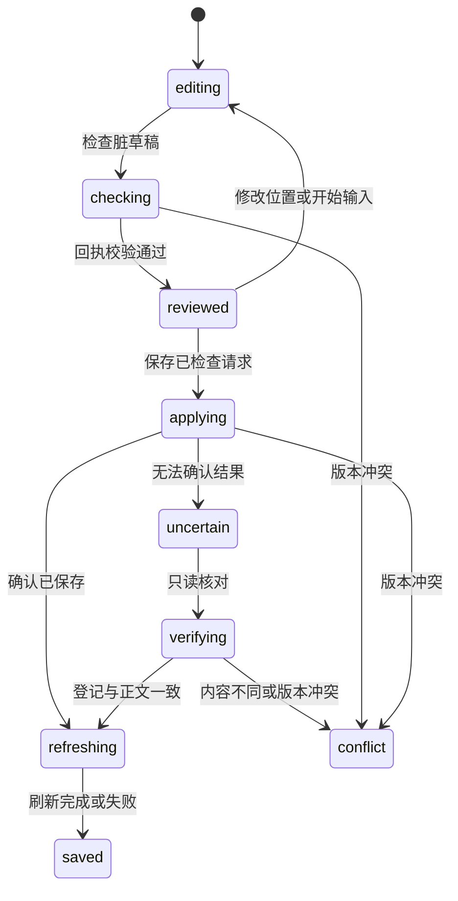

# 系统架构：当前实现

**0.2.1 源码收录**：状态片段配置、独立实例预览、逐实例正式运行、目标回看、场景到组装、动画绑定预检及二维物理运行／编辑已进入本版。各自领域、来源、视图和后端边界保持，旧专题证据与评分不重标；本机安装仍为0.2.0。见[版本记录](RELEASE_0.2.1.md)。

**已有物理声明编辑的独立边界**：`engine/scene-physics2d-edit.mjs` 负责当前原文的有界捕获、局部补丁和品牌化审阅，完整声明仍由既有 Rust `scenePhysics2D.inspect` 校验。`app-scene-physics2d-source.js` 只通过 source5、generation 和摘要守护当前原文，在最终所有权检查后同步写入草稿；普通保存单独拥有持久化权限。独立视图持有表单、选择、局部形状示意和取消票据，不读取场景目录或执行后端。

新增 `org.viento.scene-physics2d` 只依赖文档模块，贡献 `scene.authoring.physics2d`；0.2.1 源码为 **23 模块／44 项声明能力**。缺少端口或显式关闭时保持旧编辑器装配，Rust 可选能力只控制物理入口。格式识别不证明元数据登记，手填实例成员、关联与继承后的运动属性仍由构建前检查。没有新 HTTP 接口、Rust/WASM 规则、作者版本或运行协议；见[使用指南](SCENE_PHYSICS2D.md#编辑已有物理声明)和[本轮验证](test-results/scene-physics2d-editor/README.md)。下列历史专题的模块数和验收条件保留当时范围。

**二维物理为独立可选层**：`scenePhysics2D.inspect` 在 Rust 校验形状、身份和预算；`engine/scene-physics2d.mjs` 将显式 `references`／`physics2d` 关系解析为带来源的物理子计划，按种类声明执行能力。Godot 包装器只为含物理项目替换运动根与时钟，视觉动画仍留在独立子层；触发区通过普通作者行为发布现有项目事件，不伪造绑定身份。旧生成器与主核心 ABI 保持，执行适配器指纹更新仍要求旧构建重建。见[二维物理](SCENE_PHYSICS2D.md)。

**从场景进入组装**：构建宿主只传当前保存态场景身份，独立组装编辑器读取目录并持有普通草稿，经既有保存事务返回新项目身份。执行后端和作者编辑器仍通过原计划／保存接口衔接；见[边界](#场景到组装的作者边界)。

**动画目标回看**：独立领域层从完整protocol11观察派生目标分组，视图只持有选择与来源票据，构建宿主通过显式回调连接原列表。既有作者格式、Godot采集和运行协议保持；见[边界](#动画目标回看的独立边界)。

**0.2.1 收录的逐实例正式动画**：作者动画4显式保存运行范围，Rust准入、动画子计划3、目标账本及Godot项目执行分别维护。只有逐实例项目使用协议11／适配器0.20.0／清单12；旧整场景项目保持4／7／10分支，临时预览独立。详见[运行边界](#逐实例正式动画运行边界)，开发证据保持原0.2.0工作树身份，本次源码交付不更新安装。

**0.2.0 源码收录**：下列六项观察与试算增量已纳入[本版](RELEASE_0.2.0.md)，原作者／运行／手动预测边界保持。旧开发证据和评分保留，源码升版不代表更新安装。

**用例编辑**：独立编辑组件持有原始 JSON 缓冲、检查结果和会话归属，父用例组件原子接收已检查品牌对象。复用现有parse／serialize，作者表、运行协议和核心没有新增契约；见[边界](#用例编辑缓冲与载入对象的边界)。

**手动试算用例**：独立有界文件契约只保存初始状态、规范化输入和手动预期；重跑复用原序列域，文件交互及只读结果由独立子组件维护。见[边界](#手动试算用例的独立边界)。

**连续试算**：独立不可变序列层复用原事件试算及Rust比较，以精确前序身份绑定待采用结果；完成样本明确假设所选片段通知已经送达。视图持有原始输入缓冲和只读步骤，宿主仍不写作者表；见[边界](#连续手动试算的独立边界)。

**手动事件试算**：完整表准入、Rust 标量比较、纯候选编排与独立样本视图分别负责；新建／重编辑共用宿主端口，作者生成器和运行协议保持。见[边界](#手动事件试算的独立边界)。

**事件回看**：完整运行准入后的纯关联模型、独立事件回看组件与构建宿主端口协作，将一条事件的订阅回执连接到已有控制器历史。协议、Godot运行采集及作者脚本不变；见[边界](#项目事件回看的独立边界)。

**动画进入来源**：动画进入来源由固定包装回调、实际派发作用域、严格p10关联及只读视图分别负责；该来源切片引入时，严格控制器工程使用Godot0.19.0／protocol10／清单11；当前逐实例项目另用协议11，旧协议按原格式读取。作者v1–v5源码和Rust/WASM保持，22模块／43项系统声明能力保持。详见[本节](#动画进入来源的独立边界)。

**0.1.9 源码收录**：有序动画分支、共享状态与平面组合条件由独立Rust能力和v3–v5生成器维护；退出快照、逐次进入与控制器回看沿冻结来源和独立观察模型连接。0.1.9发布时Godot适配器0.18.0，新严格控制器项目使用protocol 9／库存10；普通动画保持protocol 7，无动画保持protocol 4。22模块／43项声明能力保持。见[版本记录](RELEASE_0.1.9.md)；下文开发阶段说明保留各自时点，源码发布不代表更新安装。

**0.1.8 源码收录**：自然完成通知、状态表与条件、版本化源码重编辑、参数接口及脚本使用位置已纳入[本版](RELEASE_0.1.8.md)。0.1.8发布时Godot适配器0.16.0，新含动画项目使用protocol 7／清单8，22模块／43项声明能力保持；下述较早阶段的版本与验证条件按当时范围保留，本次未更新安装。

**此前0.1.7开发阶段**增加[动画完成边界](#动画自然完成的独立边界)：完成规则仍经 Rust transport 核验，独立中间层账本、Godot 调度和只读观察组合；新含动画项目使用适配器 0.16.0／protocol 7／清单 8。以下已发布版本与历史专题保留原时点。

**0.1.7 源码收录**：下述序列帧、项目动画控制、命名片段、片段目录与使用位置、事件脚本组合、时长变换和轨道复制已纳入[本版](RELEASE_0.1.7.md)。Rust 规则、原文提案、独立视图、宿主目录和 Godot 运行各自维护；0.1.7发布时 Godot 适配器 0.15.0，22 模块／43 项声明能力保持。下文历史版本与专题证据保留开发时点，源码交付不代表已更新安装。

**0.1.6 后工作树：等分图集序列帧**。Rust 在动画 schema 2 中校验 `spriteFrame2d`／`grid` 并进行离散采样，独立可选能力导出保留主 ABI 与原四属性接口。编辑提案显式升级格式，表单仍只应用普通草稿。宿主将实例现有图片绑定到冻结资源；独立 `scene-animation-sprite-layout.mjs` 负责预览解码需求，视觉帧边界给 Canvas 裁切指令，不把时间语义或资源 IO 放进渲染器。Godot 独立序列帧生成器／运行脚本增加 `animation.sprite2d`，原四属性生成文件保持；逻辑实例、行为和图片所有权不变。22 模块／43 项声明能力保持。见[格式与操作](SCENE_ANIMATION.md#等分网格序列帧)及[验证](test-results/scene-animation-sprites/README.md)。

**0.1.6 源码发布**已收录音轨使用位置与定位、独立关键帧动画、首次创建、实例选择和保存态场景画面预览。下列专题保留开发时点；发布检查见[版本记录](RELEASE_0.1.6.md)，源码交付不代表安装或设备验证。

已保存场景的动画预览复用现有静态快照与图片租约：宿主仅在 `includeAnimation: true` 时附加独立 `animationPreview`，通过纯解析器从同一冻结 source／plan 解析关联清单。传输捕获绑定快照、来源修订及稳定实例；动画无效只使附加状态变为 invalid，静态预览保持。独立播放器复用 Rust 采样，纯视觉帧捕获把通道交给 Canvas，标签、命中及布局坐标不跟随视觉层。控件、图片读取、作者写入与后端构建分离；无新模块、Rust ABI、作者格式或图像缓存池。`sceneAnimationPreview` 需宿主声明且构建与动画模块均启用；当前 22 模块／43 项声明能力保持。见[指南](SCENE_ANIMATION.md#在场景画面中播放已保存动画)和[验证边界](test-results/scene-animation-scene-preview/README.md)。

首次动画创建由独立纯起始计划、目录／命令回执契约、Node `animation.create` 服务和界面控制器连接。`world-animation-create.mjs` 只验证保存态 Scene2D 稳定实例、定义登记与动画核心，不调用构建、音频或行为规划；三文件事务 v11 冻结场景与定义证据，恢复只处理新正文、新登记及场景登记，不恢复依赖正文或读取素材。创建成功后通过原文导航交给既有动画编辑器。`scene.authoring.animation-creation` 由构建模块贡献，当前 **22 模块／43 项声明能力**；新增只读 HTTP 目录与写命令分别校验会话及 Origin，Android 宿主尚未声明此命令。见[操作指南](SCENE_ANIMATION.md#从场景首次创建动画)与[验收记录](test-results/scene-animation-creation/README.md)。

动画实例选择通过独立只读目录连接：纯契约负责精确数据、稳定实例和来源快照，Node 服务读取保存态登记，来源宿主校验原文摘要及应用前的新目录，表单只填字段。可选 `sceneAnimationTargets` 能力失效不会撤销普通源编辑资格；音频、行为、渲染和构建不参与查询。见[动画实例选择](SCENE_ANIMATION.md#按名称选择场景实例)。

**2D 视觉关键帧（0.1.5 后工作树）**：独立 `viento-scene-animation` 作者文档通过场景 `animation` 关系选择，Rust 负责四类通道的检查和显式时刻采样；JS 桥接检查回执，编辑提案只修改普通原文草稿，播放器负责时钟，示意视图只消费采样。Godot 适配器在已有运行脚本之外增加独立视觉容器和脚本，项目组装保留每次访问的生命周期；Bevy 明确拒绝尚不支持的视觉能力。新增 `org.viento.scene-animation` 模块和 `scene.authoring.animation`／`scene.preview.animation`，初次动画接入时为 **22 模块／42 项声明能力**。主 Rust ABI 和旧 Scene2D 作者格式保持；操作见[动画指南](SCENE_ANIMATION.md)，测试与平台范围见[本轮记录](test-results/scene-animation/README.md)。

**音轨使用位置的就地来源定位（0.1.5 后工作树）**：现有目录品牌私有保留已校验的行为内容及 JSON 索引，`sceneAudioUsageSource(catalog, match)` 仅接受同目录中原匹配对象，返回冻结的保存态原文与精确 UTF-16 范围；公开目录结构、HTTP DTO、来源五字段和写入权保持。界面复用通用来源选区转换和视口适配，处理 BOM／CRLF 及转义值，不直接把磁盘偏移当成 textarea 偏移。只读原文使用未知作者语言，测量镜像复制最近语言属性（保留空串），使 UI 语言切换与原文折行独立。提示导航由当前会话、稳定 UUID、行对象和节点归属保护；只读原文与动态列表分开，刷新／关闭使旧入口失效。没有跨文档编辑会话切换，也没有新的服务或后端权限。操作见[就地定位](SCENE_AUDIO.md#就地定位提示与行为原文)。

**0.1.5 后工作树：音轨使用位置**。纯核心 `engine/scene-audio-usage.mjs` 捕获声音来源与有界只读 DTO，复用既有声音／行为校验，提取完整 UUID 文本匹配并用私有品牌绑定来源；它不读取文件、执行脚本或授权删除。Node `scene-audio-usage-service.mjs` 从一次 World 快照取场景明确关联的声音及可选行为，验证保存态、关联和回链；底层仍执行工程登记检查和文档读取，不是全局引用索引。独立鉴权 POST `/api/scene-audio-usage` 仅接受 `sceneObjectId`，可选 `sceneAudioUsage` 布尔能力不增加系统模块或声明能力。

声音来源宿主提供 `getUsage(source)`，核对保存基线真实哈希并逐次异步检查来源及独立能力代次；查询能力变化不改变普通编辑的来源 token。声音界面负责当前表单提示列表、选轨、读取状态和三语呈现，只显示行为的保存态文字匹配；读取不会取得草稿、保存、试听或后端控制权限。当前提示与保存态匹配分别标注，失败不降格成“零引用”。格式、Rust ABI 和后端协议保持；操作与边界见[使用位置](SCENE_AUDIO.md#查看音轨使用位置)。

**0.1.5 收录说明**：[本版源码](RELEASE_0.1.5.md)收录已有声音的时间提示编排、轨道管理、已绑定素材选择、就地试听及暂停／定位，以及行为文本参数中的音轨选择。读取、试听、表单修改与普通保存保持独立。下文开发阶段及专题证据保留原时点；源码发布不代表已更新安装或设备验收。

**0.1.4 收录说明**：[本版源码](RELEASE_0.1.4.md)已收录首次声音创建与逐轨触发方式、项目组装与场景切换、共享状态、项目事件和行为声音控制。当前为 **21 模块／40 项声明能力**，Godot **0.11.0**、项目协议 **4**；旧段落与验收数字保留各自执行时点，本次未更新安装。

**0.1.4 后工作树：试听进度与控制**：在现有 WebAudio 单轨适配器中增加进度、暂停／继续和定位，复用已校验的内存快照；来源与字节准备层保持，场景时间线和后端执行不参与。生命周期见[独立边界](#素材试听的独立边界)，本轮范围见[试听控制专题](test-results/scene-audio-audition-transport/README.md)。

**此前 0.1.4 后工作树：选择已绑定的声音素材**：先通过现有 **世界与对象 → 绑定资源** 为声音文档绑定已登记 WAV，再在 **编辑场景声音** 显式读取已绑定素材并选择音轨的新素材。资源目录与来源修订复核独立于保真正文提案；修改经审阅后仅应用普通草稿，再普通保存。旧四种提案契约保持；单独替换素材时保留轨道身份与提示引用。目录读取不验证实际 PCM／哈希，构建继续检查资源字节；素材绑定与正文保存是两次独立操作。验证见[素材选择专题](test-results/scene-audio-resource-selection/README.md)。

**此前 0.1.4 后轨道复制与移除切片**：[已有声音的轨道管理](SCENE_AUDIO.md#复制与移除已有声音轨道)支持复制当前轨道设置，生成独立轨道身份并复用同一素材，不复制时间提示。保持 1–16 条轨道；移除前需先移除或改接当前提示，行为脚本中的轨道 ID 由作者另行检查。新 `createSceneAudioTrackProposal` 只复用原文已使用的资源，保留已有轨道资源与相对顺序，新轨道追加；旧三种提案契约、普通草稿／保存、Rust ABI 和模块／后端版本保持。验证另见[轨道编辑专题](test-results/scene-audio-track-authoring/README.md)。

**此前 0.1.4 后提示换轨与顺序切片**：[声音提示编排](SCENE_AUDIO.md#调整提示目标轨道与顺序)支持将提示改为当前文档中另一条已声明轨道，并用 **上移／下移** 调整作者列表。播放仍先按时间排序，同刻按列表顺序执行；提示身份、轨道资源及普通草稿／保存边界保持。新 `createSceneAudioTimelineProposal` 独立扩展编排，两种旧提案 API 保持原契约；Rust ABI、模块／能力和后端版本不变。验证范围见[换轨与顺序专题](test-results/scene-audio-cue-arrangement/README.md)。

**此前 0.1.4 后提示增删切片**：[已有声音的时间提示编辑](SCENE_AUDIO.md#增删已有声音的时间提示)支持在独立面板添加或移除 0–64 条提示，保留既有轨道与资源绑定、旧提示身份和相对顺序；新提示追加。检查完整原文后应用普通草稿并保存，Rust 语义／ABI、模块／能力和后端版本保持。验证范围见[提示编辑专题](test-results/scene-audio-cue-authoring/README.md)。


**0.1.3 收录说明**：本页标为 0.1.2 后工作树的多行为、脚本引用、Bevy Rust 与声音增量现已纳入[本版源码](RELEASE_0.1.3.md)。历史版本、模块数和验收条件保留原时点；0.1.3 收录时为 21 模块／38 项声明能力，该次未制作或更新安装包。

**0.1.2 发布源码**为 20 模块／37 项声明能力，查找、诊断列表、配方创建与生成场景分别维持纯规则、视图及宿主边界。下列专题中的旧版本和当时模块数保留演进时点，当前交付范围见[版本记录](RELEASE_0.1.2.md)。

**场景声音工作树增量**新增独立[音轨与时间提示](SCENE_AUDIO.md)：Rust 负责非空间声音的严格声明和显式时刻采样，来源补丁／表单只编辑已有 JSON，普通保存仍拥有持久化权限。场景通过登记中的 `audio` 关系选择一份声音文档；构建冻结实际 PCM WAV，Godot 适配器 `0.6.0` 生成播放器和时间驱动并交付完整资源。当前工作树为 **21 模块／38 项声明能力**，应用版本仍为 `0.1.2`；Bevy 两条通道明确拒绝声音能力。`role` 的 `music`／`effect` 仅表示用途，不构成混音总线。实际测试及设备边界见[声音验收](test-results/scene-audio/README.md)。

**0.1.2 之后的未发布工作树**扩展首次行为清单至 1–32 个绑定、最多 8 份去重脚本，纯正文规划、列表交互和原 `behavior.create` 事务继续分离。该行为阶段仍为 20 模块／37 项声明能力，没有新增作者格式、运行协议或执行后端；使用范围见[首次行为指南](SCENE_BEHAVIORS.md#从场景首次添加行为)，验证记录见[独立专题](test-results/scene-behavior-multi-create/README.md)。同一工作树另接[已有行为管理](SCENE_BEHAVIORS.md#管理已有行为)：只读目录、脚本引用事务、受守护来源导航和绑定草稿编辑分开；[关联专题](test-results/scene-behavior-links/README.md)单独记录，本轮未安装新包。

**Bevy Rust 作者行为增量**另登记 `org.viento.bevy-rust`：通用宿主仍负责冻结、库存、工具身份、任务和交付；独立适配器负责 Cargo 源工程、锁定离线编译及临时目录回收，模板内运行实现负责 `ready`、显式固定步回调及自身实例位置／事件的单次提交。适配器与模板当前为 `0.2.0`，固定两步测试不等同于连续游戏循环。该 Bevy 专题保持行为 schema 1、plan／runtime 3 及当时 20 模块／37 项声明能力；旧 `org.viento.bevy` `0.3.0` 数据通道不改为作者编译器。当前限 Linux 无图场景，未增加窗口、有限输入回放、热更新或安装交付；配置与证据见[Bevy 指南](BEVY_BACKEND.md#rust-作者行为通道012-后工作树)、[首次通道记录](test-results/bevy-rust-behaviors/README.md)及[固定步记录](test-results/bevy-rust-fixed-step/README.md)。

0.1.2 增加独立配方创建链：Node 只读目录检查已登记对象与兼容投影，便携规划调用既有 Rust 配方校验，独立表单提交品牌化草稿，正文宿主执行共同的新建状态切换；普通保存单独负责落盘。起始排布另由无宿主的坐标规划器处理，只产生按身份对应的位置；视图管理显式预览、应用和一次回退，不取得作者保存权限。同一规划器兼容原单演员请求及有界多演员请求，列表视图不分配后端权限；保存仍只提交一份配方正文。新 `org.viento.scene-composition-create` 模块不依赖构建控制器，也不新增 World 写命令，见[系统模块](STUDIO_MODULES.md)与[配方指南](SCENE_COMPOSITION.md#新建场景配方)。

此前 0.1.0 之后工作树增加[内置脚本创建](SCENE_BEHAVIORS.md#内置脚本创建)：主编辑器的 **新建脚本** 提供空 Node 与参数／信号两份 GDScript 起始内容，完整预览后进入普通 TXT 原文草稿，再用普通保存登记。可选择工程已有文档类型，无需专门的 `script` 类型；创建不执行源码，也不自动关联场景。独立 `org.viento.scripts` 模块提供 `authoring.script`，该专题当时为 **19** 模块、**36** 项声明能力；当前另有 Bevy Rust 起始内容，LSP 仍待接入。

此前 0.1.0 之后工作树补上[从场景首次添加行为](SCENE_BEHAVIORS.md#从场景首次添加行为)：在构建与运行中选择已保存 Scene2D、稳定实例和已登记 TXT，审阅后一次保存新声明、新登记及场景关联，再打开原文继续编辑参数、信号和更多绑定。当时的首次界面限定 Godot／GDScript 单绑定，纯规划核心保持后端中立；创建不执行脚本。该专题当时为 **18** 模块、**35** 项声明能力，第 35 项 `scene.authoring.behavior-creation` 由构建模块提供。证据见[首次创建专题](test-results/scene-behavior-creation/)。

此前[内置行为编辑](SCENE_BEHAVIORS.md#内置行为编辑010-之后的工作树)专题接入第 18 模块和第 34 项声明能力：已有绑定文档的带类型参数、信号及绑定修改，经完整审阅后仅应用原文草稿，再普通保存。这条独立编辑路径及其[既有证据](test-results/scene-behavior-authoring/summary.json)保持；已有声明的场景／后端／语言迁移及 LSP 仍未接入；脚本创建另走独立草稿入口。

当前 0.1.0 之后工作树增加[后端工程交付](BACKEND_PROJECTS.md#交付生成工程)：可移植审阅、宿主库存核对、ZIP 生成和独立交付界面分别承担职责，补足现有 Scene2D 从内置创作到派生工程交付的末端。生成包与完整作者迁移分开，不引入新的作者格式、执行权限或系统模块；证据见[交付专题](test-results/backend-project-delivery/)。

此前粒子增量接入[通用粒子场与雨雪表现](SCENE3D.md#通用粒子场)：Rust 提供确定性分布与显式时刻采样；环境表单、普通保存、临时播放时钟和 GPU 实例绘制各自独立。Godot 工程消费同一参数；默认无头 dummy 渲染无法回读非空实例时明确报告限制，真实图形验证单独记录。该阶段为 0.1.0、17 模块／33 项声明能力；证据见[粒子专题](test-results/scene3d-particles/results.json)。纹理、透明度、碰撞和天气玩法另行设计。

此前雾效增量增加[可组合的距离雾](SCENE3D.md#可组合的距离雾010-之后的工作树)：可选颜色／密度声明由 Rust 校验和保真编辑，现有环境表单审阅后应用草稿并普通保存；独立 WebGL2 预览和 Godot 工程消费同一参数。无需细分游戏模板，不自动向旧场景添加字段。具体实测和限制见[专题记录](test-results/scene3d-fog/results.json)。该阶段为 0.1.0 工作树、17 模块／33 项声明能力。


0.1.0 的 3D 主线由独立作者表示、共享 Rust 校验／精确补丁、可移植私有提案、文档来源宿主和浏览器界面组成。九个作者域分别负责变换、对象结构、环境、属性、整体移动、参照对齐、等距分布、批量复制和批量移除；每个域只依赖文档模块，维护自己的审批，完整候选通过后仅应用原文内存。普通保存继续拥有磁盘写入、保存基线与冲突处理。0.1.0 发布时为 **17** 模块、**33** 项声明能力。

只读 3D 预览通过独立来源端口取得有效模型和可选的受守护光标定位。名称／UUID 检索、画布点选及选中边缘提示共享稳定实例身份；单对象和全场景聚焦只改变临时相机。数学、GPU 适配与界面不取得作者补丁、World、保存或执行后端接口。全场景取景使用实际旋转角点和画布比例，作者 schema、源字节及后端协议保持。操作见[3D 指南](SCENE3D.md)，交付与实际验收边界见[0.1.0 记录](RELEASE_0.1.0.md)。

当前工作树的标准方向仍在预览边界内：纯数学显式表达临时 `up` 与局部轴轨道，GPU适配器通过可选 `setViewDirection(direction)`原子取景并撤销旧手势，界面仅提交固定方向标识。绘制、几何命中与聚焦使用同一相机基底；作者schema与Rust解析、宿主端口、系统能力和后端工程保持。见[标准方向契约](SCENE3D.md#标准观察方向010-之后的工作树)。

临时镜头平移进一步划分了三层职责：`panCamera` 只消费相机、CSS 位移和绘图比例，返回冻结的相机或拒绝结果；渲染器的 `setDragMode` 及手势状态机决定旋转／平移、撤销旧手势并守护 Float32 上传和失败回滚；界面只切换固定模式并守护当前只读会话。相机目标与位置一起变化，聚焦范围、作者模型与持久化接口不转移给手势层。详见[平移操作与边界](SCENE3D.md#临时镜头平移010-之后的工作树)。

正交观察继续复用同一视图边界：`cameraProjection4` 只返回投影矩阵，`lookAt4` 仍单独负责相机基底；单对象与整景取景接受投影模式。渲染器将私有 `projectionMode` 与作者模型分开，可选 `setProjectionMode` 在矩阵与实际 Float32 上传预检后切换，失败恢复原模式并清理不完整命中帧。UI 只接收固定模式与成功回执，点选、边缘提示和绘制复用相同的实际矩阵。作者格式、Rust 解析、保存及后端导出不消费此临时状态，见[正交边界](SCENE3D.md#正交观察010-之后的工作树)。

坐标方向提示另以观察接口分离绘图和显示：纯 `orientationAxes` 把世界三轴投影到当前相机基底；渲染器的可选 `onViewChange` 只在成功帧之后发布冻结的临时相机／投影回执，失效时发布 `null`。独立 `scene3d-orientation.js` 仅维护自身 SVG 和翻译说明，预览入口负责当前渲染实例与会话守护。没有轮询、原文重解析或保存路径，观察者异常不改变绘图结果，详见[方向提示边界](SCENE3D.md#坐标方向提示010-之后的工作树)。

双指导航复用相同视图边界：纯 `touchCamera` 只接收临时相机、两组 CSS 触点、画布尺寸／绘图比例及当前距离界限，以目标平面中心锚点合成缩放与平移；不取得 DOM 或设备状态。渲染器负责明确的两触控升级、移动阈值、每次成功后的基准更新、捕获生命周期与取消，双指输入在同一浏览器动画帧内合并最新坐标，完整候选经过 Float32 预检后只绘制一次并更新基准。正常抬指提交末批有效位移，取消或视图变更撤销排帧；晚回调检查手势归属。只有输入触发排帧，没有轮询；无帧调度的适配环境保留同步处理。界面只消费 `supportsTouchNavigation === true` 这一渲染器本地提示来显示三语操作说明，不注册新系统能力。来源、保存、作者变换和后端接口保持，详见[双指边界](SCENE3D.md#双指导航010-之后的工作树)。

0.0.10 已接[3D 最小切片](SCENE3D.md)：独立作者表示与可选 Rust 校验能力、WebGL2 只读预览及可检查的 Godot 工程导出。方块、透视相机、方向光和变换形成完整实验链路；模型素材、空间层级、OC 投影与行为仍分别推进。只读预览模块取得来源读取与受守护的光标定位接口，没有原文修改和保存权限；变换编辑通过独立草稿接口接入，2D 创作域和运行协议保持。

当前 0.0.10 源码增加[片段定义重命名](SCENE_COMPOSITION.md#重命名片段定义)：Rust 原子更新定义及全部放置引用，保持稳定身份、有效场景和其他原文；复用九域中的定义管理、完整审阅、草稿应用及普通保存。旧核心只禁用此动作。证据见[独立专题](test-results/scene-composition-fragment-rename/results.json)，该专题验证在 0.0.9 工作树完成，能力纳入 0.0.10 源码。

共享片段定义管理新增独立 `definitions` Rust 能力、纯提案和第九创作入口：新增完整声明、复制原 CST 并仅替换片段标识、删除未被放置引用的定义。原放置、有效演员和组织关系保持；删除前置未使用片段后，候选重新生成全部贡献来源。GUI 只应用内存，普通保存仍为持久权威；未放置声明仅验证基础登记依赖，首次放置检查有效投影与实际图片。边界见[片段定义管理](SCENE_COMPOSITION.md#管理片段定义)。

组织分组原文创作另使用独立 `groups` 能力与提案：Rust 负责组声明、演员归组及关联身份映射的保真补丁；纯层绑定全部引用，候选层额外核对完整组名、父级和有序成员关系。界面通过自己的创作接口操作内存草稿，普通保存保持作者权威，组织变更不改变空间或后端计划。详见[组织分组](SCENE_COMPOSITION.md#编辑共享片段的组织分组)。

整份放置创作另使用独立 `scene_composition_placements_patch.rs`／`scene-composition-placements.mjs`／`app-scene-composition-placements.js`。可选 Rust placements 能力提供新增、复制和移除；候选层核对完整展开身份与贡献来源，独立 `placements` 工作流通过原有来源／审阅／应用接口接入，持久化继续普通保存。复制只替换身份字节，移除不要求原选中演员继续存在；不修改具体执行后端，范围见[放置管理](SCENE_COMPOSITION.md#管理片段放置)。

当前另接[系统模块与工程需求](STUDIO_MODULES.md)：固定注册／需求规划、GUI 装配、正文宿主、资源接口与原生模板快照分别接入。声明能力和宿主权限分开；未注册的场景表示或未知需求只产生局部诊断。正文生命周期、World 区和构建区内部的聚合仍是下一阶段任务。

[后端工程持久恢复](BACKEND_PROJECTS.md)把本机索引 IO、恢复身份守护、服务冻结运行目标和三语选择控制器继续分开。Node 只登记创建成功的输出，跨进程锁与原子更新保存相对目录／来源／物理身份／清单 pin；重启恢复列表不检查工具或扫描认领。显式选择完整重验后重建旧控制／验收入口的冻结上下文，来源离线时保留仅冻结场景入口；小作品清单可读时核 workspace UUID。恢复记录不生成删除 ledger，当前宿主仍只清理真实写出的普通输入。

[后端工程管理](BACKEND_PROJECTS.md)另分为可移植清单 DTO、Node 冻结工程检查、创建宿主的内存所有权凭据和三语只读界面。生成器与执行注册表保持原边界；清单声明不授予执行／删除权，失败部分输入与运行报告的保留状态可见。

工具身份、运行验收用例、工程内保存、有序批次及成员报告现已随 [0.0.9 源码](RELEASE_0.0.9.md)交付；下列旧阶段名称与专题验收记录保留其原条件。

0.0.10 源码新增[单实例恢复继承](SCENE_COMPOSITION.md#编辑单个实例的局部覆盖)：共享 Rust 核心负责保真原子 set／reset，独立可选 edit 能力保护旧接口；可移植提案绑定原文，GUI 选择恢复，宿主验证完整候选并守护内存应用。原作者格式、执行后端和普通保存链路保持。

同一版源码另接[单实例配方画布](SCENE_COMPOSITION.md#从画布调整单个实例位置)：纯适配层组合已有 Rust 几何会话和单实例 set 提案，GUI 只编辑展开后的场景中心坐标，宿主检查完整候选后写入当前原文草稿。位置写回目标与共享片段分开，无新核心协议或作者格式。

当前另接独立[配方多实例批次画布](SCENE_COMPOSITION.md#从画布批量调整配方实例)：复用一个 Rust 几何历史会话处理全部稳定实例，新可选 positions 域原子产生多个局部位置覆盖的精确补丁。视图选择与作者来源权限分开，完整候选及目标列表检查后整批应用到原文草稿；原格式、普通保存和旧单实例入口保持。

当前另接[共享片段演员字段编辑](SCENE_COMPOSITION.md#编辑共享片段的演员声明)：独立可选 fragment 域原子设置现有模板演员的六类声明，纯层返回 raw 值和全部引用／覆盖掩蔽，GUI 逐字段勾选；宿主完整检查、来源守护和普通保存复用，结构及跨文件编辑保持独立。

同一表单另接[共享声明恢复](SCENE_COMPOSITION.md#恢复共享片段的投影继承)：新可选 fragment_edit 域原子处理设置和允许的声明删除，纯层保留旧 SET 提案并增加显式 `reset`，GUI 不推测继承结果。来源宿主、全候选检查和普通保存复用；新证据保存于[共享继承专题](test-results/scene-composition-fragment-inheritance/results.json)，不重标已有执行后端或平台成熟度。

当前另接[放置偏移表单](SCENE_COMPOSITION.md#调整整组放置偏移)：独立 placement 域设置／删除某个现有放置的 offset，所有成员在局部位置覆盖之后加上该偏移，组织分组不提供变换。纯提案、GUI 和普通保存宿主继续分离；[新专题](test-results/scene-composition-placement-offset/results.json)独立绑定本轮范围。

当前主线另接[共享演员结构创作](SCENE_COMPOSITION.md#编辑片段的演员结构)：Rust 独立可选结构域原子新增／移除模板演员及所有放置映射，纯提案绑定影响身份，GUI 显式审阅完整候选，来源宿主只应用当前内存草稿。未放置片段可编辑，移除清理局部覆盖，已有组与其他身份保留；旧 recipe v1、生成 v3 和普通保存继续复用。

本轮继续接入[批次成员报告](RUNTIME_CASE_REPORTS.md)：纯层复用既有 case/trace 重新评价严格终态数据；Node 保存并校验成员文件 pin，当前服务只读接口按当前任务与成员 UUID 查询；独立三语 GUI 查看预期／实际并显式下载 JSON。私有缓存路径不进入 HTTP，查看不重新读取作者或启动引擎。报告保存失败保留已提交断言并停止余项，旧事件／采样不会被合成为虚假运行回放。

本文说明当前源码的模块职责、数据权威和调用链路。源码与安装包的交付范围见 [当前状态](STATUS.md)，后续范围与验收见 [演进路线](ROADMAP.md)，完整目标模型见 [下一代架构书](NEXT_ARCHITECTURE.zh-CN.md)。这里不把目标设计解释为已实现接口。跨区域功能、具体实现、评分理由和证据由 [当前功能图谱](FUNCTION_ATLAS.md) 统一索引；[离线交互版](function-atlas.html) 可按架构、语言、交付状态与工作流切片。

Viento 正从通用文档设计工具演进为设计优先的 IDE。当前 GUI 使用 Web/Tauri，可移植引擎负责文档语义和变更规划，Node 或 Rust 宿主执行文件、进程与归档操作。原生方向是 Nuislang、ns-nova 和 yalivia runtime，Viento 将成为 ns-nova 的官方 GUI 编辑器；自身 GUI 的迁移与工程执行后端分开推进。Godot 4 承接受限场景执行和 GDScript 行为，Bevy 0.19.1 另以可信无头运行程序验证同一冻结计划的实例、方向输入与移动逻辑。两条引擎路线共用宿主编排，不依赖 Nuislang 的研发进度；原生运行与 ns-nova GUI 尚未接入。

当前源码还把[运行对象观察](RUNTIME_OBJECTS.md)置于可移植引擎层：从验证后的冻结计划取得稳定身份和来源，只消费适配器已准入的既有生命周期／状态事件。宿主保存并提供当前任务的只读观察，工作台负责显示、检索与原文导航；没有将具体 ECS 句柄、节点路径或反射方法提升为作者契约。

当前再增加[有限控制回放](RUNTIME_CONTROL.md)：可移植层验证有界方向数据与 trace 顺序；schema 1 为全局，schema 2 仅按冻结 plan 2 实例 UUID 独立输入，提前检查目标与输入行预算，具体后端在每步释放未列实例。宿主冻结程序、绑定 SHA-256 和独立会话，适配器负责暂存驱动／数据，Godot 与 Bevy 自己执行移动。步骤位置只更新同一只读对象观察；没有引入引擎反射、Entity 或实时命令通道。

已交付的[工具身份检查](BACKEND_MIDDLEWARE.md#工具身份检查未发布增量)另把纯状态 DTO、宿主探测和界面显示分开。宿主显式复用各适配器的工具识别；普通轮询只观察文件，缓存只在当前服务内存。工具路径和进程输出不进入可移植状态，检查结果不替代构建／运行时的完整身份校验。

已交付的[运行验收用例](RUNTIME_CASES.md)组合已有控制程序与步骤采样：纯模块负责用例／实例准入和位置／状态比较，通用宿主负责真实完成事实与独立记录，界面负责显式输入和逐行结果。仅无行为冻结 plan 2；用例不含引擎标识、路径或句柄，评判不模拟移动。运行成功与断言失败分别记录，取消和缺样本标未完成。旧作者／计划／trace、适配器指纹及 Rust／WASM 保持。

包装文档 `viento-runtime-case-document` 单独保存场景 UUID 与原用例，纯模块负责绑定和依赖校验；Node 作者文档服务复用登记锁、原子正文写入、原文及场景修订保护，GUI 独立控制器负责显式载入／保存与草稿归属。资源包从正文派生必要场景和可选子内容，不复制关联权威到元数据；目录迁移保留作者字节和实例身份。执行仍消费纯用例及已验证场景绑定，不把文档路径带进运行 DTO。

本轮另接[有序验收组](RUNTIME_CASE_SUITES.md)：纯数据层定义同场景成员、联合预算与汇总，共享作者写入保护；Node 一次捕获全部成员，再按顺序复用原无头执行器。GUI 只编辑成员与显示结果；读包／导入复用场景准入，已知坏场景不会因成员正文延期而绕过。任务分配前重查构建归属，每成员重新核对冻结身份；取消等待进程退出。无新引擎协议、Rust／WASM 或作者格式升级。

行为创作的 `scene-behaviors-edit.mjs` 仅持有严格声明、稳定绑定身份和保真文本补丁；共用 `json-source.mjs` 由 JSON.parse 准入，再扫描词元记录范围与重复键，不依赖浏览器第三方解析包。只读依赖服务沿已有 World 快照与关系规则生成选项及依赖摘要，私有提案不持有 IO 或工具句柄。文档来源宿主在异步摘要和依赖重验后再次核对会话，并同步替换内存；独立 UI 只调用来源／检查／草稿端口。普通保存仍拥有持久化与外部冲突处理，具体运行能力仍属于原执行适配器。此链路是可移植 JS 实现，没有新增 Rust ABI、作者格式或运行权限。

首次创建另由 `world-behavior-create.mjs` 规划 `behavior.create`，复用 World／场景修订、声明及依赖规则，派生新行为登记并保真追加场景的唯一 `behavior` 边；通用 `relation.add` 的种类保持。稳定 UUID 由调用者持有，预览不分配磁盘文件。Node 宿主以登记锁和完整 World 再检查执行固定三文件事务，v9 日志区分两个新建目标与一个既有登记，按摘要验证后整体回退或补齐。恢复使用单独冻结的场景／脚本／角色定义证据验证，不解析当前只读依赖原文，也不恢复或覆盖这些依赖文件。构建区中的创建控制器只取得只读目录、该命令及已保存原文导航接口；创建不启动后端，后续参数编辑仍走独立草稿模块。


0.1.2 后增量的 `engine/scene-behavior-create-plan.mjs` 接收明确的场景、后端／语言以及已分配身份的绑定列表，调用既有 `inspectSceneBehaviors` 生成普通行为 JSON 和排序去重的脚本身份。它不读取文件、DOM、宿主或后端状态，也不分配 UUID。独立视图持有新增项身份和逐项表单，在切换、增删、重检时保护其余内容；一次审阅固定完整清单及依赖，事务仍负责同时写入新正文、新登记和原场景登记。一个实例可有多份行为，一份脚本可被多个绑定引用；参数与信号的后续修改继续经过原行为草稿宿主。已有绑定文档新增脚本引用另走独立管理入口，首次创建规划不取得既有登记的任意关联写权限。

已有行为目录由 `scripts/lib/scene-behavior-directory-service.mjs` 从一次受读取屏障保护的 World 快照取得：输入仅为场景 UUID，沿唯一显式 `behavior` 边核对完整清单和依赖，返回身份、相对路径、修订及脚本使用关系，不返回正文。没有关联时明确为空，多个关联、缺失或无效依赖阻止操作；不调用构建计划、渲染器或模板来猜测后端。候选是至多 256 份、每份至多 64 KiB 的已登记 TXT；实际绑定仍为 1–32 条、最多 8 份源码。

`engine/scene-behavior-directory.mjs` 捕获严格冻结目录，规划既有 `relation.add` 的 `references` 请求并核对命令回执，无文件、DOM、宿主读取或后端调用。独立 `app-scene-behavior-links.js` 只管理选择、审阅与结果确认；Node 事务保真追加一份行为登记，打开原文另经来源修订与编辑会话守护。随后绑定编辑只应用内存草稿，普通保存才持久化正文。该关联管理阶段保持当时的 20 模块／37 项声明能力，未新增 World 命令、模块、声明能力、作者格式或运行协议。

## 创作与交付的接口

脚本创建由 `engine/script-authoring.mjs` 的已知起始内容和私有提案、独立 `app-script-create.js` 界面及正文宿主 `scripts` 端口组成。`getContext` 提供文档会话、正文目录和类型目录；`createDraft` 重新核对提案品牌及完整上下文后同步建立普通 TXT 内存草稿。纯模块返回语言与后端标识，不读取文件、分配 UUID、执行源码或生成关系；持久登记继续走普通保存。该入口不改项目类型模板，不把 TXT 后缀当成 GDScript 语法识别，也不扩充现有 `behavior.create` 事务。

产品主路径为 **设定 → 投影 → 场景实现 → 组装打包 → 工程交付**。文档／字段编辑器、OC 投影表单和场景作者区负责基本创作；各自以来源身份、修订与候选检查衔接，磁盘持久化仍由普通保存或明确的作者事务负责。已保存 Scene2D 经中立计划、冻结输入和后端适配生成工程，交付只消费成功构建的登记清单。Composition 通过独立场景生成入口接到此链路：共享 Rust 展开、可移植创建规划与界面分离，现有 `scene.create` 负责新正文及登记事务。配方本身与 Scene3D 仍不直接进入 Scene2D 构建目录。

`engine/backend-project-delivery.mjs` 定义无 I/O 的审阅 DTO，绑定完整后端清单与精确摘要。Node 交付适配器重新检查登记、文件身份和字节，只生成清单登记的 `project/*`、`README.md` 与 `manifest.json`；独立校验器核对归档成员和校验和。清单中的原快照和运行证据摘要只是来源引用，原始输入、`build.json`、运行日志、缓存、工具与额外目录均不随包复制。包校验不创建作者工程、不认领缓存，也不取得运行或删除权限。

构建服务按构建 ID、预期快照与清单摘要准入，持有现有执行槽直到 ZIP 写入、最终复查及取消收尾结束，避免与构建回收并发。导出服务拥有临时包、读取者和到期回收；生成后下载只读冻结包，作者可以继续编辑。独立 `app-backend-project-delivery.js` 仅通过来源上下文、准备、检查下载和释放端口工作；它守护场景／会话／后端归属及原生保存结果，不取得作者保存接口。父构建面板只负责装配和忙碌状态，详情核对、选择运行与交付互不替代。

外部 IDE 与 LSP 将通过独立文档接口接入，当前没有实际 LSP 客户端或服务。后续契约需要明确文档 URI、语言、版本、来源范围、诊断以及带来源和版本前置条件的 `applyDraft`；内置视图和外部工具共同遵守作者草稿与保存边界。生成工程的外部修改不自动回写作者数据，语言服务也不取得任意文件或进程权限。

## 模块与依赖方向

| 模块 | 当前职责 | 边界 |
| --- | --- | --- |
| `web/` | 文档阅读、源码／分段／字段草稿、世界与对象、素材／导出、场景预览与布局编辑、构建面板和中英日界面 | 通过宿主接口操作工程；不直接启动执行器或选择磁盘输出路径 |
| `engine/` | 解析与布局、项目模型、保真字段修改、文档存储流程、World 投影／查询／命令规划、资源依赖选择、Scene2D 来源模型、计划、布局草稿、执行后端纯数据能力检查及独立运行对象观察／查询及有限控制数据／步骤准入 | 不依赖 Node、HTTP、Tauri 或具体游戏引擎；不执行文件和进程操作 |
| `scripts/adapters/` | Node 文档读写、World 快照／命令执行、冻结构建输入、可信执行后端注册表、通用构建与运行编排 | 落实路径、修订号、锁、资源字节、适配器身份和生成物校验；具体引擎命令留在后端 |
| `crates/viento-studio-core/` | 独立 Rust 布局、位置草稿／历史／保存、源码坐标补丁及实验性文件内片段组合；原生库／CLI 和 WASM 共用 | 不依赖 DOM、Tauri 或 Godot，不读写作品；当前编辑器使用 WASM 同步调用 |
| `crates/viento-bevy-runtime/` | 固定 Bevy 0.19.1 的可信无头运行程序，用 ECS 执行已生成场景数据及受控输入／移动，0.3.0 可消费全局与按实例有限控制程序 | 独立于编辑核心；不编译作者 Rust 文本、不加载图片／渲染插件，二进制作为本机工具配置 |
| `scripts/backends/` | Godot 4、Bevy 数据与 Bevy Rust 源工程适配器的产物生成、阶段／参数／环境、工具识别、诊断和缓存回收 | 引擎节点／实体只属于运行实现，不改变作者对象身份；图片与作者行为能力按后端分别声明 |
| `scripts/lib/`、`scripts/ops/` | HTTP 服务、项目／模板、索引、素材、导出、事务恢复、构建任务和启动编排 | 把宿主操作交给相应适配器，不把领域规则放进路由 |
| `desktop/`、`src-tauri/src/desktop_host.rs` | 桌面作品库、内置 Node、窗口／会话和进程生命周期、原生保存与归档 | 编辑 WebView 不直接获得文件系统或 Shell 权限 |
| `mobile/`、移动端 Rust 模块 | Android 作品库、WebView 请求桥、私有存储、即时索引、草稿恢复和完整迁移 | 不启动 Node／HTTP；支持范围单独声明 |
| `schemas/` | 作品清单、登记和实验性语义契约的验证定义 | 软件、作品格式、命令／事务协议分别版本化 |

`engine/` 是共享语义实现，不是未来 ns-nova 的替身。其文档存储流程通过注入的 `storage` 调用宿主，命令规划返回待写内容和提案；真正持久化在宿主完成。旧的解析入口保留兼容转发，YAML 依赖随应用离线提供。接口细节见 [引擎说明](../engine/README.md)。


图中的共享 Rust 分支承接已列出的布局、历史、保存、源码补丁及组合规则；可信 Bevy 程序属于另一独立运行工具。编辑核心原生 CLI 是验证入口，当前编辑器实际调用 WASM，未增加原生 GUI 通信链。Web 编辑器按宿主选择传输。Android 在 WebView 内适配请求，直接调用 Tauri 原生命令；构建分支目前只接入 Linux 本机编辑服务。

## 数据权威与生命周期

新建 v3 工程用 `workspace.json` 声明类型与布局，默认保存 `documents/`、`templates/`、`metadata/`、`assets/`。旧 v1／v2 工程继续走兼容读取与原有保存规则，不因应用升级自动改名或重排正文。

| 数据 | 权威来源与保留规则 |
| --- | --- |
| 文档内容 | 原文是标题、字段、叙事和场景声明的权威来源；布局、索引和 World 属性是解析投影 |
| 身份、关系与素材登记 | `metadata/` 保存稳定 UUID、逻辑路径、类型、归属／引用和资源用途绑定；名称和路径不充当身份 |
| 类型和起始模板 | 创建工程时复制完整定义与模板，实例此后自行维护；模板不会自动重写旧正文 |
| 素材字节 | 由登记中的逻辑存储定位；正文使用相对逻辑路径或 `asset:<UUID>`，本机外置位置留在 `.viento/local.json` |
| 派生索引 | 受管理工程的标准化文件和索引位于 `.viento/cache/`；Android 索引即时生成，均不作为作品权威内容 |
| 恢复状态 | `.viento/world-transactions/` 等意图和恢复记录参与一致性保障，不能当作普通缓存清理；活动事务阻止不一致的读取或导出 |
| 构建输出 | 写到作者工程和实际素材目录之外，默认使用应用构建缓存；保存输入摘要、生成物、工具版本和会话记录 |
| 本机偏好与草稿 | 与工程分开；Android 恢复草稿不等于作品备份，也不会自动进入完整迁移包 |

角色背景仍由角色正文或有明确 `part-of` 归属的附属文档承载；共享故事可以多归属。不能为对象化另建一份与原文竞争的可写属性库。

物理默认布局在 `scripts/lib/workspace-layout.json`，起始模板目录在 `scripts/lib/project-templates.json`。桌面和移动端创建工程时选择模板包，复制类型／模板并记录版本与摘要；缺少原始包不妨碍打开已创建工程。这些仍是文档实例模板，尚无可执行工程类型插件或模板包升级框架。格式与迁移见 [通用项目](GENERIC_PROJECTS.md)、[工作流](PROJECT_WORKFLOW.md) 和 [作品布局](WORKSPACE_LAYOUT.md)。

## 文档编辑与宿主存储

桌面作品库启动内置 Node 和 `scripts/desktop-server.mjs`，服务绑定本机随机端口，以每次启动的会话 Cookie、Host 和 Origin 校验隔离编辑器。浏览器编辑入口由 `scripts/ops/site.mjs` 启动；独立浏览服务不开放正文写入、项目配置写入和构建操作。

```text
工程清单 + 正文 + 登记
  → 标准化与静态索引 → 阅读器和列表

源码／分段／字段草稿
  → 文档接口 → engine/document-store.mjs
  → node-document-storage.mjs 或 Android Rust 存储
  → 修订检查、原子写入与登记 → 刷新视图
```

可编辑目录来自已验证的工程定义。桌面静态索引入口 `data/index.json` 与实时文档接口 `/api/index` 是不同读取路径；两者共享原文及登记约束。正文保存与索引刷新分开：保存成功后即使刷新失败，也保留保存结果并允许重试。版本冲突保留草稿，字段修改只替换可证明对应的原文范围。

Android 的 `mobile/platform.mjs` 复用引擎并通过 `mobile_storage` 传入作品 UUID 与逻辑源路径；Rust 核对 SHA-256 修订号、目录边界和共享锁，执行原子替换。创建文档另有持久化创建意图；恢复不覆盖已有的不同内容。媒体访问、World 命令与 Godot 构建没有因此自动获得移动端实现。

桌面关闭会检查未保存草稿，返回作品库可保留编辑窗口；Android 则按作品在 WebView 本机存储维护恢复草稿，两种保证不同。完整平台限制见 [桌面宿主](../desktop/README.md) 和 [Android 宿主](../mobile/README.md)。

## World 查询、语义命令与事务

`scripts/adapters/node-world-projection.mjs` 读取正文和登记，交给 `engine/world-projection.mjs` 生成 World／Object／Resource 观察快照。GUI、`GET /api/world` 和 `scripts/world.mjs` 共用查询实现。投影保留原文修订号与属性范围，只存在于内存；资源的 `present-unverified` 状态表示发现文件，不表示字节已验证。

```text
GUI / HTTP / CLI 语义请求
  → 可移植命令校验和原文变更规划
  → 预览提案，或 Node 执行器在共享锁内重新校验
  → 原子单文件写入，或持久意图 / 数据发布 / 提交决定
  → 回执与新投影
```

| 已实现动作 | 持久化范围 |
| --- | --- |
| `property.set` | 一个现有文档中的一个字段，保真写回原文 |
| `changeset.apply` | 多个现有对象的属性批量修改；当前每个对象一个字段，使用可恢复事务 |
| `object.create` | 一个新正文与其登记共同发布／恢复 |
| `projection.update` | 原位修改投影标题／配置、追加新图片绑定；version 7 意图守护正文与登记两个既有文件，保留来源／模板和额外元数据 |
| `projection.create` | 新建 OC 投影配置与来源／图片登记；子模板快照完整嵌入正文，version 6 意图仍限两个新文件 |
| `scene.update` | 原位修改场景、保留继承／覆盖语义，追加必要依赖；version 8 意图守护正文与登记两个既有文件 |
| `scene.create` | 复用已有工程类型，新建 Scene2D 正文及派生角色／图片依赖；version 5 意图仍限两个新文件 |
| `relation.add` | 保真追加一个引用或共享归属关系，重新校验端点和关系图 |
| `resource.bind` | 向既有登记追加素材用途绑定；允许保留离线资源身份，实际构建另验资源字节 |
| `world.recover` | 按已持久化的提交决定完成恢复，外部内容冲突时保留现场 |

Node 语义命令与旧文档保存共享登记锁。多记录发布先保存意图和前后镜像，以提交标记决定恢复到完整旧版或新版；读者在活动事务期间拒绝取得混合状态。World、旧编辑、资源包及 Node／Rust 完整导出遵守相应屏障。语义批次还不是任意混合命令事务，资源文件内容和 Build 不属于这些作者事务。

请求中的 `actorRef` 只是操作标签；HTTP 鉴权仍由宿主负责。语义命令描述不等于已接入远程 AI、Lese 或协作权限系统。使用、协议及恢复边界见 [World 投影](WORLD_PROJECTION.md)、[批量事务](WORLD_TRANSACTIONS.md)、[对象创建](WORLD_OBJECT_CREATE.md)、[关系](WORLD_RELATIONS.md) 与 [资源绑定](WORLD_RESOURCES.md)。

## 构建与运行

现有 2D 构建工作台是一条明确的 Scene2D 链路：场景 JSON 引用已登记角色 UUID 和图片，支持方向键输入与 `idle`／`moving` 状态。它不会从故事正文推断程序。明确关联行为清单的 v2／v3 场景可通过 Godot GDScript 或工作树 Bevy Rust 通道执行受限参数／信号绑定；Nuis 与其他执行语言尚未接入。

```text
已保存的场景、对象和登记
  → node-build-snapshot：读取屏障、修订复查、图片字节与摘要
  → engine/json-source：严格 JSON 值与原文范围
  → engine/scene-model：场景语义、投影继承、依赖与来源
  → engine/build-plan：按来源发射 v1／v2 几何计划；明确行为场景组合为 v3
  → engine/backend-capabilities：分别核对执行操作、平台、计划与功能需求
  → 可信宿主注册表／通用执行器：固定实现与输出验证
  → 所选适配器：Godot 生成／导入／脚本检查、Bevy 数据检查，或 Bevy Rust Cargo 源工程／离线编译检查
  → build.json + snapshot.json + source-map.json + 生成项目
  → 校验冻结产物并创建独立运行副本
  → 所选引擎的独立进程 → 状态事件、诊断、session.json
```

0.0.8 的[执行后端中间层](BACKEND_MIDDLEWARE.md)分开纯数据能力、可信宿主编排和具体引擎实现。描述符精确声明七种操作；Godot 4 支持构建、无头逻辑、独立窗口及窗口截图，Bevy 只支持构建和无头逻辑；两者离屏、内嵌视口和 GPU 均为 `false`。`node-execution-backends.mjs` 固定宿主注入的实现和阶段，`node-project-build.mjs` 不包含具体引擎参数、环境或生成文件名；资源映射采用中立 `resourceFiles`。输出相对路径、碰撞、入口和预算在发布前核对。HTTP 仅接收已有任务语义，不能传入后端代码或路径；CLI 和本机宿主选择已登记的后端，网页没有选择下拉框。

新构建／会话记录另有 `executionAdapter` 指纹，和旧生成器 `backend.sha256` 分别检查；已知 Godot 明确允许无新字段的旧记录，其余冻结检查不变。Bevy 不接受缺少适配器指纹的历史记录。原 Godot v1／v2 生成器和运行脚本字节、作者格式及无行为 plan／runtime 协议均保持。Godot 显式行为另用 plan／runtime 3，不复用旧协议承载新事件。服务返回平台、完整描述符及任务／产物后端身份，UI 按操作分别判断并在描述符变化时撤销旧批准。Bevy 以独立工具链验证第二实现，旧替代测试夹具仍只证明宿主接口可注入。

Bevy 适配器生成 `scene-data.json`，由单独预编译的可信 Rust 程序检查和运行。`engine/scene-runtime-events.mjs` 只处理与渲染无关的 plan 1／2 事件准入：实例／定义配对、有限坐标、运动状态及 ready／finished 生命周期；源码导航来自冻结计划，不能来自进程输出任意路径。Godot 保留自己的历史协议读取实现。这条数据链路不增加动态 Cargo 编译、BRP、反射或作者 Rust 行为。独立 `bevy-rust-adapter.mjs` 则只接无图行为 plan 3，`bevy-rust-project.mjs` 原字节复制 TXT 并生成 UUID 分派，`bevy-rust/` 模板提供类型化上下文、ECS 就绪与固定步回调：每个绑定只操作自身实例，单次成功才提交候选位置与事件，累计预算覆盖完整运行。固定步回调的调度和错误处理留在运行实现，通用宿主继续只处理冻结计划、工具、进程与既有事件协议。编译／运行阶段由适配器在作者目录外维护临时 Cargo home 与 target，复用预缓存 registry 并使用 `--locked --offline`；源码工程清单只记录可迁移源码。两条通道分别核对工具和适配器身份，具体边界见 [Bevy 后端](BEVY_BACKEND.md)。

场景预览从相同冻结快照读取可移植计划，`scene-preview-service.mjs` 提供有限期的图片字节，`app-scene-preview.js` 和 Canvas 视图消费有效字段。预览与构建任务使用独立生命周期，读取和查看无需启动引擎或写入作者数据。捕获结果在冻结 `snapshot` 外另外携带 `sceneEditing`、`sourceLocations` 和 v3 的 `sceneStructure`：前者提供场景原文及 World／对象／正文修订，后者为场景、对象定义、场景声明与有效字段提供来源。`sceneStructure` 只携带组织分组与实例归属，`scene-structure.mjs` 严格验证后供视图使用，不进入计划或快照容器。预览服务复制这些编辑信息，本身不承担保存。

原文草稿预览使用独立入口 `captureSceneDraftPreview`。`engine/scene-draft-preview.mjs` 限定 128 KiB UTF-8、注册场景路径和原始正文基线，在克隆的只读观察中替换单份原文并重新派生 World 投影；登记记录、关系和资源绑定不变。Node 冻结层核对同一读取屏障、图片摘要和前后修订，草稿成功／失败均复查基线。返回独立域的预览摘要及 `draft` 来源信息，不产生可执行构建快照或 `sceneEditing`；`captureBuildSnapshot` 始终读取磁盘保存版本。

界面从主编辑器的原文保真序列化器取得草稿及基线。候选模型与图片完成后才替换上一有效结果，解析失败保留旧画面并标明来源；同场景返回编辑器再打开可继续草稿模式，切场景／切保存模式／销毁清理缓存。请求和精确来源定位核对场景、编辑会话、草稿令牌和内容摘要，异步旧响应不能覆盖新编辑。草稿定位只选择当前编辑器的原文本，不重读文件；保存来源继续使用原读取流程。预览服务本身保持只读；当前文本草稿的布局回写通过另一个本地接口接入，不提升预览结果的 World 保存权限。

```text
当前单场景源码草稿 + 有效草稿预览
  → Rust sceneSource.inspect：严格 JSON、稳定身份／坐标／分组检查
  → scene-source-layout：核验路径／基线／原文 SHA-256、模型与分组侧带
  → scene-layout 的共用几何会话 → Rust LayoutDraft：位置、100 批次历史
  → Rust sceneSource.patch → propose：仅变化坐标的精确数值 token 补丁
  → 主编辑器：复核 sceneId／会话／源码模式／完整原文，再应用到内存
  → 普通文档保存：沿用原版本与冲突检查
```

`engine/scene-source-layout.mjs` 不接收或制造 `sceneEditing`、World 修订或事务命令。源码的严格 JSON 检查与坐标数值补丁已迁入 Rust 的无状态 `sceneSource.inspect`／`sceneSource.patch`；JS 负责解码、预览元数据匹配、摘要和编辑会话归属。`createSceneSourceLayoutDraft` 在注入的摘要函数返回后绑定已分离的输入；`patchSceneSourcePositions` 调用 Rust，仅替换变化的数值 token，不从有效角色重建作者声明。Rust 内部按 UTF-8 字节范围修改原文，范围不持久化，也不取代导航使用的 UTF-16 来源映射。原文前后均限 128 KiB UTF-8，JSON 预算沿用 64 层和 100000 个值节点；检查 v1／v2／v3 的 1–128 个角色身份与位置、v3 的 0–128 个组和 16 层组织关系。字面孤立代理字符、解码重复键、身份歧义和不一致的分组侧带被拒绝，合法未改 token 的原写法保留。`prepareSceneSourceLayoutApply` 重新计算补丁并核对完整候选正文与来源摘要；宿主在异步返回后再次复核当前编辑会话、路径、场景身份、原文及编辑会话持有的保存基线，才替换内存中的源码。应用过程不读磁盘；外部文件变化不阻止本地补丁，之后的预览基线校验及普通保存的原版本条件分别拒绝过期预览和覆盖写入。

本地布局和保存版布局共用 `createSceneGeometryDraft` 及既有 Rust 协议；本地会话不暴露 `command`、`beginSave` 或保存阶段接口。UI 的本地操作归属独立于 World 写入忙碌状态，取消不碰主编辑器草稿。成功应用保留主编辑器的旧保存版本并重新比较 dirty；未保存修改重新预览草稿，恰好回到原基线则显示保存态，不触发 `scene.update`、索引重建或构建。它限定当前已登记场景的源码模式，没有跨文本／表单／布局的统一撤销栈或多文件提交。

共用 `engine/json-source.mjs` 以 `JSON.parse` 决定语法和值，再用无第三方依赖的词元扫描取得范围、预算和解码重复键信息；扫描不重新解释 JSON 值。此前源码布局已把严格检查与数值补丁迁入 Rust，并撤去专门的 YAML 包目录静态入口；当前行为编辑可直接复用轻量 JS 索引，无需为浏览器开放 `node_modules`。通用 YAML 文档解析与移动端既有 `/vendor/yaml/` 支持保持，JSON 索引的实现替换不删除 YAML 格式支持。范围为原文含 BOM 的 UTF-16 半开区间，附 JSON Pointer、是否精确以及正文 SHA-256 修订。索引限制为 8 Mi UTF-16 单元、64 层和 100000 个值节点，Node 读取另有字节限制；索引只保留在私有 WeakMap。解码后重复键在运行规划中拒绝，避免构建与保真保存解释不同；仅 v1 旧事务登记恢复保留 JSON 最后键语义，不提供歧义范围。v1 新索引预算或范围构建失败仍可使用旧 JSON 语法门槛恢复，宿主既有大小屏障继续生效；v2／v3 从首次接入即严格拒绝重复键和超预算索引，包括恢复。两种恢复模式均不解析当前投影正文。

`engine/scene-model.mjs` 解析场景字段、投影有效值和资源依赖，输出与声明对应的 `viento-scene-model` v1／v2／v3。`scene2DModelToPlan` 只发射 v1／v2 几何计划，作者 v3 也发射 plan v2 并剔除组织分组字段；显式行为由上层 `createScene2DPlan` 另行组合为 plan 3；已有 v1／v2 DTO 保持原样；来源范围独立于冻结计划，因此既有有效 v1 快照和生成文件保持一致。声明位置属于场景修订，继承字段属于投影修订；宽高分别映射配置项，合成尺寸只有近似容器位置。缺失字段也只返回最近容器提示。

场景预览的字段按钮将完整位置传给主编辑器。编辑器先读取当前正文并核对摘要，再把原文 UTF-16 偏移转换为 textarea 的 LF 偏移并选中精确值；正文变化、近似范围或无法定位时显示说明。已有未保存草稿及光标保留，过期异步读取不能改动后来打开的文档。普通文档链接继续可用，这条链路不写作者文件。

保存版 `createSceneLayoutDraft` 核对原声明与解析角色的身份、顺序和中心位置，再通过 `engine/scene-layout.mjs` 的共用几何会话创建 Rust 位置草稿。v2／v3 使用 `instanceId` 选择实例，保留作者 `objectId` 作为定义引用；适配器将实例 UUID 传入 Rust 协议名为 `objectId` 的不透明几何键。这组几何／历史操作仍只解释不透明键；另设的 `sceneSource.*` 才检查受限的 Scene2D 源码结构，不读取登记关系或修改旧操作的协议。`setPositions` 在 Rust 内完成整个批次的校验、原子更新及最多 100 批次的撤销／重做；JS 接收当前位置和状态快照。拖动、方向键微调和对齐各形成一个可整体撤销的批次。候选声明仍从原文解析结果复制，只替换已有角色的 `position`，保留继承、局部覆盖、明确去图和可选字段省略。

`engine/scene-layout.mjs` 的几何入口通过 `studio-core.mjs` 调用 Rust/WASM 核心，原有 JS 几何算法已移除。Rust 为所选对象计算共同位移；吸附以实际抓取对象的中心为锚点，坐标上限限制整组位移，保持相对间距。`alignSceneSelection` 使用已解析的有效尺寸形成选择集整体外接矩形，按其侧边或中心计算六向对齐，非法结果整批拒绝。`app-scene-preview-canvas.js` 复用这些几何规则，拖动中的位置只用于临时绘制，结束时提交一次位置批次；Esc、捕获丢失或模型／选择变化取消临时移动。视图平移与缩放独立于作者坐标。

多选仅在布局编辑器启用，已保存场景的预览保持原有单对象检查。布局的选择集与主选对象保留在页面内存，支持组合键、列表复选框以及全选／清除，不进入作者声明、归档或构建输入。X／Y 输入只在单选时显示，多选通过整体移动与对齐修改位置。批次草稿保留输入的 Scene2D v1／v2／v3 声明版本；保存版使用同一 `scene.update`，原文草稿版只提出坐标补丁；v2 选择与撤销分别作用于独立实例。v3 的组织分组保留在声明中；分组选择先展开为后代实例 UUID，Rust 仍只接收实例几何键。workspace 格式不变。

保存版 `web/modules/app-scene-layout.js` 流程管理拖拽、坐标输入、历史操作入口和明确的检查／保存步骤，撤销与保存阶段由 Rust 草稿提供，界面保留审阅正文和异步请求归属。检查调用 `scene.update` 的预览模式并展示实际候选原文，保存沿用同一修订基线与第 8 版事务；有效位置修改或开始输入都使前次检查失效。冲突保留输入，结果未知时暂停重试写入，通过只读 World 与原文核对场景身份、路径、修订和完整声明后确认结果。保存成功使旧构建计划失效，刷新失败单独报告。布局草稿及忙碌状态加入页面离开和桌面关闭检查，草稿仍只存在于当前会话内存。预览和布局草稿都是静态设计状态，运行语义仍由后端执行。

后续场景创作以结构化、类似剧本的文本为主要入口，实施顺序见 [文本驱动场景路线](ROADMAP.md#文本驱动场景的实施顺序)。当前已接入“OC 定义 → 用途投影 → 多个独立场景实例”的平面关系；实例身份与原对象身份分离。可嵌套的组织分组已接入，预览和布局大纲复用纯引擎的树与搜索结果，组来源可定位原文。文件内复用片段另有独立组合实验；配方已复用普通文档保存与依赖迁移，并支持已保存／未保存原文的只读预览和贡献来源定位；当前源码配方可通过单实例覆盖对话框生成精确原文草稿补丁，再由普通编辑器保存；0.0.10 源码另接单实例恢复继承与独立位置画布；共享演员六字段 SET-only 已另行接入；共享演员增删、整份放置管理和组织组创作已通过各自独立能力接入；空间变换层次、嵌套／跨文件复用和事件流程仍需另定语义。文本原文仍是持久权威，解析／展开结果和引擎工程都是派生数据。

Scene2D v2 在扁平 `actors` 中要求唯一小写 UUID `instanceId`，同一 `objectId` 可以出现多次；实例数量仍为 1–128。保真编辑匹配、布局选择与历史、来源映射、构建节点及运行事件均区分实例与定义。定义参与诊断和资源包依赖时按 `objectId` 去重，实例不另建 World 对象。新建表单默认 v2，旧场景只在显式启用并保存后升级：已有实例以旧对象 UUID 初始化，新复制的实例分配新 UUID；不以数组下标或显示名称决定身份，当前拒绝 v2→v1 降级。

`godot4-dispatch.mjs` 按计划版本选择原 v1 生成器或 `godot4-instances.mjs`／`runtime-v2.gd`。v2 来源映射与运行协议同时携带 `instanceId`、定义 `objectId`，接收端核对配对关系；重复定义不能折叠为一个运行节点或状态。原 v1 生成文件与生成器摘要保持兼容。预览版本随计划，冻结快照容器及构建／会话记录仍用现有版本。兼容保证是新代码能读取旧数据和产物；旧客户端的普通原文编辑仍可能接触新格式，并不保证所有旧入口都只读。

作者 v3 的持久组织层次由 `scene-groups.mjs` 验证：最多 128 组、16 层，身份、父组和实例归属严格核对。`buildSceneOutline` 提供确定顺序、保留祖先的搜索结果及后代实例列表，`app-scene-outline.js` 只负责 DOM、焦点、折叠和选择。组织层次不改变绝对坐标与 `actors` 绘制顺序。单场景源码与布局的坐标回写已接入；文件内片段已有下述独立实验 CLI、配方预览和单实例覆盖草稿编辑；共享演员增删、整份放置和组织组创作已有独立原文编辑接口；空间变换、剧本事件、多文件草稿及跨视图统一撤销仍未实现。源码布局所需的严格结构、身份／位置／分组检查与坐标补丁已迁入 Rust；完整模型、投影继承、依赖、来源导航和 World 规划仍在 JS。后续片段或共享草稿必须保持明确写回目标，避免单实例覆盖反向改动全部共用定义。

0.0.8 的[行为绑定](SCENE_BEHAVIORS.md)在场景几何与执行后端之间增加独立的作者清单。`scene-behaviors.mjs` 严格校验 `viento-scene-behaviors` v1、注册关系、稳定实例、源码和标量声明；`build-plan.mjs` 只为明确关联清单的场景组合 plan 3。源码和清单进入保存态快照，重放时从冻结原文重建同一计划。World v1 的 `behaviorBindings` 仍为 `[]`，不新增 World 对象类型或 workspace 格式。

Godot 适配器把 TXT 源码复制为按 UUID 命名的 `.gd` 文件，逐份编译，再为每个绑定创建独立 Node。导出参数和映射信号由真实反射检查；protocol 3 事件只能带已批准绑定的实例／定义身份及至多四个类型化标量。编译错误映射回 TXT，参数错误映射回清单 JSON Pointer，精确范围由冻结原文补充；界面只显示 DTO 与日志。选择式资源包重新派生并验证清单的场景／源码闭包，完整备份保留未完成正文。静态预览仍只生成几何计划，不校验或执行行为绑定。

当前每个绑定独立实例化，不反复替换场景演员脚本；参数注入和信号连接先于激活，运行事件核对 ready／finished 生命周期。脚本在 Godot 进程以用户权限运行，这不是沙箱；源码不进入 GUI 执行。当前通用参数与信号表单只编辑已有行为声明；尚无任意方法 RPC、热重载、状态机、运行值回写或脚本导出属性自动发现。C# 暂缓；Bevy 数据通道只消费无行为计划，新增 Rust 通道以独立身份接入就绪及固定步自身位置回调，不获得旧有限输入回放能力。Nuislang／ns-nova／yalivia 继续单独实现与验收，共享身份契约不承诺源码互译。选型与旧隔离探针仍保留于[构建文档](PROJECT_BUILD.md#行为绑定选型历史预研)。

`web/modules/app-scene-create.js` 共用创建／编辑场景表单，按字段维护投影继承与显式覆盖，提供实例复制、重排、分组管理和旧场景显式升级。`engine/world-scene-create.mjs` 和 `world-scene-update.mjs` 复用 Scene2D 规划器；宿主分别执行第 5 版创建和第 8 版更新事务，既有原文／字段编辑器继续可用。

`object-projection-template.mjs` 提供无解析器依赖的 OC 子模板继承、快照锁与配置规则，供浏览器直接导入；`object-projection.mjs` 负责正文识别及依赖验证；`world-object-projection.mjs` 规划创建，`app-object-projection.js` 提供表单。World 汇总同一 OC 的不同投影；场景可按投影运行映射继承配置，Build 保留投影 UUID 和原 OC 的来源身份。引擎适配器消费已解析值，不读取内置模板目录。见 [投影契约](OBJECT_PROJECTIONS.md)。

`web/modules/app-project-build.js` 提供 Linux 本机编辑器面板；`scripts/lib/project-build-service.mjs` 管理跨 HTTP 请求的任务、进度、取消和本次服务登记的产物 ID；CLI 调用同一 Node 构建／运行适配器。面板关闭后任务继续，重新打开可以观察。计划检查返回快照身份，面板构建以该身份拒绝过期输入；未保存草稿不会被静默加入构建。

当前运行对象来自 `engine/scene-runtime-query.mjs` 的分离观察 DTO，通用执行器在冻结构建全部验证后才建立它，任务视图独立于原始事件环。服务的 inspect 仅查询当前 owned run，UUID 过滤不变为引擎反射请求；`app-project-build.js` 检查任务／构建／快照归属，再本地检索和返回冻结声明。采样、取消与来源边界见[运行对象](RUNTIME_OBJECTS.md)。

宿主通过 `VIENTO_EXECUTION_BACKEND` 固定已登记的后端，再使用对应的 `VIENTO_GODOT_BIN`、`VIENTO_BEVY_BIN` 或 `VIENTO_BEVY_RUST_CARGO` 配置工具；未设置时默认 Godot。`/api/project-build` 限制回环连接与本机 Host／Origin，POST 沿用写鉴权；浏览器不能指定任意二进制、环境或磁盘输出目录。远程绑定的编辑服务、只读浏览服务与 Android 不提供执行能力。

构建记录固定输入、适配器与真实工具的版本／摘要，运行前重验生成文件，并从冻结产物创建隔离副本。运行节点与作者 UUID 的映射只保存在生成记录中，运行值不会自动改写原文。进程输出有界，取消、超时、SIGINT／SIGTERM 和桌面 owner 关闭会回收引擎；运行工作副本与引擎缓存随后清理。强制杀死宿主或断电后的会话恢复仍未实现。

产物仍需要对应本机工具：Godot 生成工程需要 Godot，Bevy 数据工程需要固定运行程序，Bevy Rust Cargo 源工程需要匹配工具链和锁定依赖；均非独立发行程序。无头测试只验逻辑，Godot 正常窗口预览验图形路径；Bevy 图片／窗口、内嵌运行视口、原生 GPU 计算、Live Build 与 Nuis／yalivia 仍是后续工作。参数、使用和验证入口见 [构建与运行](PROJECT_BUILD.md)。

## 共享 Rust 核心的运行边界

当前 `viento-studio-core` 只依赖序列化库，协议第 1 版保留 `move`、`align`、`validateBatch`，并增加 `layoutDraft.create/setPositions/undo/redo/reset/read/close`。Rust 的独立 `LayoutDraft` 持有初始位置、当前位置及最多 100 个批次的撤销／重做历史，判断 dirty；错误批次和无变化操作保留原状态与 redo。这些布局操作只接收身份、坐标、尺寸及操作参数。新增的无状态 `sceneSource.inspect`／`sceneSource.patch` 接收有界场景正文和位置修改，执行严格 JSON 扫描、源码几何结构检查与精确数值补丁；不创建草稿、不访问文件或 World，也不接收素材字节、路径或凭据。原生 CLI 用于复现和跨目标对比；编辑器实际执行的是同一 crate 的 WASM，尚未新增 Tauri 原生命令。它与独立 `viento-bevy-runtime` 是两个 crate，编辑核心不加载 Bevy 或渲染器。

`engine/studio-core.mjs` 只处理协议与内存边界，宿主通过 `initializeStudioCore(loadBytes)` 注入加载函数；浏览器适配器 `app-studio-core.js` 负责受限 HTTP 加载，Node 适配器 `node-studio-core.mjs` 负责文件读取。核心桥接不导入宿主模块。WASM 由适配器初始化一次，后续同步调用，拖拽无逐帧 IPC。缓冲由 Rust 持有，单条请求上限 1 MiB；桥接校验协议、缓冲范围及返回结构，各操作域独立校验。原协议版本及布局／保存操作保持兼容；可选 `viento_core_scene_source_version() === 1` 导出声明源码检查／补丁的支持，缺少该能力的旧核心仍可使用旧几何和历史，源码布局明确拒绝执行，不回退 JS 补丁。加载失败保留阅读和静态预览，布局编辑显示错误，无第二份 JS 算法回退。HTTP 只增加固定核心文件的静态入口，CSP 使用 `wasm-unsafe-eval`，不开放普通 JavaScript `unsafe-eval`。移动资源包含同一核心，但这不会自动启用 Android 场景工作台；设备支持仍需实测。

`npm run core:build` 在开发／打包时生成 `engine/studio-core.wasm` 与摘要记录，`check`、`start`、桌面和移动资源准备均接入此步骤。生成物不进入 Git；缓存按源代码及 WASM 摘要复核，安装包直接携带产物，运行时无需 Cargo。核心 crate 编译目录与生成文件纳入既有清理命令。WASM 目标及 CSP 的依据见 [Rust 编译目标](https://doc.rust-lang.org/rustc/platform-support/wasm32-unknown-unknown.html) 与 [WebAssembly CSP](https://developer.mozilla.org/en-US/docs/Web/HTTP/Reference/Headers/Content-Security-Policy/script-src#unsafe_webassembly_execution)。

原生 JSON-lines 适配器与每个 WASM 实例通过受限草稿表使用同一实现：每个线程／实例最多 32 份草稿，每份沿现有 Scene2D 上限接收 1–128 个对象。句柄是单调递增、不会重用的十进制字符串，不充当授权或持久身份。每次只返回当前位置和状态快照，历史不经 JS 往返；关闭、取消、重新读取以及打开失败会释放草稿。WASM 输入只消费一次，重复执行旧缓冲不会重复创建或撤销。

`engine/scene-layout.mjs` 的保存版适配保留作者原文、继承字段和修订前置条件；原文草稿适配由 `scene-source-layout.mjs` 负责。两者共用 Rust 几何会话，只缓存返回的视图快照，不独立维护位置历史或 dirty 比较。草稿仍仅驻留内存，关闭或重启不恢复。保存阶段、错误分类和重复请求门禁由独立 Rust `LayoutSaveWorkflow` 管理，见下方流程。源码布局的严格结构检查与数值补丁已由 Rust 执行；完整作者语义解析、回执内容与摘要校验、只读核对的 World／正文读取、实际保存事务及构建规划仍由 JS 及宿主适配承担。后续迁移顺序见 [Rust 核心路线](ROADMAP.md#studio-核心与界面解耦)，每次迁移都保持现有文件格式和事务兼容。

### 源码检查与坐标补丁

`sceneSource.inspect` 和 `sceneSource.patch` 每次重新扫描输入，保持 stateless，不占用布局的 32 个会话槽位。扫描器按解码后的 UTF-16 键检查整份 JSON 的重复字段，但只解释此操作需要的版本、身份、位置与组关系；未涉及的数值和字符串 token 不经全文反序列化／重排后写回。未变的指数、负零、超出浮点范围的其他字段、转义字符串、BOM 和 CRLF 保留原字节；变化坐标使用与既有 JavaScript 补丁一致的数值表达。组名长度继续按 UTF-16 单元计数。inspect 仅返回来源版本与角色数；patch 返回候选正文和 JSON Pointer 列表，不返回可复用的作者存储句柄。

该检查不替代完整 `Scene2DModel`：标题、视口、投影继承、资源和关系仍由原 JS 模型验证，保存态事务及 v1 历史恢复继续走原路径。兼容对照和执行范围见 [Rust 源码补丁验证](test-results/rust-scene-source/results.json)。

### 配方创作区与宿主接口

九个配方编辑区通过 `app-scene-authoring.js` 独立连接来源、目录、HTTP 预览和导航接口。`scene-authoring-workflow.mjs` 只消费注入的状态与操作，不读取构建目录、运行任务或页面；每入口保持独立回执，并只向自己的控制器暴露六个来源字段及一个能力标志。`scene-authoring-candidate.mjs` 负责固定操作语义的候选信封／目标来源检查，没有宿主 I/O。构建父窗口仅提供当前归属和处理成功导航，主编辑器保留最后来源复核、内存应用、保存基线与普通保存。详情见[场景创作工作流](SCENE_AUTHORING.md)。

这次拆分未统合各视图的选择、局部历史、审批状态或撤销，也未改变 Rust／WASM、配方格式、执行后端和 World 事务。后续面板与工作流交互可逐区调整；纯流程的成功通知与界面焦点行为分开验证。

### 文件内片段组合实验

0.0.8 的 `sceneComposition.expand` 接受单份配方原文，由 `scene_composition.rs` 执行严格 JSON、片段／放置／身份／覆盖与展开预算校验，返回普通 Scene2D v3 及独立来源映射。原生与 WASM 共用实现，可选 `viento_core_scene_composition_version() === 1` 能力导出使旧协议 1 核心继续支持原操作。组合无状态、无宿主依赖，不创建布局会话，不读写工程或分配随机身份。

`engine/scene-composition.mjs` 是可移植同步入口，`studio-core.mjs` 守护操作与响应，并检查每个贡献指针的模板／演员覆盖／放置／组引用归属。Node 的 `scripts/scene-compose.mjs` 提供至多 128 KiB 的普通文件读取，或通过 `readWorldSnapshot` 按 UUID 读取已登记配方；处理原始字节 SHA-256、可选修订守护和 stdout 输出。配方内每次放置明确保存局部键到演员／组 UUID 的映射，顺序变化不重建身份；覆盖先合并，位置再加偏移，输出仍受 128 实例、128 组及 16 层限制。来源以 JSON Pointer 记录声明、身份映射及字段贡献，合成坐标可包含模板／覆盖与偏移两个来源，不伪造精确字符范围或反向写回权限。

纯组合只检查声明。`scene-composition-document.mjs` 按当前正文顶层格式识别普通已登记 JSON 文档，在 Rust 校验后收集全部模板和覆盖的定义／图片依赖，并只读检查 self、嵌套配方、缺失来源和图片类别。配方登记、原文保存及冲突沿用现有文档机制；未完成原文可保存与完整备份，派生边不写回元数据，删除顶层格式标记后退出配方处理。

资源包目录把派生边与手工关系／素材引用合并，并把当前原文指纹纳入 revision；包读取器和导入计划从实际字节重新派生引用，要求相应文档／素材在包内或按类别和指纹锁定为 requirement。目标恰有同 UUID 内容不能补足包内遗漏，现有依赖的源码在规划／提交期间仍受指纹和变化检查。没有新增 World／journal 命令、workspace 或资源包格式；完整备份仍保留原始作者文件。

定义的投影有效值及生成场景依赖登记继续由已有模型和 `scene.create` 核验。生成 v3 单独登记后走原计划及 Godot 构建，编辑它不会回写配方。已登记 CLI bundle 的 `origin` 描述文档身份、相对源路径和 World 修订，仅是读取来源。当前源码配方的单实例覆盖、恢复继承、共享演员字段与结构、放置偏移、整份放置及组织分组管理走独立草稿补丁；嵌套／跨文件复用及多文件提交尚未接入；详细契约见[片段组合](SCENE_COMPOSITION.md)。

`scene-composition-preview.mjs` 为配方提供纯只读模型入口：对有效 workspace v2／v3 观察读取 recipe v1，检查全部声明依赖，在内部克隆中展开为 v3，将临时派生关系／绑定与作者原有登记合并，再复用 `resolveScene2DModel`。未保存原文先经既有 `overlaySceneDraftPreview` 核对同一保存基线；没有新 World 命令、journal 或核心语法。内部观察不返回宿主，输出只有模型、诊断与小型配方来源描述；World 修订和场景来源摘要恢复为有效的作者观察。

配方来源重映射覆盖场景标题／视口／背景、演员／组声明、字段和诊断。模板、覆盖、偏移和身份映射分别带真实 UTF-16 位置；多贡献字段的主位置为近似范围，独立贡献项才能精确选中。继承字段继续保留投影定义的来源与修订，生成 `/actors/N`、`/groups/N` 和生成摘要不会充当作者位置。位置只授权导航，不能转为 `sceneEditing` 或布局写入。

Node 的预览捕获对保存态和草稿配方都返回独立预览身份与冻结图片，不返回可执行 snapshot；源读取及资源摘要仍由既有前后快照／fence 核验。构建工作台区分可构建 Scene2D 与可预览文档，配方仅进入后者。前端复用画布、大纲和修订守护定位，展示贡献按钮；配方的普通 Scene2D 表单／布局保存和构建入口保持关闭，当前源码的单实例位置画布另走下述覆盖提案。失败草稿保留最后有效画面与其独立来源修订。

单实例覆盖另设 `sceneComposition.patchOverrides`，用独立可选能力导出，不改变展开和 recipe／World 协议。Rust 在完整校验前后原文及展开预算后，按稳定 `placementId` 与局部 `actorKey` 仅设置 position／size／color／speed／controls／imageResourceId；复用 scanner 的字节范围和数值序列化，保留未改原字节，必要时插入字段或覆盖容器。无状态操作不读取工程或创建历史会话。桥接验证回执目标、固定顺序真实路径与唯一语义变化，并经核心重新展开拒绝重复键等原文异常；坏回执禁用运行时，缺少新能力只关闭该入口。

恢复继承使用独立可选的 `viento_core_scene_composition_edit_version() === 1`，通过 `supportsStudioCoreCompositionEdit()` 门控新 `sceneComposition.editOverrides`；旧 set／expand 探针及请求保持。`resetFields` 与 set 的 `values` 使用同一六字段白名单，重复或交集拒绝；原生与 WASM 原子产生相同候选。位置和尺寸成对删除，偏移仍作用于恢复后的局部位置；图片字段删除与显式 `null` 分开。最后字段删除时移除目标演员覆盖条目，保留 `overrides` 数组，其他身份和顺序不变。桥接调度结束后严格重验原输入及输出，避免恶意回执通过删除非法条目来伪造合法原文；不会嵌套调用 WASM 缓冲接口。

`scene-composition-overrides.mjs` 绑定有效预览、作者原文和保存基线；异步摘要前分离输入，提案只写实际改动字段，并从 set 中排除选中的恢复字段，准备应用时重新检查来源和精确核心回执。Web 独立对话框编辑偏移前局部坐标与有效显示值；恢复时保留输入但禁用相应字段，取消恢复可继续编辑。检查阶段通过原预览服务重新解析继承、验证完整模型、依赖和真实图片，GUI 不推算继承值。恢复选择进入 dirty、表单签名和审阅批准守护；即使有效值相同，删除源码覆盖仍需检查。父控制器与主编辑器在内存应用前再次核对当前源码会话／修订，应用后由普通保存处理持久化和外部冲突。取消不动原草稿，迟到响应不能写入；来源导航、预览元数据或生成坐标都不能直接授予写权限。没有新 World 命令、元数据回写、共享模板修改或跨文件事务。

`scene-composition-layout.mjs` 复用上述原文／完整模型绑定，再通过 `createSceneGeometryDraft` 创建仅含一个固定实例 UUID 的 Rust 会话；渲染 DTO 仍返回其他演员的冻结副本。世界位置在纯适配器中减去作者放置偏移，`propose()` 只输出旧覆盖提案中的 `position`，`prepareSceneCompositionOverrideApply` 沿旧链重算精确候选。未动轴使用原局部值以避免浮点逆减漂移；局部与展开位置各限 ±100000，非法输入／其他 UUID 在修改几何、dirty 或历史前拒绝。移动、吸附、100 步历史继续由现有 Rust 实现，无新增 Rust／WASM 源码或协议；退出及失效打开释放同一有界会话。

`app-scene-composition-layout.js` 提供独立单实例对话框，显示完整场景作参照，固定可移动 UUID；`app-scene-preview-canvas.js` 的可移动实例门禁覆盖指针与方向键，默认仍兼容普通场景布局。位置输入使用展开后的中心坐标，局部位置和偏移只读显示，检查与应用期间锁定编辑，任何移动、数值输入或撤销使批准失效。`app-project-build.js` 复用配方候选预览／图片校验及主编辑器内存应用，保存仍走普通文档流程；不会把派生 `/actors/N` 交给普通 `sceneSource.patch` 或 `scene.update`。该单实例入口没有多选或对齐；独立批次入口另见下述边界。两者都不修改偏移、共享模板或跨视图统一历史；恢复位置继承继续使用独立覆盖表单。

批次位置另由 `scene_composition_patch.rs` 的无状态 `sceneComposition.patchPositions` 处理，独立可选 `viento_core_scene_composition_positions_version() === 1` 与 `supportsStudioCoreCompositionPositions()` 门控 `dispatchStudioCoreCompositionPositions`。请求只含协议、操作、原文和 1–128 个 `{ placementId, actorKey, position }`；严格拒绝重复／未知目标和其他字段。Rust 用同一次扫描定位全部字节范围，按作者放置及片段演员顺序组合替换和新增容器，再完整验证最终展开及 128 KiB 预算；不按多个单实例请求逐个改写，不留下部分成功正文。旧 set／edit／expand 域及探针保持，缺新能力只拒绝批次操作。桥接独立核对全部目标语义及规范路径，伪造非目标改动或恶意回执使运行时不可用。

`scene-composition-batch-layout.mjs` 从分离的当前原文和完整有效预览核对全部实例／放置／局部键及组织侧带，再创建一个已有 `createSceneGeometryDraft` 会话。移动／吸附和按有效尺寸六向对齐继续由 Rust 几何完成，每批在更改历史前分别检查各目标场景坐标和逆偏移局部坐标，任一越界时保留全部位置、dirty 与 redo。最多 100 步历史不分散到多个实例会话，释放仍幂等。未动轴保留基线局部值，`propose()` 只按作者顺序携带净变化目标和完整候选；`prepareSceneCompositionBatchLayoutApply` 重验来源、保存基线、全部身份、规范顺序和精确补丁。

`app-scene-composition-batch-layout.js` 是独立对话框，复用大纲的搜索／分组后代选择和画布多选；组织侧带通过 `sceneStructureActors` 合并给列表，不从平面运行 DTO 猜组。选择仅属于当前视图，可以在完整候选检查后换选而保留批准；原始字段签名仍阻止静默数值变动绕过检查。未完成数值输入锁定换选／移动／对齐，第一次撤销只回到显示的有效位置；检查和应用期间锁定所有作者操作。对话框持有独立图片副本，关闭、失效打开和销毁均释放副本及 Rust 会话。父预览归属不绑定批次内选择，宿主完整检查所有目标及真实素材后，仅在最后一次 live 来源守护成立时替换当前原文内存，普通保存继续处理写盘及外部冲突。无共享片段写回、偏移编辑、其他字段批次、跨文件提交或跨视图统一历史。

共享片段演员声明另设可选 `viento_core_scene_composition_fragment_version() === 1`／`supportsStudioCoreCompositionFragment()` 及独立 dispatcher。`sceneComposition.patchFragmentActor` 只接受现有 `fragmentId`／`actorKey` 和 position／size／color／speed／controls／imageResourceId 的非空设置子集，不接 reset、remove 或结构改变。Rust 复用严格 JSON 扫描及保真字节编辑，原子更新共享声明后完整展开所有放置，核对每个局部／偏移后坐标及最终 128 KiB 预算；未变字段、局部覆盖、UUID、组和继承开关不动。旧 expand／set／edit／positions 域拒绝新操作，缺 probe 只关闭共享字段入口；坏回执不能授权修改非目标语义。

`scene-composition-fragments.mjs` 在首次摘要 await 前分离模型及原文，绑定选中实例对应的共享声明与完整来源，返回 raw-only 已声明值及按作者顺序排列的全部 `{ instanceId, placementId, overrides }`。`propose(selectedValues)` 只携净源码变化，缺失声明明确添加相同有效值仍有效，全部引用被覆盖掩蔽时也允许声明变化；null 图片只在开启投影继承时有效。`prepareSceneCompositionFragmentApply` 重新核对来源摘要、保存基线、完整引用集合／顺序／覆盖列表和精确补丁，拒绝遗漏、伪造或异步变动的回执。纯模块不读素材，不写作品，也不持有几何会话。

独立 `app-scene-composition-fragments.js` 只用声明初始化表单，缺失值留空，每字段明确勾选才启用并发送；位置和尺寸各按一对处理。影响列表逐实例区分净字段变化与局部覆盖优先，全遮蔽明确提示只修改模板原文。图片清单由父预览沿现有只读 World 查询提供；表单不发送 World 请求，不复制画布图片。检查绑定 raw 表单签名与完整 canonical 提案，输入或静默变化使批准失效；pending 锁定操作，迟到打开／失败／检查／应用仍受父 owner 和源码 token 守护。父预览重新检查完整候选及真实图片，主编辑器仅更新原文内存，再普通保存；这里不编辑结构／偏移、引入多文件事务或统一历史。

共享声明恢复使用独立 `viento_core_scene_composition_fragment_edit_version() === 1`、`supportsStudioCoreCompositionFragmentEdit()` 与 `dispatchStudioCoreCompositionFragmentEdit`，操作为 `sceneComposition.editFragmentActor`。Rust 声明补丁实现独立置于 `scene_composition_fragment_patch.rs`，复用原严格扫描和保真编辑；`values` 与 `reset` 先检查原始意图不重叠，再原子设置／删除并完整展开所有放置。位置必需，禁止删除；尺寸、颜色、速度、控制仅 source `useProjectionDefaults: true` 可删，图片任一继承状态可删。开启继承时重新读取投影，关闭继承时删图片表示无图；局部覆盖、继承开关、身份、组、放置偏移和其他作者字节保持。

`draft.proposeEdit({ values, reset })` 返回净设置与实际存在的删除，始终包含规范顺序的 `reset`，原 `propose(values)` SET 形状不变。`prepareSceneCompositionFragmentApply` 根据提案形状选择独立能力，重算来源、全引用／覆盖掩蔽、候选和路径；旧调度域拒绝新操作，缺新能力只禁恢复。GUI 的五个恢复选择仅对允许删除的声明开放，与同字段设置互斥，不抹去原始输入；批准包含 reset/raw/canonical，全候选重新验证继承和实际图片。父／主宿主继续检查全部目标及 live source owner／token，只进行原文草稿内存应用，普通 Save 再处理持久化和外部冲突。

[本轮共享继承结果](test-results/scene-composition-fragment-inheritance/results.json)记录 Rust 110／fmt／clippy、固定 Node 24.20.0 完整应用 2283／2283、459 个 JavaScript 文件及相关 418／核心 88；新 60 项包含在全量，专项不相加。真实 Chrome 新恢复 6 条及旧 SET 6／实例恢复 9／批次 5 条全部通过；截图目视限可见页，完整候选另逐字断言。桌面／隔离移动各 10 新＋11 旧共 42 组，85 个移动本地模块与实际 WASM 仅验证纯层，不提升安装、Android 宿主设备或引擎成熟度。560 源码、2339 历史、16 旧切片与 7 冻结 Godot 字节保持，最终来源和清理范围在新报告中单独保存。

放置偏移另用独立 `viento_core_scene_composition_placement_version() === 1`／`supportsStudioCoreCompositionPlacement()` 和专用 dispatcher，操作为 `sceneComposition.editPlacementOffset`。`scene_composition_placement_patch.rs` 定位现有 `placementId`，对有限数值对或 null 原子设置／删除可选 offset；声明和缺省零的区别保留。Rust 复用严格扫描和保真编辑，完整展开各演员，检查偏移及世界坐标的 ±100000 边界和前后 128 KiB 预算；其他放置、共享片段、局部覆盖、UUID、组与范围外字节保持。旧调度域拒绝新操作，缺能力只关闭偏移入口。

`scene-composition-placement.mjs` 从一个实例绑定整个 placement，首次 await 前分离源与模型，核对完整演员／组 provenance。草稿返回 raw offset（pair 或 null），全部 `targets: [{ instanceId, actorKey }]` 和 `groups: [{ groupId, groupKey }]` 按片段声明顺序排列；`propose(pairOrNull)` 只出净原文变化，`prepareSceneCompositionPlacementApply` 重算来源摘要、保存基线、所有身份映射和精确回执。GUI 不自动补零，恢复保留 raw，显示只读差异及完整候选；来源批准守护和普通 Save 复用。没有 Canvas、图片副本、几何会话、空间分组变换、结构编辑或跨文件事务。

放置偏移的[本轮实际记录](test-results/scene-composition-placement-offset/results.json)绑定 571 份源码：共享 Rust 119 项及 fmt／clippy、固定 Node 24.20.0 完整应用 2353／2353、468 个 JavaScript 文件、相关 488／核心 155 通过；新增 70 项已含全量，专项不相加。Chrome 新偏移 5 条及旧共享恢复 6／批次 5 条实际通过。桌面／隔离移动各 14 新＋21 旧共 70 组，86 个移动本地模块及实际 WASM 只验证纯层；不提升安装、Android 作者宿主设备或执行引擎成熟度。2430 历史、23 旧切片与 7 冻结 Godot 字节保持，清理只覆盖本轮 8 个起始不存在生成目录。

九个配方子对话框都会分离复制提案，各入口独立创作工作流的应用完成守护因此核对完整规范化提案快照、当前 owner 及同一结果回执身份，兼容合法复制而拒绝字段改变；单目标、位置批次、共享声明及放置偏移分别校验自己的提案目标形状；共享声明回执包括全部相关引用及覆盖掩蔽，放置回执包括全体演员和组映射。主编辑器写入仍在最后一次 live 来源检查后同步完成；父完成回调随后关闭原工作台并转交当前编辑器焦点，不把应用已确认误报为仍待处理。

### 布局保存工作流

`layoutSave.read/invalidate/begin/resolve/refreshed` 与位置草稿共用 `draftId` 和释放边界，没有第二份持久状态或额外会话表。每次检查、保存或核对取得草稿内单调递增的 `requestId`；完成事件必须同时匹配会话、当前阶段和请求。Rust 拒绝重复完成、过期令牌、未检查的保存，以及结果未确认时再次写入。保存阶段冻结后，原生位置修改和撤销接口同样拒绝变更。



图中省略可重试的错误返回：检查的一般失败回到可编辑状态；保存的明确声明／命令校验失败回到可编辑状态，其他失败进入待核对；核对的普通读取失败继续待核对。三个 World 冲突码统一进入冲突状态。核对仍执行“读取登记 → 读取正文并核对摘要 → 再读登记 → 比较完整声明”，不会再次提交保存。

确认写入后先进入 `refreshing`：已保存但仍忙，继续阻止页面离开；刷新失败只显示警告，最终保持 `saved`，不能使保存再次可用。前端在每次异步返回以及清理阶段核对操作归属，关闭再打开后的旧响应不能批准新草稿，也不能解除新请求的忙碌状态。草稿关闭会释放整套状态；这些内存令牌不是服务器事务 ID，不能提供跨重启恢复或网络幂等保证。

## 资源复用、分享与完整迁移

作者内容与派生工程沿独立输出契约交付：

| 链路 | 数据范围与实现 |
| --- | --- |
| 文档分享 | 选定文档及附属内容 → 通用布局 → HTML／Markdown 和所需素材 → ZIP |
| 选择式资源包 | `engine/resource-package.mjs` 计算依赖闭包；Node 校验内容、预览冲突，以独立持久导入事务追加内容 |
| 完整项目迁移 | 清单、模板、正文、登记及素材全部收集；Node 和 Rust 实现对齐同一项目包格式，Android 复用 Rust 并增加系统传输适配 |
| 后端工程交付 | 核对成功构建的登记清单，生成 `.viento-build.zip`；只携带生成文件、必要素材／脚本、说明和校验清单，仍需相应工具 |

单个图片、音频、视频还可按原始字节导出。完整项目包不携带 `.viento/local.json` 的本机绑定或派生缓存；外置素材收集实际字节。导出核验摘要、身份、关系与源变化，活动事务先恢复或阻止导出；恢复先暂存校验再发布，拒绝覆盖既有异内容工程。

构建输出不混入作者工程备份。`.viento-build.zip` 解决已登记派生工程的可迁移交付，`.viento.zip` 保留完整作者数据；独立游戏发行仍需目标平台和工具链的另一份契约。详见 [导出](EXPORT.md)、[后端工程管理](BACKEND_PROJECTS.md)和[资源包](RESOURCE_PACKAGES.md)。

## 验证与架构演进

当前平台覆盖和源码交付由 [STATUS](STATUS.md) 汇总，复现命令及设备边界见 [TESTING](TESTING.md)。历史 `test-results/`、发布记录和 [功能链路网络](FUNCTION_NETWORK.md) 保留执行时的环境与证据，不由本文更新旧统计。

新增能力沿现有边界做可运行纵切：先说明作者数据、命令、宿主权限及输出归属，再用真实执行器验收。后续原生异构计算通过独立计算／渲染适配开放；设备句柄、队列和显存状态留在运行会话，通用文档与事务内核保持可移植。下一步范围见 [ROADMAP](ROADMAP.md)，长期决策见 [ADR 0008](adr/0008-native-nuis-and-bootstrap-runtime.md)。

## 0.0.10 之后的 3D 开发切片记录

以下保存各切片当时的模块数量和未发布工作树条件；能力已纳入 0.1.0，历史验证版本不重标。

此前 0.0.10 之后的工作树新增[独立 3D 批量移除](SCENE3D.md#批量移除对象010)：按稳定身份明确选择多个对象，Rust 一次生成保真删除区间与完整候选；未选对象的顺序、身份和原文写法保留，场景至少保留一个对象。全选不会静默调整，审阅后只应用原文草稿，普通保存负责持久化与冲突。第十七模块仅依赖文档模块，九份作者审批独立；当时17模块、33项声明能力，版本为0.0.10。

上一复制专题在 0.0.10 之后的工作树新增[独立 3D 批量复制](SCENE3D.md#批量复制对象010)：显式选择现有对象，为每个来源分配独立新 UUID，并设置共同 XYZ 偏移；Rust 保留全部原声明，按来源顺序一次追加保真副本。名称与其余属性继承，零偏移仍是可审阅的结构复制，可能重叠。最终场景最多128个对象，一轮成功复制最多64个且受当前剩余容量限制。第十六模块仅依赖文档模块，八份作者审批独立，原格式、预览和后端保持；当前16模块、32项声明能力，版本仍为0.0.10。

上一分布专题在 0.0.10 之后的工作树新增[独立 3D 位置等距分布](SCENE3D.md#等距分布多个对象的位置010)：显式选择 3–128 个对象及作者轴，Rust 按原坐标与声明顺序排序，保留两端原位置，只保真修改中间对象该轴的净变化词元。完整候选审阅后应用草稿并普通保存；非零跨度无法在浮点精度内严格排列时整次拒绝。第十五模块仅依赖文档模块，七份作者审批独立，预览、schema 与执行后端保持。当前十五模块、31 项声明能力，版本保持 0.0.10。

上一对齐专题在 0.0.10 之后的工作树新增[独立 3D 参照位置对齐](SCENE3D.md#对齐多个对象的位置010)：勾选 2–128 个现有对象，明确所选参照与作者轴，Rust 从同份原文直接设置该轴坐标、保真修改净变化位置词元，完整审阅后应用草稿并普通保存。第十四模块只依赖文档模块，六份作者审批独立，预览、作者 schema 与执行后端保持。当前十四模块、30 项声明能力，版本保持 0.0.10；验证另存[对齐专题](test-results/scene3d-alignment-authoring/results.json)。

上一整体移动专题在 0.0.10 之后的工作树新增[独立 3D 多对象整体移动](SCENE3D.md#整体移动多个对象010)：勾选 1–128 个现有方块，Rust 一次计算共同偏移、校验全部最终位置并保真修改数字词元；完整审阅后只应用原文草稿，普通保存继续负责磁盘与冲突。第十三模块只依赖文档模块，五份作者审批互不替代，与预览和执行后端分开；当前十三模块、29 项声明能力，版本保持 0.0.10。验证另存[整体移动专题](test-results/scene3d-translation-authoring/results.json)。

上一选择反馈专题在 0.0.10 之后的工作树补齐[3D 选中视觉反馈](SCENE3D.md#选中对象的视觉反馈010)：画布与列表共用稳定 UUID，选中方块在原实体表面显示明暗边缘提示，沿当前深度和声明顺序保持遮挡；过滤、重置和无效草稿保留选择，刷新删除后明确回退。反馈重绘与几何帧资格分别处理，正常双击仍可临时聚焦。渲染只消费身份，不新增作者格式、Rust／WASM、宿主、后端或保存权限；仍十二模块、28 项能力和 0.0.10，验证另存[选择反馈专题](test-results/scene3d-selection-feedback/results.json)。

上一画布选择专题在 0.0.10 之后的工作树接入[3D 画布选择](SCENE3D.md#画布选择010)：单击可见方块同步稳定实例选择，双击复用临时聚焦；筛选保持，空白不清空选择，拖动及被取消的手势不会变成点击。命中测试使用实际上传的 Float32 绘图矩阵和当前裁剪，渲染适配器只向独立预览返回 UUID 与聚焦提示，作者语义、原文定位宿主、四份创作接口及执行后端保持。仍为十二模块、28 项声明能力，版本保持 0.0.10；验证另存[画布选择专题](test-results/scene3d-picking/results.json)。

上一导航专题在 0.0.10 之后的工作树补齐[3D 只读浏览与原文定位](SCENE3D.md#只读浏览导航010)：按名称或实例 UUID 检索，筛选不改变稳定选择；聚焦完整方块只改变临时视角，重置回作者相机。原文定位重新调用 Rust 解析当前完整来源，核对文档、会话、原文字节和调用方状态，关闭预览后再一次性回焦到声明。BOM、CRLF／CR 与非 BMP 字符的原文 UTF-16 范围只映射到文本框显示位置，作者字节保持。仍为十二模块、28 项声明能力；只读端口新增可选定位函数，没有新增作者格式或执行协议。验证另存[导航专题](test-results/scene3d-navigation/results.json)，版本保持 0.0.10。

上一属性专题在 0.0.10 之后的工作树新增[独立 3D 对象属性编辑](SCENE3D.md)：按稳定实例身份修改现有方块的名称和颜色，明确选择字段、审阅完整候选后应用原文草稿，再由普通保存落盘。名称保留空格、换行与 Unicode 字符，颜色大小写按显式输入保留；位置、尺寸、旋转、环境及其他对象的原文字节保持。第十二模块只依赖文档模块，与预览、变换、对象管理、环境编辑各自装配。四种提案品牌和审批互不替代，任何草稿变化都撤销旧审批。验证另存[属性专题](test-results/scene3d-property-authoring/results.json)，版本保持 0.0.10。

上一环境专题在 0.0.10 之后的工作树新增[独立 3D 环境编辑](SCENE3D.md)：显式选择背景、作者相机及方向光字段，完整候选审阅后应用到当前原文草稿，再由普通保存落盘。相机位置／目标和近／远裁剪面按最终模型原子校验，只替换净变化的值词元，保留所有对象、未选字段及原文格式。第十一模块只依赖文档模块，预览临时转动／缩放不作为作者相机输入，环境／对象／变换的审批相互独立。验证保存于[环境专题](test-results/scene3d-environment-authoring/results.json)，版本保持 0.0.10。

上一对象专题在 0.0.10 之后的工作树继续新增[独立 3D 对象管理](SCENE3D.md)：新增方块、复制现有对象并分配全新 UUID、删除指定对象；完整候选审阅后只应用当前原文草稿，再由普通保存落盘。复制保留原对象声明字节，只替换新身份及明确名称；移除保持其他对象的身份与顺序，场景至少保留一个对象。第十模块与变换编辑、只读预览分开，各自审批互不替代；共享来源检查与最后草稿应用守护，语义、界面及宿主权限分别接入。当前验证另存[新专题](test-results/scene3d-object-authoring/results.json)，版本仍为 0.0.10，尚未发布新提交或安装包。

上一轮 0.0.10 之后的工作树新增[3D 对象变换编辑](SCENE3D.md)：位置、XYZ 欧拉旋转和尺寸逐项选择，Rust 保真修改单个稳定对象的数字词元，完整候选审阅后只应用原文草稿，再走普通保存。独立第九模块与只读预览分开；当前文档、加载会话、原文字节和保存基线变化均使旧审阅失效。当前证据见[独立记录](test-results/scene3d-transform-authoring/results.json)，尚未提交发布或生成新安装包。

### 通用源码编辑工具

`engine/source-indentation.mjs` 只接收规范 LF 文本、UTF-16 选区、操作及缩进单位，返回一次整行替换与映射选区；输入及输出长度均有界。它不读取语言、工程类型、DOM、文件或后端。

`app-source-indentation.js` 负责工具条、IME、快捷键和浏览器原生编辑事务；正文宿主只提供编辑状态及来源标识。原生 input 沿既有脏状态和普通保存路径处理，程序载入正文另更新来源标识，语言刷新不会重置原文或撤销记录。此工具属于既有正文模块，不添加独立执行或持久化权限；Rust 原生文本命令和外部 LSP 后续可按相同职责分别接入。

`engine/source-position.mjs` 独立提供有界 LF／UTF-16 行索引和位置查询，不依赖 DOM、语言或文件。`app-source-position.js` 只接收正文元素、容器和共同的 `sourceEditorContext`，读取选区并移动光标；不调用缩进控制器、input、原文替换或保存接口。跳转窗口绑定来源标识及完整原文，关闭和焦点恢复后重新核对归属；可丢弃的排版镜像测量软换行后的滚动位置。正文模块数量及宿主权限不变。

`engine/source-diagnostic.mjs` 约束独立、不可变且有界的诊断展示快照，不接收构建任务或执行器对象。构建视图只提供代码、说明与详情；正文宿主负责读源、版本核对和位置转换，再将定位结果交给 `app-source-diagnostic.js`。面板只能展示／清理，正文输入令旧结果保持待复验，不能触发检查或保存。

`app-source-reveal.js` 是独立 DOM 适配器，供行号跳转和已核对来源导航共同使用；完整文本镜像避免在词中截断而改变折行。模态来源导航的激活路径延后焦点，窗口关闭后再次核对来源、忙碌状态、弹窗及新用户操作；同步 focus 回调不能把旧范围写入另一份源码。它们仍属于正文模块，不新增声明能力。

### 原文查找与替换

`engine/source-search.mjs` 提供有界字面匹配与单次替换规划，保留原始 UTF-16 范围；大小写选项不通过整篇转小写改变偏移。替换规划只返回最小包围区间和字面候选，不读取文件或控制编辑器。

`app-source-search.js` 消费既有 `sourceEditorContext`，负责非模态控件、输入法、快捷键、选区及原生撤销事务。跳转复用独立的 `revealSourceOffset`；替换通过一次原生 `insertText` 沿普通 input 更新草稿、诊断和保存状态，不直接覆写 `.value` 或绕开正文宿主保存。操作前后均核对来源令牌、确切原文及查找条件，重入或文档切换不能把旧选区或输入事件交给新来源。正文模块仍为既有模块，不增加执行器、构建或持久化权限。

媒体粘贴／拖放沿既有编辑适配器核对目标输入框：只有 `getContext(input).input === input` 的正文输入可以成为素材插入目标。搜索等辅助输入不会更新正文的最后目标，也不会因宿主的默认回退而上传素材或修改正文。该判断由通用媒体组件负责，不依赖搜索组件的 ID 或类名。

### 当前任务问题视图

`engine/project-problems.mjs` 严格捕获可序列化的单任务标量、诊断与来源信息，返回不可变快照；独立字面筛选接受严重度、查询和可选的本地化消息，不依赖 DOM、构建任务对象或文件访问。无效来源元数据整份拒绝，不静默遗漏诊断或修正来源。

`app-project-problems.js` 保持搜索控件与等价结果的行节点，消费快照、可用状态及来源令牌；只把所选条目和归属检查函数交给导航接口。`app-project-build.js` 负责从当前任务映射友好消息与数据，绑定后端、任务及窗口会话，保留现有构建／运行控制。主编辑宿主在原文读取与摘要计算后复核归属，再接已有版本检查、精确范围和延迟焦点交接。完成导航后的焦点交接由正文令牌守护，不要求已关闭的问题窗口继续可见。


## 配方与运行场景的显式衔接

`scene-composition-materialize.mjs` 消费保存态预览、已登记来源原文和读取前后的同一 World 修订，复用 Rust 展开，生成独立 Scene2D 及已有 `scene.create` 请求。它不从预览渲染模型反推作者声明，也不读取文件、执行后端或取得保存权限。`app-scene-materialize.js` 独立负责来源读取、目的地审阅、保存结果核对与会话守护；构建父窗口仅提供可用性、选中身份和保存后的目录交接。

配方依赖先经原有只读预览校验，目的场景再经原有创建事务校验。原配方不修改，新场景保留展开后的稳定实例身份与投影继承；行为关联、构建快照、后端输出及交付沿现有接口进行。不新增系统模块、Rust 协议或作品格式。

## 场景声音的独立边界

声音作者文档使用 `viento-scene-audio` schema 1，含稳定场景、轨道、资源与提示 UUID。共享 Rust 的 `sceneAudio.inspect`／`sceneAudio.sample` 严格校验 1–16 条轨道、0–64 个提示、0–60 秒及 0–1 音量；同刻提示保留作者顺序，采样只返回命令和声明状态，不推断素材自然结束。可选 WASM 能力缺失时明确失败，没有 JavaScript 规则替代。旧 `createSceneAudioProposal` 保持严格的定长、固定身份叶编辑契约。原 `createSceneAudioCueProposal` 继续接受完整提示行，按 UUID 核对保留项的固定轨道绑定与原相对顺序，只允许移除并在末尾追加新提示；旧契约保持。原 `createSceneAudioTimelineProposal` 继续独立接受完整编排，可将既有提示换到当前声明轨道，并按作者指定顺序保留、新增或移除提示。完整候选仍由同一 Rust 核心校验，不使用排序后的运行数组重写文档。运行时间优先，同刻才沿新的作者顺序。

新编排提案在只换轨而未增删／重排时修改 `/cues/<index>/trackId` 叶 token；结构变化时只替换 `/cues` 数组，按 UUID 复用保留提示原片段，并对明确修改的 trackId／时间／动作做叶补丁。空数组与删至空分别处理，源映射随保存后的新索引重新解析。轨道 role／volume／loop 可在同一候选中按既有叶路径修改。场景、轨道／资源身份、资源绑定和数组外原字节保持；这三种旧提案继续固定轨道数量、身份与资源；各自编辑模式由私有品牌记住，应用时按同一模式重算。新轨道提案单独扩展下述范围，沿用来源宿主复核，未增加 World 写命令、保存端口或 Rust ABI。

原 `createSceneAudioTrackProposal` 的 tracks 行完整包含 id／resourceId／role／volume／loop；保留项按原轨道身份复用，resourceId 和相对顺序固定，新轨道只在末尾追加且资源必须来自原文轨道所用集合。最终维持 1–16 轨，cue 可沿既有编排语义修改，但不能指向被移除轨道；完整候选仍由 Rust 检查。结构补丁分别复用 `/tracks` 与 `/cues` 原片段，按各自净变化替换数组或叶值；新增 ID 与当前提案内的其他身份保持隔离。

复制 UI 复制当前表单设置但不复制 cue；删除依据当前草稿提示引用禁用，并明确行为脚本／参数里的动态轨道 ID 须由作者检查。行为标量参数没有轨道静态语义，不能从没有 cue 引用推导安全删除；项目实际调用未知轨道时现有 `runtime_behavior_audio_track` 错误仍负责拒绝。

资源登记不进入写集。`resolveSceneAudio` 只要求每份使用资源存在于 assetBindings，因此保留多余绑定合法；它只将最终轨道使用的资源去重放入计划，冻结宿主只读取这些计划资源。`validateSceneAudioPlan` 禁止计划中的未使用音频资源，不禁止登记的绑定超集；现有声音目录同样接受合法超集。移除轨道不删除文件或登记绑定，复制不授予访问新素材的权限。

本轮 `scene-audio-resources.mjs` 以 `captureSceneAudioResources` 单独捕获已绑定素材目录；`createSceneAudioResourceProposal(source, edit, catalog)` 允许资源引用修改及同批轨道／提示结构编辑，旧四种声音提案不放宽。宿主复用现有声音创建目录的只读 inspect，核对原文／已保存基线与 World、场景、声音文档和候选目录修订；目录读取、审阅与应用之间的变化拒绝旧提案。应用重新读取并捕获新的品牌化目录实例，比较完整 DTO（含未绑定候选与 metadata 附注），并分别核对草稿及保存正文摘要。原文补丁只修改显式选择的 resourceId，仍由 Rust 检查完整声音候选；来源宿主在最后一次复核后同步写普通草稿。

素材绑定继续使用现有 World 的 `resource.bind`，只在独立 metadata 事务中追加绑定。声音表单不调用这一写命令；作者先保存绑定再选择素材，普通 Save 最终只写声音正文。两次保存不具有跨文件原子性，取消正文不会撤销绑定，旧绑定与资产不清理。目录候选仍为 unverified，不读取实际 PCM／哈希；构建使用的音频字节校验与冻结继续属于 build，独立试听只验证自己的本次读取副本。

`org.viento.scene-audio` 仅依赖文档模块，独立提供 `scene.authoring.audio@1`。视图通过来源读取、已绑定素材目录和草稿应用端口负责三语言表单、完整原文审阅和取消；来源宿主在每个异步边界检查 owner／token／修订，最终同步更新普通草稿。独立试听端口另负责一份所选素材的验证副本与浏览器播放生命周期，界面不取得行为控制器、后端运行或保存权限，编辑操作不会自动播放。

可移植计划解析器沿 Scene2D 的唯一 `audio` 登记关系取得声音文档，并核对声音到场景的依赖引用及资源绑定。来源映射按稳定身份回到作者原始 JSON Pointer；无声音关系时旧计划保持原样。新增 `audio.nonspatial`／`audio.timeline` 执行能力必须显式准入，Bevy 数据与 Rust 行为适配器均拒绝。构建的冻结宿主独立校验实际哈希和 WAV 容器：PCM16、8–96 kHz、单／双声道、每份不超过 32 MiB，不转码或改写作者素材。

Godot 生成器负责资源路径、播放器和时间驱动；每条轨道独立设置流实例、音量和循环。中立事件读取器独立核对声音就绪、提示顺序、终止与冻结来源，不把声音事件当演员状态。真实 Godot 混音缓冲测试区分零增益、停止和循环，其结果不代表物理扬声器验收；详情见[场景声音](SCENE_AUDIO.md)。声音首轮未包含行为触发和创建向导；后续已分别接入[项目行为声音控制](PROJECT_AUDIO_CONTROLS.md)与[首次添加声音](SCENE_AUDIO.md#从场景首次添加声音)。空间音频、混音总线以及声音与有限控制回放的组合仍未接入。

## 行为参数与音轨目录

`scene-audio-directory.mjs` 只捕获已保存声音声明的音轨身份，复用既有 Rust 声音规则；为行为来源建立深冻结、带私有品牌的目录，并仅允许从目录显式取出普通 UUID 字符串。它不依赖 DOM、文件系统、播放器或执行引擎，不生成行为提案，也不扩大普通行为参数的语义。

独立只读 `POST /api/scene-audio-directory` 沿用现有鉴权与请求来源检查。Node 服务检查已登记 Scene2D v2／v3、唯一 `audio` 关联、声音反向引用及声明；没有关联时返回空目录，歧义或无效声明拒绝读取。此接口不读取 WAV、不验证资源可用性，也不运行完整构建规划。API 布尔能力 `sceneAudioDirectory` 只控制宿主是否提供读取端口，不增加 Studio 模块或声明能力。

行为来源宿主先复核既有行为依赖，再读取音轨目录；两个结果的场景身份、路径和修订必须一致，每个异步步骤都检查原文、保存基线、会话和能力。表单通过可选 `getAudioTracks` 获取目录，选择后显式填入文本参数，继续使用原有检查／提案／草稿／普通保存。音频目录不加入行为依赖修订或普通应用路径，故不承诺持续引用保护。可选能力变化使用独立目录世代撤销迟到结果，不改变普通行为来源令牌或已审阅提案的应用权限；旧宿主缺少端口时仍可编辑普通参数。

本次保持 Rust ABI、作者格式、后端版本和运行协议；不增加安装或设备验收。操作与证据见[音轨选入](SCENE_BEHAVIORS.md#将音轨编号填入行为参数)和[专题记录](test-results/scene-behavior-audio-picker/README.md)。

## 素材试听的独立边界

`engine/scene-audio-audition.mjs` 的 `prepareSceneAudioAudition(source, catalog, resourceId, ports)` 在首次 await 前捕获来源五字段，要求已品牌化且精确匹配的绑定目录；通过 `getResources` 取得不同实例的 fresh catalog，比较完整创建 DTO（包括未绑定候选及登记附注）。`readBytes` 只读取选中的注册资源；独立 `digestBytes` 核对本次 Uint8Array 副本的大小和 SHA-256，再执行共享 PCM 校验。每个异步返回后检查来源及取消，私有品牌和 WeakMap 保存验证字节；公开描述只有资源身份、名称、声道、采样率、帧数与时长，`sceneAudioAuditionBytes` 每次返回新的 ArrayBuffer。这里没有播放、正文或 metadata 写入权。

`engine/audio-wav.mjs` 原样承接既有 PCM16 容器校验，`scripts/lib/audio-wav.mjs` 只重导出，Node 构建和浏览器准备层使用同一规则。Godot 适配器的完整来源指纹同时纳入新的 engine 路径，已有构建缓存因此需重建；适配器版本与协议保持，真实 Godot 回归和浏览器试听分别记录。`web/modules/app-scene-audio-media.js` 通过既有 `/asset-files/<UUID>` 只读地址受限读取，限制超时、取消、完整响应及登记大小，不接受任意 URL／路径；无需新增服务路由。目录仍是 unverified，读取成功和试听验证都不把目录提升为长期可信文件状态。

`web/modules/scene-audio-audition.js` 单独管理 WebAudio：显式点击时发起 AudioContext resume，验证字节后 decodeAudioData，经 GainNode 使用 0–1 音量，以 AudioBufferSourceNode 实现整份素材循环。解码前按帧数、输入／输出采样率与 float32 声道数估算内存，限制 128 MiB；文件上限仍为 32 MiB。一次只持有一份试听，停止撤销旧 generation，释放节点；迟到的 resume／读取／解码不能重新开始。无需 Blob URL，现有 CSP 保持。

播放器的 `pause()`、`resume()`、`seek(seconds)` 与 `snapshot()` 属于同一临时 owner；公开快照增加当前位置和时长，时钟取自 AudioContext，循环位置按素材时长取模。暂停停止并断开当前 source，保留缓冲、增益和 context；继续／播放中定位创建新的单次 source，旧 `onended` 与迟到继续结果需按 owner 和操作序号丢弃。停止释放整个 owner 与缓冲。非循环定位末尾统一暂停、继续从头；循环末尾归零。继续处理中只接受停止，不堆积暂停或定位命令。进度只触发轻量视图更新，不能重建表单或修改审阅。

来源宿主和表单复用现有实现，试听与草稿应用各走独立端口。编辑、重新读取目录、检查、应用、关闭及 hidden 都停止，包括暂停中的快照，语言切换保留表单与试听。这个端口不执行场景 cues 或行为，也不控制执行后端；21 模块／40 项声明能力、Rust ABI、Godot 0.11.0 与项目协议 4 不变。暂停／继续和定位只消费当前验证快照，不重读素材，也不升级目录 unverified 状态。本轮证据另列[试听控制专题](test-results/scene-audio-audition-transport/README.md)，此前基础播放与 PCM 指纹回归仍见[原专题](test-results/scene-audio-audition/README.md)；不把浏览器缓冲输出外推物理设备、Godot／Bevy或安装支持。

## 首次场景声音创建

0.1.3 后工作树新增 `scene.authoring.audio-creation`，当前 **21 模块／39 项声明能力**。`scene-audio-create-plan.mjs` 接受已分配身份的轨道数据，复用 Rust 音频检查器生成声明；`scene-audio-creation-contract.mjs` 隔离目录、请求、回执与未知保存核对。独立表单只取得查询、命令、刷新和受守护的回源接口，不取得播放器或兄弟编辑器。

`world-audio-create.mjs` 规划正文、声音登记和场景关系三文件写集。Node 宿主在预览、应用及发布意图前核验所选 PCM WAV 的真实大小／哈希；资源内容不进入写集。独立 v10 恢复适配器检查冻结场景／对象和素材登记证据，旧行为 v9 日志协议保持。恢复只处理既定三文件，不读取或覆盖今天的 WAV 内容。已有声音文档继续通过原文草稿与普通保存编辑，播放和工程交付沿用既有后端链路。

目录与创建均不依赖后端工具；当前仅有 Node 宿主提供 `audio.create`。浏览器和桌面的通用退出标记保护新窗口的脏状态及处理中状态，参见[使用说明](SCENE_AUDIO.md#从场景首次添加声音)与[验证范围](test-results/scene-audio-creation/README.md)。

## 项目目标与运行入口的区分

`build-target.mjs` 分派单场景和项目计划，分别提供构建目标来源与入口场景访问。纯 `project-assembly` 声明和计划只消费作者 World；Node 在同一快照中冻结去重资源，Godot 才负责成员路径。运行会话以项目身份归档，只把入口子计划交给现有场景事件读取器。后端清单 v2 与目录 v2 显式保存组装信息，旧清单／目录仍可读取。作者服务使用普通登记和原子原文保存，独立窗口仅通过目录、保存与刷新端口工作。详细契约见[项目组装](PROJECT_ASSEMBLY.md)。

## 项目行为声音控制

`project.audio-control` 是执行后端能力，不增加 Studio 模块或作者格式。共享 Rust 仍拥有音轨和时间提示语义，本轮把 schema 1 的提示下限扩展为零，WASM 桥同步核对空数组；原非空声明及 ABI 保持。作者可用 `cues: []` 声明纯行为触发；首次创建表单默认定时播放，也可逐轨选择由行为触发。该选项只决定是否生成初始提示，不进入持久声音格式，不自动创建脚本或绑定。

`engine/project-audio-commands.mjs` 独立维护实际命令账本，项目协议 4 读取器从冻结行为绑定与音轨声明解析双来源，查询只返回已准入 DTO。命令序号、访问身份、局部时间、到期提示前缀与结束计数都受校验。最大观察数据包含声音、事件、状态与当前场景；仅协议 4 使用相应复制上限，旧协议预算不变。核心和界面不持有播放器、Godot 对象或任意资源路径。

Godot 的 `project-audio.gd` 维护访问内请求队列，桥接原场景播放器；场景初始化、声音就绪及零时刻提示完成后，先排空事件，再执行声音请求，最后切换或正常关闭。`audio-command` 只在实际调用播放器后发出，取消或失败不补造回执。只读 `app-project-audio-observation.js` 显示已执行命令并分别导航行为与音轨来源，不推断当前播放状态。旧单场景生成字节和声音子协议 1 保持，当前生成 `assembly.json` 为 5，作者组装与计划仍为 1。操作、预算与验证边界见[行为驱动场景声音](PROJECT_AUDIO_CONTROLS.md)。

## 项目动画控制的独立边界

0.1.6 后工作树以 `sceneAnimation.transport` 将播放头规则放入共享 Rust：输入完整动画声明、上一状态、显式场景时间与可选命令，输出 `sceneObjectId/phase/positionSeconds/timeSeconds`。主 ABI 与动画 schema 1／2 保持，增加可选 `viento_core_scene_animation_transport_version`；旧核心不会以 JS 回退模拟控制。相同时间命令按顺序处理，非循环末端包含浮点舍入边界，循环支持长场景时钟而不丢掉既有小播放头。

`project-animation-commands.mjs` 保存有界回执和双来源。protocol 5 reader 从冻结成员动画与行为绑定解析身份，调用 Rust 核对实际转移，逐访问隔离状态并核对结束时间与命令总数。来源路径不由后端线帧提供。查询只返回已准入的状态快照，40 MiB 观察复制上限容纳动画、声音、事件与共享状态，旧协议预算保留。

Godot 新 `project-control-runtime.gd` 继承既有项目协调器；`project-animation.gd` 排队，`project-animation-scene.gd` 桥接既有视觉运行。渲染从最后一次命令锚点和场景绝对时间计算，不逐帧累计播放头，避免后端与 Rust 在循环／结束边界漂移。队列使用当前访问与绑定，事件或声音失败、退出、过期端口都不能产生新的成功回执。新场景重建 transport；视觉停止不会冻结逻辑或声音。

`app-project-animation-observation.js` 只有只读快照与受守护的来源导航端口，不取得 Godot 对象或命令执行权。脚本起始内容仍是通用目录中的普通文本，创建与保存、行为绑定分别使用既有流程。含动画项目声明 `project.animation-control` 并生成 protocol 5／清单 6；无动画项目允许精确回退到 protocol 4／清单 5，其他协议不放宽。单场景四属性／序列帧生成文件不改；新增后端代码纳入构建指纹。

操作与实际验证范围见[项目动画控制](SCENE_ANIMATION.md#行为控制项目动画)及[本轮记录](test-results/project-animation-controls/README.md)。22 个 Studio 模块／43 项声明能力保持；该后端能力不等于 Bevy、Android 或当前安装支持。


## 命名片段的独立边界

`scene_animation.rs` 为作者 schema 3 增加有界 `clips`，独立可选 `viento_core_scene_animation_clips_version` 门控 `sceneAnimation.sampleClip` 与 `sceneAnimation.clipTransport`。原采样、原四字段 transport 和 ABI 保留。新 transport 状态增加 `clipId`，播放头始终为所选范围的本地秒数；`select` 归零并暂停，旧控制动作作用当前选择。采样只在局部范围循环一次，再用原曲线的绝对时刻插值，非循环片段终点不受整份动画 loop 干扰。

原文编辑仍由 `scene-animation-edit.mjs` 产生私有品牌提案；三字段旧请求保留已有片段，显式 clips 请求升级 schema 3。新增根属性与同 ID 叶补丁保留 BOM／换行和无关原文；增删只替换 clips 数组。`app-scene-animation-clips.js` 只负责片段表单，父编辑器继续拥有来源检查、完整审阅和普通草稿应用。共享 player 仅持有时钟与选择，编辑示意及保存态场景控制器分别消费 Rust 样本，不修改曲线或渲染器以模拟片段。

schema 3 使用 animation-plan 2 和 `locations.clips`，旧作者保持 plan 1。`project-animation-transport.mjs` 独立连接协议与 Rust：protocol 5 保留原 transport，protocol 6 调用 clipTransport；混合项目的旧动画只允许 null 选择。命令线帧不携带名称或来源，reader 从冻结计划派生片段声明和 `/clips/N`。中立账本显式按协议检查局部范围、选择连续性、稳定声明身份和预算；protocol 6 的快照／整观察累计字符串复制预算分别为 12／48 × 1024² 个 UTF-16 码元，另有节点与深度限制；这是复制检查预算，不是整个对象的内存字节上限，旧预算不扩大。只读观察组件额外提供片段来源，不获得执行权限。

Godot 新片段生成包装器保留旧视觉采样脚本及素材布局；仅 protocol 6 项目接新协调器、队列和场景 transport 模板。请求先检查类型和全动画上界，排空时按前一命令已选中的范围检查定位；仍从最后命令锚点计算，事件→声音→动画→离场顺序和 256／64 命令预算不变。schema 3 项目使用 assembly 7；旧 protocol 4／5 文件与来源映射保留，宿主按构建冻结协议选择观察，不能根据后端输出猜版本。

内置片段脚本起始内容继续普通 TXT 草稿、审阅、保存及行为绑定。旧控制 starter 同时补充 `has_method` 检查，避免没有动画控制端口的项目调用不存在的方法。22 个 Studio 模块／43 项声明能力保持；后端 `animation.clips2d` 与 Studio 模块能力分别计数。验收和限制见[本轮记录](test-results/scene-animation-clips/README.md)。


## 行为参数的动画片段目录

`scene-animation-directory.mjs` 复用 Rust 动画检查，独立约束保存态目录和行为来源品牌：动画正文限 128 KiB，行为来源限 32 KiB；原文五字段和场景三字段必须相符。catalog 只暴露名称、范围、循环与稳定 UUID；显式取值只返回普通字符串，不创建引用、提案或保存权限。旧 schema 1／2 与空 clips 保持原声明，不自动升级。

Node 只读服务从一致 World 快照检查唯一 `animation` 关系和回链，返回受认证、禁止缓存的 `/api/scene-animation-directory`。这是一份声明目录，图片字节、轨道实例成员和运行脚本由各自构建验证；目录读取不依赖运行后端。服务能力 `sceneAnimationDirectory` 与音轨目录分开，沿用 `scene.authoring.behaviors`，不增加 Studio 模块、作者格式、Rust ABI 或执行协议。

来源宿主独立维护动画读取代数，普通草稿身份不因可选目录撤回而变化。`app-scene-behavior-animation-clips.js` 只持有目录与暂选；父表单以当前绑定、私有参数行身份、类型和会话检查显式填入。读取/刷新不修改参数或审阅，关闭及行切换撤销在途回复。语言切换在原表单节点更新标签，保留输入焦点和选区。普通 Save 仍负责持久化，Godot 继续消费已有 protocol 6 字符串选择接口。范围见[操作说明](SCENE_BEHAVIORS.md#将动画片段编号填入行为参数)和[验收](test-results/scene-behavior-animation-picker/README.md)。


## 动画片段使用位置与只读来源

`engine/scene-animation-usage.mjs` 维护目录与私有来源品牌，复用既有 Rust 动画语义和行为声明检查；动画正文/来源限 128 KiB UTF-8，行为正文限 32 KiB。结果枚举已保存行为的完整 UUID 字符串参数，UI 再按当前片段过滤，不把名称、脚本变量或动态字符串推断成语义引用。精确原文 accessor 仅接受该品牌目录自己的匹配对象，返回当次保存态快照和 UTF-16 参数值范围；不读取磁盘或授权导航写入。

`scene-animation-usage-service.mjs` 沿一致 World 快照读取唯一双向 animation/behavior 关联，动画必需、行为可缺省。`/api/scene-animation-usage` 是独立作者会话认证 JSON POST，只公布读取能力并返回 no-store；无素材读取、构建依赖检查或写入命令。旧 schema 1/2 与空片段沿用原样，登记/来源冲突和限额错误单独返回。

动画来源宿主在每次异步边界核对 source5、保存字节摘要及独立 usage generation；usage 与实例目标选择分别撤销，不改变普通提案应用权限。片段字段只发出显式查看请求，独立使用位置组件持有查询、暂存快照和只读定位，父编辑器继续持有审阅、普通草稿和播放器。UI 以来源会话、能力和当前片段归属废弃迟到结果，语言切换更新现有节点。沿用现有模块与动画作者能力，不增加 Rust ABI、作者格式或后端协议。


## 事件与动画的脚本组合

`script-authoring.mjs` 新增 `godot-project-animation-event` 起始内容，复用既有 `subscribe_event`／`unsubscribe_event` 和 `select_animation_clip`／`play_animation` 端口。模板仍沿普通 TXT 草稿、保存、行为绑定和文本参数流程；`event_name` 默认 `checkpoint`，空值不订阅，空 `clip_id` 选择完整动画。片段名称选择只填入 UUID，不增加作者格式、Studio 模块能力或后端协议。

就绪阶段只验证有效对象和所需方法并订阅，保留默认自动播放；同步回调依次提交选择和播放，重复触发从范围起点重播。事件 handled 仅确认回调已提交两条命令，执行事实仍由独立动画回执验证。缺少片段选择端口的旧项目安全返回，退出主动取消有效订阅并清空本地身份；旧访问继续由既有生命周期隔离。该组合不将事件系统变成动画状态机。作者用法见[事件动画片段](SCENE_ANIMATION.md#用项目事件触发动画片段)。

## 动画整段时长变换的作者边界

`sceneAnimation.retime` 是共享 Rust 的纯作者变换，接收已验证的完整动画 `document` 和 `durationSeconds`，返回 `{ document }`。独立可选导出 `viento_core_scene_animation_retime_version() = 1` 经 `supportsStudioCoreSceneAnimationRetime()` 门控；主协议、原检查／采样／transport 接口和作者 schema 1／2／3 保持。缺少能力时不在 JavaScript 中回退计算，普通动画编辑不受此可选区域影响。

变换只替换总时长、全部关键帧时间和片段起止，保留值、稳定身份、列表顺序、格式版本、插值、循环和图集网格。0 与旧终点精确映射，目标相同直接保留原数据；正常比例使用乘法，极端比例以归一化计算避免中间溢出或下溢。独立校验集合核对所有不同时间（含跨轨道、片段边界与总时长）仍严格有序，精度塌缩或结果不合法整次拒绝，随后重验原动画预算；该集合不重排作者列表。

`retimeSceneAnimationDraft(content, edit, durationSeconds)` 在异步边界前严格复制当前表单，与普通提案共用候选文档及 schema 升级规则，再调用 Rust，返回冻结文档供本地表单回填。返回值没有提案品牌或保存权限；原文仍经 `createSceneAnimationProposal` 的保真叶补丁、来源复核、普通草稿应用与 Save。独立 `app-scene-animation-retime.js` 维护目标输入，父编辑器维护当前表单与审阅；目标输入不使普通草稿变脏，失败／无变化保留审阅和预览，成功且有变化后重新检查。运行时钟、后端协议、资源读取及播放速率不参与变换。操作见[整段按比例调整时长](SCENE_ANIMATION.md#整段按比例调整时长)。

## 动画轨道复制与实例目录边界

`sceneAnimation.copyTrack` 接受精确信封 `{ protocolVersion, operation, document, sourceTrackId, targetInstanceId, newTrackId }`，通过独立可选 `viento_core_scene_animation_track_copy_version() = 1` 与 `supportsStudioCoreSceneAnimationTrackCopy()` 准入。Rust 校验完整动画，按稳定编号找到源轨道，复制后仅替换新 `id`／`instanceId` 并追加到末尾；新轨道编号按原 tracks 命名空间查重，同目标／属性拒绝，随后重验轨道、关键帧和正文预算。它不生成 UUID、读取 World 或推断目标图片；既有 schema、采样／transport 和后端协议保持。

`copySceneAnimationTrackDraft(content, edit, sourceTrackId, targetInstanceId, newTrackId)` 先捕获当前完整表单，复用候选格式规则并调用纯核心，返回冻结文档供本地回填。父编辑器从现有且来源匹配的目标目录确认新实例并分配新身份；不要求复制准备阶段通过其他轨道的目标完整性检查。普通检查与应用仍核对全部轨道目标。目录刷新、来源、选择和表单变化均废弃在途结果；来源宿主和 HTTP 服务没有新增能力。

独立 `app-scene-animation-track-copy.js` 负责源／目标暂选及准备状态，父编辑器持有表单、审阅和普通草稿应用；成功后才撤销旧预览／审阅。返回文档不是保存授权，结构提案沿原 `tracks` 数组替换规则保留外部未改原文、BOM 和换行，不能承诺旧轨道内部原字节保持。复制序列帧仍使用目标实例图片，逻辑坐标、资源绑定和命名片段均不复制。见[轨道复制操作](SCENE_ANIMATION.md#复制轨道到其他实例)。

## 动画自然完成的独立边界

`project-animation-completions.mjs` 管理有界完成与投递快照；`project-runtime-events.mjs` 将 protocol 7 的自然完成送入既有 Rust transport（`command:null`）核对。自动播放没有合法的行为发布者，因此完成不伪装成通用事件总线的 `event-publish`，而是从冻结动画／片段声明取得来源；只有订阅接收者使用行为来源。

新完成帧包含完成序号、当时已执行命令序号、访问和五字段播放状态，另有独立投递帧。reader 检查自然结束、去重、连续顺序、来源与预算后才提交；查询 DTO 再检查跨访问、命令快照和投递一致性。旧 protocol 1–6 的精确形状保持，旧 Rust/WASM ABI 与作者 schema 不变。

Godot 的完成管理器、项目包装器和场景完成桥分别负责订阅队列、安全点调度和自然结束锁存。播放推进只捕捉完成，不在采样过程中运行作者回调。排空顺序是事件、声音、动画命令、完成投递，再处理离场；回调提出的新命令仍经原队列执行。捕捉之后的动画命令或待离场／结束使旧投递跳过。场景重入使用新访问和订阅，清理不持有旧行为节点。

`app-project-animation-completion-observation.js` 只接受已验证 DTO 和来源导航端口；不持有播放器、保存或进程权限。内置衔接内容是普通 GDScript，经普通脚本创建和行为字段保存进入冻结工程。三语标签、来源会话与旧观察组件各自维护；完成记录不扩大为实时画面观察。

新含动画项目库存明确列出完成运行脚本及来源指纹，分发仍通过既有工程 ZIP；旧库存可读取，无动画生成分支不引入新脚本。实际验证范围见[本轮专题](test-results/project-animation-completion/README.md)。


## 动画状态表与源码生成边界

`animation_state_table.rs` 只接收初始状态、状态键和事件／完成边，拒绝歧义、缺失引用和超预算数据，输出稳定索引及事件目录。可选核心 marker 与 `animationStateTable.inspect` 保持旧 ABI 可用；`animation-state-table-core.mjs` 只做受限请求、回包核对和冻结。它不读取片段、保存文件、执行图或依赖 Godot。

`godot-animation-state-script.mjs` 将已验证索引发射为普通 GDScript，导出 `clip_<key>` 参数，通过现有项目事件、自然完成和动画命令端口执行。参数捕获、退出撤销和失败停止属于生成代码；新的运行协议、状态回执或播放头仲裁都不在该生成器中隐式加入。

`app-animation-state-script.js` 拥有独立表格和局部行身份；父脚本创建窗口把表格签名纳入审阅和异步草稿交接，只有当前精确生成源码能获得既有草稿品牌。三语切换不重置作者输入。生成后的保存态 TXT 属于作者，界面不反向解析任意改写源码。操作和限制见[动画指南](SCENE_ANIMATION.md#从状态表生成动画脚本)。


## 状态表声明与原文再次编辑

`engine/animation-state-script-source.mjs` 包装固定的 Godot v1 发射器，将可移植状态表放入同一 TXT 的版本化注释；重新打开时经 Rust 规则检查并完整再生成比对，标记存在本身没有写入权限。`engine/animation-state-script-edit.mjs` 产生绑定五字段来源快照的进程内提案，重新核对摘要和生成结果后才准备替换内容；不读写文件或行为关系。

`web/modules/app-animation-state-script-source.js` 独立维护当前原文、基线、会话和可选能力归属，只接内存草稿写入。`app-animation-state-script-edit.js` 负责表格和前后源码审阅，复用支持独立 ID 前缀的表格子组件。脚本模块组合新建与重编辑两个控制器，分别注入创建端口和修改端口；普通 Save 仍由原编辑器负责。参数集合变化显式列出，不获得跨文档迁移权。复用既有 Rust 核心、protocol 7 和 Godot 0.16.0，本轮没有改变运行后端或增加 Studio 能力声明。


## 脚本参数接口与绑定修复边界

`engine/script-parameter-interface.mjs` 只捕获有界的标量参数契约并比较表单行，返回缺失、未声明、重复、类型和引用格式提示。它不读取文件、解释源代码或持有保存权限。`script-parameter-discovery.mjs` 是独立格式识别层，目前唯一 provider 调用状态表源码 codec；只有版本和整文重建一致才返回就绪接口。普通 GDScript／Rust 没有默认解析回退，状态表规则仍来自 Rust。

既有 `scene-behavior-authoring-service.mjs` 从同一 World 快照读取已关联 TXT，给 source 描述追加可选 `parameterContract`，不返回脚本全文。原有来源摘要已覆盖脚本正文和登记，继续承担检查与应用时的依赖失效判断。参数声明不另建一份持久化权威；缺少可选能力只影响辅助提示。行为候选原有 64 KiB 源码预算保持。

`app-scene-behavior-parameters.js` 负责提示和更名目标暂选，父行为表单以当前会话、脚本、绑定和行身份检查显式补齐／更名，随后撤销旧审阅。普通目录比较保留原来源摘要，并排除可选注解的可用性变化。原提案、来源宿主、普通草稿和 Save 分别负责检查、应用与持久化；宿主在外部取消检查之后重新捕获来源，避免同步切换文档造成误写。未增加 Studio 模块、能力声明、Rust ABI 或后端协议。


## 保存态脚本使用位置与来源导航

`engine/script-usage.mjs` 严格捕获有界目录，按保存的行为正文枚举脚本 UUID 匹配，保留参数类型和精确 JSON 来源范围。目录、只读原文与导航请求各有私有品牌；文档引用状态与行为绑定分开表达，不把无效正文静默计为零使用。该模块不解释脚本语言、不写文件、不依赖动画状态表或运行核心。

`script-usage-service.mjs` 通过同一次 World 快照观察当前工程的已登记非归属引用，明确返回缺失正文。独立 `/api/script-usage` 只读 POST 沿编辑会话鉴权并禁止缓存；`scriptUsage` 是可选服务标记。没有这项接口时，原有脚本创建和参数编辑继续可用。来源限额与整个响应预算都在完整交付前核对，不部分截断。

`app-script-usage-source.js` 将读取结果绑定当前 TXT 的五字段来源、保存基线和可选能力代数，只注入读取与导航端口。导航前重读目录，复核 World／脚本身份、目标保存版本和内容摘要；交接后由原导航流程维护目标文档加载和精确定位，窗口只守自己的选择与生命周期，避免正常切文档导致自取消。主编辑器仍负责未保存草稿确认，没有新保存入口。

`app-script-usage.js` 独立维护目录、当次只读原文和三语展示；它从品牌快照请求导航，不接收任意文件路径权限。既有 scripts 模块组合创建、状态表编辑和使用位置三个控制器并分开注入端口，仍为 22 模块／43 项声明能力。作者格式、Rust ABI、后端协议与生成代码保持。见[操作指南](SCENE_BEHAVIORS.md#从脚本查看使用位置)。


## 状态表静态图与字段定位

`engine/animation-state-graph.mjs` 从当前原始表格调用统一准入 facade（含组合优先使用 Rust `animationStateTable.inspectCombined`，其次共享来源使用 `inspectSelected`，其余依次按显式 `eventSelection`、标量条件、无条件分流到 `inspectBranches`、`inspectConditional`、`inspect`），将稳定状态与转换索引投影为只读图。图的节点、边及有限布局深冻结；同向同端点连线保留全部转换下标，自环与反向边分开布线。它不修改语义规则、发射脚本或读取文件，布局不进入作者声明。

`app-animation-state-graph.js` 只管理展开、图选择、SVG 与可键盘操作的文字列表。共享 `app-animation-state-script.js` 提供当前表格与字段定位闭包，因此创建与重编辑使用同一子组件。图形操作不调用表格 `onChange`，不会撤销已经生成的源码审阅；实际字段编辑仍通过原有路径使审阅失效。

字段定位同时检查渲染归属、当前表格与原行身份；重置、移除、关闭或不可用状态不能由旧按钮定位到新行。无效草稿清除旧合法图，核心不可用不作 JavaScript 语义回退。图只描述声明，不模拟运行中的活动状态，不新增保存或运行端口。Rust/WASM、源码生成版本、运行协议和 22 模块／43 项声明能力保持。见[使用方法](SCENE_ANIMATION.md#查看状态转换图)。


## 事件载荷条件与生成器版本

`animation_state_conditions.rs` 扩展独立的标量条件域：`animationStateCondition.inspect/evaluate` 与 `animationStateTable.inspectConditional`。旧状态表操作及可选marker语义保持；新能力由 `viento_core_animation_state_conditions_version` 单独探测。`animation-state-conditions-core.mjs` 通过自身属性描述符选择新旧Rust准入，不执行作者getter。JS桥验证请求及回执对应关系，不另写比较求值回退。

条件位于事件 `trigger.condition`，包含明确的 `type`、`operator` 和 `value`。有界表仍保持稳定状态索引、引用与唯一触发规则。核心比较采用精确f64、严格标量类型与共享事件载荷边界；不匹配是一条已处理但未转换的事件。旧v1固定发射器保持，独立v2生成器消费已验证IR，数值用8字节little-endian编码防止GDS文本小数解析偏差，文本用UTF-8/base64表示。源码codec绑定版本与完整再生字节，v2加64KiB总预算，来源宿主和普通保存继续独立。

`app-animation-state-condition.js` 只持有每条转换的原始输入；共享状态表持有转换归属，父窗口持有审阅会话。条件变化撤销审阅，无效输入清除静态图，语言切换只更新文案。缺少可选条件能力时旧无条件流程继续使用；缓存条件提案不能越过能力失效守护。条件文本渲染为普通文字，不执行表达式或扩展事件运行端口。新Rust/WASM能力不改变运行协议7、Godot适配器0.16.0、清单8及22模块/43声明能力。


## 显式有序事件分支

0.1.8 后工作树新增 `animation_state_branches.rs` 与 `animationStateTable.inspectBranches`，可选 marker 为 `viento_core_animation_state_branches_version() = 1`。顶层 `eventSelection: "firstMatch"` 明确选择顺序语义；状态、名称、引用与条件检查复用原核心规则，旧两个表操作继续拒绝重复事件和新模式字段。新规则只允许同起点／同事件条件边有序重复，并要求该组无条件兜底最后；自然完成保持唯一。IR 保留状态索引、转换列表及事件名首次出现顺序，JS 桥检查模式、条件、顺序与回执对应，不提供前端规则降级。

独立 `godot-animation-branches-script.mjs` 消费已准入 IR，把可信旧生成器产生的脚手架组合为 v3 固定源码；条件不匹配继续扫描，首个匹配只调用一次进入状态。v1/v2 发射器文件字节不变。源码 codec 将 v3 模式与完整再生成字节绑定；条件常量继续使用精确8字节浮点与UTF8/base64编码，继承已记录的Godot NUL限制。生成器版本与运行协议分开；该增量只组合已有项目端口。

共享表单持有模式和转换行身份，移动现有DOM节点保留条件局部输入；父新建／重编辑窗口在模式、顺序或能力变更时撤销审阅。静态图复用统一Rust准入，重排后重新映射下标并拒绝旧定位句柄。关闭分支模式保留重复行供显式修复。核心、发射器、codec、视图与来源保存仍各自负责；22模块／43声明能力、protocol 7／清单8／Godot 0.16.0不变。操作见[有序分支](SCENE_ANIMATION.md#按顺序匹配事件分支)。


## 动画状态快照与冻结来源

`project-animation-states.mjs` 从冻结项目计划构造只读控制器目录：完整源码 codec 识别固定 v1/v2/v3/v4/v5 生成器，绑定顺序、状态标识、片段参数和两类来源均由计划提供。普通或修改过的脚本排除；可选核心能力缺失和已识别脚本的非法参数显式报错。目录检查与运行执行分离，不读取作者目录中的最新脚本替代冻结内容。

Godot 的 `project-animation-state-runtime.gd` 继承完成通知调度，发放原端口时仅登记 WeakRef；显式离场或报错中止在实例清理前读取 `_active`、`_state`、`_selected_clip`。每访问最多一批，只发送绑定身份、状态索引和片段编号；进程无法提供任意来源路径或状态文字。正常窗口关闭沿已有 finish 请求处理；强制终止不尝试在树已清理后补采样。字段损坏产生诊断，不降格成“不可用”或伪造成功终帧。

protocol 8 的 reader 核对冻结目录、完整控制器顺序、状态/片段对应、访问、采样原因、场景时间和命令截止序号，并将索引转换为冻结状态标识与来源。正常场景退出必须有匹配快照，快照之后拒绝新的控制事件，仅允许清理音频结束及退出；报错记录允许保留未完成访问。ready/finished 含独立 `animationStateSequence`。DTO 为 `project.animationStates`，独立限制64批、每批32绑定、合计2048控制器，不放大旧协议预算。

退出快照引入时，Godot描述符升级0.17.0；该阶段严格识别到控制器的新项目选择protocol8／清单9，普通动画仍protocol7、无动画仍protocol4。新库存包括固定采样脚本与冻结目录，源码指纹覆盖识别依赖；旧库存字段与预算继续校验，交付ZIP能脱离作者工作区执行。旧作者生成器与Rust/WASM字节不需改变。

`app-project-animation-state-observation.js` 只渲染已验证DTO，独立拥有筛选、语言和导航票据；构建宿主提供来源打开端口，与命令、完成、事件和共享状态观察器并列。它没有创作、保存或执行权限。脚本接受状态与实际播放回执分别呈现，不能由快照推导实时状态图或混合能力。操作见[动画状态快照](SCENE_ANIMATION.md#查看运行后的动画状态快照)。


## 动画状态进入记录的独立边界

`project-animation-state-entries.mjs` 复用冻结控制器目录，为每次成功进入建立有界账本。wire `animation-state-entered` 只携带访问、绑定身份、索引、片段、场景时间和当时已执行的命令序号；reader 将状态名与两类来源从计划重建。相同状态重启仍有独立连续序号，不从命令反推状态，也不猜测触发原因。

Godot生成器保留作者 `behaviors/<id>.gd` 原字节，为每个已识别来源生成独立派生wrapper。生成的行为运行层通过工厂hook实例化wrapper，参数与信号反射仍检查原Script。wrapper调用 `super._enter_state`，仅成功后通过绑定到本实例的端口读取 `_active/_state/_selected_clip`；初始进入和回调中的同帧多跳使用同一方法。来源映射单列包装文件，作者路径与行号不被包装层冒用。

新的 `project-animation-state-entry-runtime.gd` 继承退出快照层，沿既有端口WeakRef、访问生命周期和失效检查发记录。进入记录发生在请求被接受之后、播放执行之前，因此其commandSequence可以相同且不对应下一条命令；此处不建立虚假的请求到执行因果关系。已有p8离场快照仍发出；p9 active快照需与该绑定本次访问的末条进入状态对应，inactive/unavailable保留历史但不强行相等。

protocol9新增独立 `animationStateEntrySequence` ready/finished计数与 `project.animationStateEntries` DTO。reader拒绝未就绪、已报错、错误身份、越界索引、片段不匹配、时间倒退、错误截止序号及终快照之后的新进入；query复核访问、来源、截止序号和快照。独立上限128条、4MiB进入DTO、116MiB完整观察；旧协议和wire行预算保持。

新控制器工程使用适配器0.18.0／清单10，精确列出包装脚本并核对原作者来源；普通动画p7、无动画p4与旧库存读取保留。仅p9生成文件预算扩至1024以容纳原作者及包装层，旧预算512保持。采样脚本与包装模板纳入适配器指纹、工程检查及ZIP交付，包装文件归生成产物。

`app-project-animation-state-entry-observation.js` 与退出快照、动画命令、完成通知分别维护，只负责合法DTO、筛选、三语渲染和受保护来源导航。追加历史保留同状态多条记录、已有节点、焦点和筛选；来源会话失效会撤销旧操作。没有新增作者写入或运行控制权限，22模块／43项Studio声明能力保持。

该协议的工程清单最多1152文件（1024生成/作者副本加128资源），独立ZIP最多1154条目；读入时先做总条目硬限制，再以已验证清单收紧旧协议至640文件/642条目。清单与交付复查统一使用同一纯契约，避免构建成功却无法交付。


## 动画控制器历史回看的边界

`engine/project-animation-state-review.mjs` 从完整运行观察建立只读模型，复用已有p9查询的描述符、预算、时序和来源交叉验证，按访问／场景／绑定分组。公开进入记录及查询结果冻结，品牌和索引私有保存；调用方不能用伪造模型绕过准入。查询返回当前进入、同组前后记录、截止序号之后的同组执行命令及独立终止采样，不创建因果关联或补造缺失记录。

独立回看组件只消费这个模型和来源导航端口，平铺记录提供选择入口。既有构建宿主交付同份完整观察与会话／导航归属；追加证据不抢选择或焦点，选中项替换和新会话撤销旧票据。视图不读取当前作者文件重建运行状态，不把静态声明图当作实际走过的转换路径，也不申请编辑、保存或运行控制权。

此切片保持protocol9／Godot0.18.0／库存10以及22模块／43声明能力；Rust/WASM、作者发射器和后端生成物契约保持。后续因果跟踪、实时图与每实例播放头分别定义。


## 动画条件来源与后端读取

共享状态条件在既有 `condition:{type,operator,value}` 上增加可选 `selector:{kind:"projectState",key}`。未声明selector时，条件继续使用事件载荷。独立Rust模块 `animation_state_selectors` 和可选marker验证完整声明，复用既有类型、表结构、分支顺序及预算；桥接回执同时验真selector所在的表行和索引IR，禁止丢失或错配来源。

旧 `inspectAnimationStateDeclaration` 继续限定v1–v3，避免原直接发射器忽略新字段。来源入口 `inspectAnimationStateDeclarationWithSelectors` 在任何selector属性出现时进入来源能力；其余声明沿用旧路径。v4发射器继续使用此入口；当前静态图、重新编辑和源码codec使用下节的 `inspectAnimationStateDeclarationWithCombinations`，无组合时再委托来源入口。旧生成器文件和正常输出字节保持，新封套只在确实使用新来源时成立，完整源码再生一致后才能重新编辑或登记为严格控制器。

来源描述保持引擎中立。Godot v4发射器单独解析它，在事件回调中调用已有 `read_state`，再使用既有严格标量比较；没有扩展运行协议或共享状态存储。缺失值和类型不符不匹配。表单只编辑描述，静态图只显示已准入声明，运行观察仍来自既有p9包装层；三者不互相推断条件结果。

该切片保持protocol9／Godot0.18.0／库存10及22模块／43项声明能力。新增可选Rust/WASM能力和作者生成器版本不迁移作品或改变已安装程序；未来新增数据来源、求值追踪、每实例播放头需要各自的明确契约。


## 动画平面条件组合

组合声明为 `condition:{combine:"all"|"any",conditions:[scalar,...]}`，每组1–8个现有严格标量叶子，可带共享状态selector，禁止嵌套与额外字段。独立Rust模块 `animation_state_combinations`、可选marker `viento_core_animation_state_combinations_version` 和操作 `animationStateTable.inspectCombined` 负责准入。完整表仍限32 KiB，每个数字叶子保守占32字节；表与索引IR均保留组合方式、来源和顺序，桥接逐项验真。

新统一入口 `inspectAnimationStateDeclarationWithCombinations` 在任何自有combine或conditions字段出现时优先走新能力；否则委托既有来源入口。旧两个入口继续拒绝组合，避免旧发射器静默剥掉新条件。新能力独立提供完整准入，不依赖旧可选marker同时存在。源码codec、重编辑与静态图只使用相应声明契约，不运行条件。

`godot-animation-combinations-script` 是独立v5发射器，复用固定v1生命周期骨架；旧v1–v4文件保持字节兼容。运行按声明顺序短路，在执行到具体叶子时通过既有端口读取状态；纯载荷组不要求read_state。已匹配转换失败沿用停用逻辑，不执行兜底。完整源码再生验真和已有p9包装层负责状态观察，不引入新的运行协议或状态存储。

`app-animation-state-condition-group` 组合现有标量控件，独立维护单条件／组缓冲和稳定叶子身份；上层负责能力、审阅与草稿，普通保存负责落盘。三语与图显示只投影声明，不向生成器或运行时注入UI状态。该切片保持22模块／43项声明能力、protocol9／Godot0.18.0／库存10；求值追踪、嵌套表达式、逐实例播放头和Bevy动画各自推进。


## 动画进入来源的独立边界

新p10继承p9成功进入采集，以四种严格标签区分`initial`、`direct`、`event`和`completed`。事件只携带`eventSequence`及`subscriptionId`，完成只携带`completionSequence`及`subscriptionId`；事件名、值、片段与来源通过已验证的消息／完成记录投影，不重复复制也不从状态或命令倒推。

Godot派发器只在调用真正callback前后维护短暂作用域，包括访问、绑定、Callable与消息身份。固定包装器覆写原脚本入口并调用super，成功进入仍复用p9的实际实例、状态、片段和新select/play请求对校验。事件名绑定参数、实例与接收绑定必须全部一致，其他脚本直接调用某个入口不会借用无关投递。初始化标记依据包装器首次进入_ready的调用作用域，直接重入不按历史记录序号猜测。旧五个作者生成器与p9包装／采集资源原字节保留。

`project-animation-state-entry-triggers`独立维护新标签与交叉证据，旧p9 validator不接纳额外字段。在线reader要求当前队列首个pending recipient、完整冻结来源及单次callback身份；完成还要求精确时钟和已执行命令截止。已记录进入后不能再声称该投递skipped。完整查询允许已处理或当前尚未确认的回调，保留错误／取消时已经接受的进入；按类检查投递次序，不把后续命令归为某次进入成功执行。

UI只投影验证结果并沿原来源宿主导航；旧p9回看对象的字段形状不变，显示“来源未记录”。p10／p11回看补充`triggerEvidence`，初始化／直接入口为null，事件／完成关联已验证记录及对应投递。没有具体转换边号、逐项条件结果、未匹配分支或实时状态图。

该来源切片的适配器0.19.0及清单11用于整场景严格控制器工程，逐实例分支见[下述边界](#逐实例正式动画运行边界)；普通动画p7和无动画p4保持；旧清单10及协议1–9仍读取。新运行资源和中间层加入完整构建指纹、库存和ZIP，生成文件／资源预算沿p9。系统22模块／43能力与Rust/WASM不变，新增的是后端`project.animation-state-entry-triggers`能力。实际范围见[本轮验收](test-results/animation-entry-triggers/README.md)。

## 项目事件回看的独立边界

`engine/project-event-review.mjs` 对完整运行视图调用既有 `queryProjectRuntimeObservation`，只接受p3–p11，随后构造深冻结且带品牌的只读模型。p10／p11仅按事件序号与订阅编号索引已验证的event来源进入；完整准入继续负责订阅顺序、访问／绑定／来源、撤销和回调唯一性。p3–p9明确返回关联不可用；不从相邻动画命令、当前源码或状态键推断原因。

`app-project-event-review.js` 独立管理选择、逐订阅显示、三语与来源票据；事件列表只输出选择编号。`app-project-build.js` 持有两类观察组件，通过显式端口把关联编号传给现有动画进入组件的 `selectEntry`，再复用控制器历史。事件组件不访问动画组件DOM或运行后端。

事件身份由消息及捕获的订阅来源构成；投递状态推进与进入记录追加不清除选择。会话变化清空模型和选择，当前访问变化使导航票失效；来源读取继续检查宿主编辑器所有权。按钮焦点与历史筛选各自维护。可移植模型不包含DOM、文件IO或后端命令；不增加系统模块／能力、作者格式、Rust ABI、协议或引擎适配器版本。证据见[本轮报告](test-results/project-event-review/README.md)。


## 手动事件试算的独立边界

`engine/animation-state-event-preview.mjs` 对完整当前表调用既有组合条件准入，构造深冻结品牌模型；筛选相同状态／事件的候选，并在任何条件比较前校验完整手动样本。描述符读取拒绝 getter、循环、额外字段和无界对象；共享值复用项目状态的64键、16KiB预算与严格标量限制，即使暂时未使用的输入也检查。

每个已到达且存在的叶值交给既有 Rust `evaluateAnimationStateCondition`；缺键不是标量，明确记为不匹配。可移植 JS 只编排有序选择、all／any短路及结果DTO，不复制比较运算。短路后的叶保留规则和索引，不产生actual或matches。选中只预测目标，不调用状态进入、播放器、实时项目端口或运行查询。

`app-animation-state-event-preview.js` 单独管理手动输入、局部缓存、结果、三语和字段定位请求。`app-animation-state-script.js` 通过getTable／getContext／onLocate接入新建及重编辑；样本不进入getValue、onChange或源码审阅签名。定位票据校验会话、表、样本、能力与当前结果，关闭、重置或真实字段变化后旧操作失效。折叠时不读取表或创建样本行，保留64条转换的表单性能边界。

作者格式／五份生成器、Rust源码／WASM、Godot后端、协议10及系统22模块／43项能力保持。本功能提供手动领域语义；真实引擎对照单列NUL构造差异，不能扩写为运行条件轨迹。验证见[独立报告](test-results/animation-state-event-preview/README.md)。


## 连续手动试算的独立边界

`animation-state-trial-sequence.mjs` 创建完整准入的不可变序列；事件步骤直接调用原事件试算，完成步骤仅按当前状态投影唯一完成边，附带 `current-playback-completed` 假设标识。完成不读取事件标量、不调用标量比较，也不查询实时运行或绑定片段。作者格式、旧事件求值API和Rust/WASM保持。

预览返回带品牌的待采用结果，并通过WeakMap绑定精确的前序序列。显式追加才采用选中目标；无匹配保持状态，自环不合并。截取历史前缀始终创建新身份，旧待采用结果不能附到新分支。仅追加检查32步和规范化样本64KiB预算，超限原子拒绝，单次预览仍可用。历史复用冻结结果，不在重绘时重新计算旧条件。

试算视图继续通过状态表宿主的getTable／getContext／onLocate工作，原始输入缓冲和展开状态属于UI，规则与不可变步骤属于领域层。当前表变化撤销整条路径；下一样本变化只撤销待采用结果。采用、撤回和清空不触发作者onChange，不进入getValue或源码审阅签名；历史没有写入或采用旧结果的端口。完成假设、NUL运行端差异与真实回执分别说明，见[本轮报告](test-results/animation-state-trial-sequence/README.md)。


## 手动试算用例的独立边界

`animation-state-trial-case.mjs` 通过已有序列的品牌门验证导出来源；文本使用有预算、拒绝重复键的JSON解析，再检查整个用例。只有create／parse产生的冻结品牌能序列化或重跑，普通对象与伪造结果没有该能力。用例不保存原作者表、工程身份、脚本路径、播放命令或可信运行回执。初始状态及每步手动预期遵循作者状态标识规则，事件及共享样本复用既有标量约束。

重跑先准入整个当前状态表，再从用例初始状态调用原序列preview／append；每一步只比较目标状态和选中转换有无。首个不符后剩余步骤保留输入及预期，actual／result为空，明确未运行。当前表可与导出时不同；缺少起始状态报独立错误，缺少预期目标可作为普通不符，不将某个转换索引当作跨版本身份。原事件求值、序列算法及Rust比较没有平行实现。

`app-animation-state-trial-case.js` 独立持有文件读取票据、载入用例和只读报告；父试算组件仅提供getTable／getContext／getSequence及refresh／reset／dispose。导入不执行，重跑不更新父手动路径或作者onChange；表变化撤销旧报告而保留用例，关闭或重置清会话。文件操作按票据隔离取消、较晚读取和折叠，失败原子保留旧用例。Blob下载／文件选择属于浏览器宿主，项目登记、作者保存及运行后端未取得新接口。见[本轮证据](test-results/animation-state-trial-case/README.md)。


## 用例编辑缓冲与载入对象的边界

`app-animation-state-trial-case-editor.js` 持有原始JSON文本、编辑会话和已检查候选；候选只由原有`parseAnimationStateTrialCase`产生。输入变化、折叠或归属失效撤销应用资格，文本缓冲独立保留。编辑器不读取作者表、不执行用例，也不自行写文件。初始文本先经过品牌序列化，再选择预算内的缩进表示；不能绕过品牌门访问未知对象或把格式整理视为有效性检查。

父`app-animation-state-trial-case.js`负责创建草稿来源、载入品牌对象、回放报告和下载。同步应用回调再次核验编辑归属后原子替换loaded并清报告；取消只结束编辑，原loaded保持。父层暂停冲突文件与运行操作，撤销迟到的读取票据。载入用例与当前手动序列的导出各自读取所属品牌，不相互覆盖。

用例编辑会话不绑定作者formGeneration；新增状态、转换排序等正常编辑会改变该编号，但不应丢失独立JSON草稿。关闭／reset／dispose清理子组件，旧会话操作不能写入新载入对象。作者onChange、getValue、源码审阅、原事件／序列／用例核心、Rust/WASM和运行后端保持。实际边界与来源保留见[本轮报告](test-results/animation-state-trial-case-editor/README.md)。


## 逐实例正式动画运行边界

作者选择由 `scene_animation.rs` 的动画schema4负责：在版本3字段上增加必需的 `playbackScope: scene|instance`，片段及轨道预算保持。可选 `viento_core_scene_animation_instances_version() === 1` 与JS回执门禁只限制新格式，旧marker和旧文档继续可用。`scene-animation-edit.mjs` 只在显式选择instance时升级旧文档；版本4切回scene不降级。表单、完整提案审阅、原文草稿和普通Save分别负责，读取不迁移作者数据。同步源码必须重建WASM，不能仅放宽JS校验。

`scene-animation.mjs` 将文档4映射为动画子计划3，仅instance范围要求 `animation.instances2d`；场景和项目父计划格式保持。冻结计划明确范围及轨道实例，不从参数名、片段名或同源OC定义推断。`project-animation-targets.mjs` 将命令来源与目标分开，目标严格为scene或instance标签。命令账本、Rust transport、自然完成及完整观察按场景访问和目标核对，同一实例的多个绑定共享一个播放状态。

协议11仅用于包含显式instance范围的项目组装。命令保留全局序号；完成同时保存全局 `commandSequence` 截止和同目标 `targetCommandSequence` 锚点。只有同目标的新命令会使该目标旧完成通知失效，其他实例可以继续控制自己的片段。读取器结合冻结轨道归属、绑定来源、订阅、目标最后命令和Rust传输结果验证，UI仅显示已准入目标及两类序号，不获得引擎命令权。请求、完成、订阅及投递仍共用原全局预算。

Godot的独立target运行层、队列和场景桥维护逐实例播放状态；instance初始停止，scene保留自动播放。公开端口按实际对象身份登记原访问、冻结绑定和行为弱引用；每次动画命令、完成订阅及进入采集都先核对该原始记录。修改公开兼容字段或把整份binding替换成另一条合法声明不会获得其他实例的目标。此约束仅保护公开端口的来源身份，不把作者GDScript或生成工程当作安全沙箱。

包含instance的工程使用适配器0.20.0、协议11、清单12；库存逐场景声明animationScope和animationInstances，并核对运行模板、作者源码和状态包装。无instance的控制器、普通动画、无动画项目分别保留0.19.0／p10／清单11、0.16.0／p7／清单8、0.11.0／p4／清单5。历史读取形状保留，新资源纳入指纹、工程检查与ZIP交付，旧缓存需按完整身份重新构建，不迁移作者脚本或已安装程序。

保存态逐实例预览继续由 `scene-animation-instance-playback.mjs`、独立控件与视觉帧端口消费Rust采样；其选择、时钟和静态恢复不写作者范围。正式stop保留片段并采样其本地0，预览stop撤销临时覆盖，两者不共用副作用。单独scene生成拒绝instance范围，要求项目组装；Bevy未接此能力。用法见[动画指南](SCENE_ANIMATION.md#为正式运行选择播放范围)，验证与平台边界见[本轮记录](test-results/animation-instance-runtime/README.md)。

## 动画目标回看的独立边界

`engine/project-animation-target-review.mjs`先经完整`queryProjectRuntimeObservation`准入，再以`visitIndex / sceneId / explicit target`建立不可变品牌模型。`createProjectAnimationTargetReview`只列已观察分组；`queryProjectAnimationTargetReview`按组返回命令和完成；`findProjectAnimationTargetReview`由独立种类与序号定位分组。分组不使用来源绑定或定义身份，避免同实例多绑定被拆开、同定义实例被合并或重入访问互串。

完成项的`anchorCommand`来自已经严格验证的`targetCommandSequence`；0仅保留为空，不捏造自动播放命令。全局`commandSequence`仍是截点，两个记录序号域不合并。返回值深冻结、来源脱离调用方，非法品牌、访问器和伪造锚点拒绝。

`app-project-animation-target-review.js`独立维护组选择、记录高亮及来源票据，没有执行、存储、播放或网络权限。命令与完成观察通过`onReviewTarget`交给宿主，回看通过`onClose`归还最初入口焦点；各组件不读取兄弟DOM。宿主以同一完整观察调用`setObservation`，统一提供来源读取与编辑会话保护。命令来源、完成主体和订阅来源分别持有身份，追加记录或无关订阅状态变化不撤销有效读取；改组、改来源、换运行或失去继续权限立即撤销。独立CSS和中英日字典只负责呈现。

本轮不改Rust/WASM、作者格式、运行协议、后端版本与生成清单；不承担实时播放状态、未进入分支追踪或运行断言。实际验证范围见[专题](test-results/project-animation-target-review/README.md)，发布与安装单独验收。

## 场景到组装的作者边界

`setupProjectAssembly.openForScene(sceneId)` 与已有 `open(documentId)` 分开。宿主提供当前场景、作者会话与来源令牌；组装编辑器重新读取 `assembly-list`，确认身份后预填成员与入口。原 `review`／`assembly-save` 负责完整 JSON 审阅和修订保护，保存确认才调用 `applied` 让构建宿主选择新项目并清除旧计划。

预填仅修改对话框草稿，不创建临时作者文档、伪造项目来源或调用后端。种子场景归属贯穿异步目录读取和待保存草稿；显式载入、手动新建或确认保存时释放，允许保存后的正常目标切换。作者接口、项目计划及 p11 运行协议保持，既有单场景逐实例拒绝仍有效。
