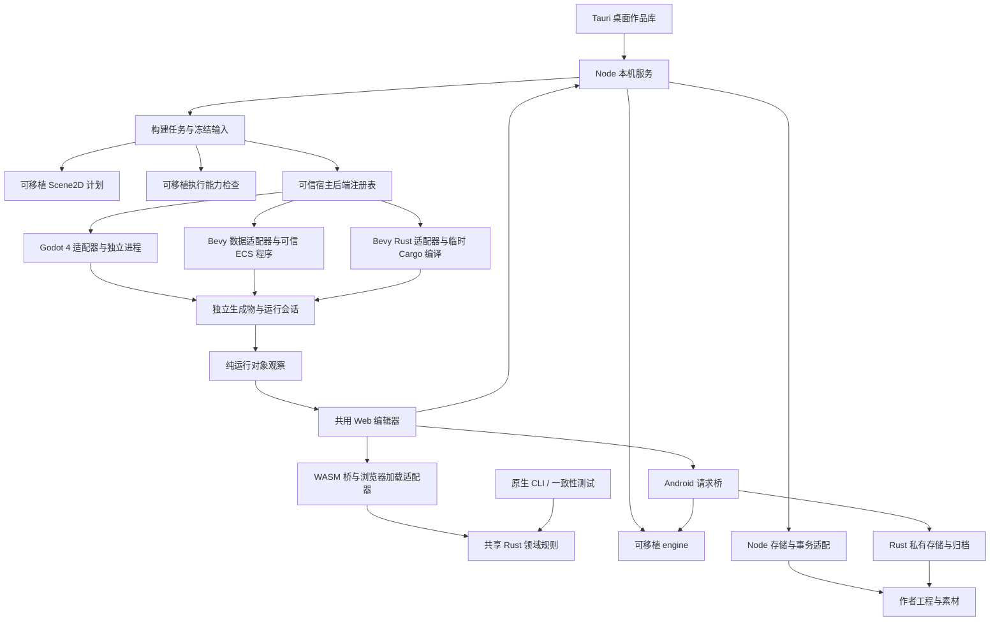

# 系统架构：当前实现

Viento Studio 以作者原文和稳定元数据为中心，连接通用创作、场景实现与后端工程交付。本文按职责、数据流和扩展边界描述当前实现；具体操作见[工作流](PROJECT_WORKFLOW.md)，API 入口见[可移植引擎](../engine/README.md)，GUI 装配见[系统模块](STUDIO_MODULES.md)。

源码版本为 **0.2.4**，已收录物理观察、角色重力／跳跃、运动与移动碰撞事件及静态单向平台，固定注册 **23 个模块、45 项声明能力**。源码、开发阶段验证和本机安装分别记录于 [STATUS](STATUS.md)；本机 **0.2.0 Linux** 验收不代表这些新能力已安装。旧发布数字和逐轮实现细节完整保存在[整理前快照](history/architecture-2026-10-25.md)，不在本文逐轮追加。

## 阅读与扩展入口

| 要解决的问题 | 首先查看 |
| --- | --- |
| 作者内容放在哪里、如何迁移 | [数据权威](#数据权威与生命周期)、[作品布局](WORKSPACE_LAYOUT.md) |
| UI 如何接入功能、避免互相调用 | [模块与依赖](#模块与依赖方向)、[系统模块](STUDIO_MODULES.md) |
| 编辑、检查、应用、保存各负责什么 | [文档存储](#文档编辑与宿主存储)、[共享 Rust](#共享-rust-核心的运行边界) |
| 哪些操作是可恢复的作者事务 | [World 命令](#world-查询语义命令与事务) |
| 引擎如何接入、工程如何交付 | [构建与运行](#构建与运行)、[中间层](BACKEND_MIDDLEWARE.md) |
| 能力实现到什么程度、在哪里验证 | [状态](STATUS.md)、[功能图谱](FUNCTION_ATLAS.md)、[测试指南](TESTING.md) |

## 创作与交付的接口

产品主路径为 **设定 → 投影 → 场景实现 → 组装打包 → 工程交付**。文档和字段编辑、OC 投影、场景作者区以稳定身份、修订和候选检查衔接。Composition 经共享 Rust 展开后，通过独立规划和既有 `scene.create` 生成 Scene2D；配方与 Scene3D 不直接进入 Scene2D 构建目录。

内置脚本创建由 `script-authoring.mjs`、独立视图和正文宿主 `scripts` 端口组成。`getContext` 提供会话及目录，`createDraft` 核对品牌和完整上下文后建立普通 TXT 草稿；语言标签不授予执行权，保存登记、行为关联与后端执行分别完成。外部 IDE／LSP 尚未接入；未来接口应显式携带文档 URI、语言、版本、诊断、来源范围以及有版本前置条件的 `applyDraft`。

工程交付只消费成功构建的登记清单。`backend-project-delivery.mjs` 产生绑定清单摘要的审阅 DTO，Node 重新验证身份及字节，仅打包登记的 `project/*`、`README.md` 和 `manifest.json`。作者快照、运行日志、缓存和工具不随包复制；原始摘要只作来源引用。交付持有构建执行槽直到最终复查和收尾，下载读取冻结包。独立视图只取得准备、下载和释放端口，生成工程的外部修改不会自动回写作者数据。

[完整接口细节与阶段记录](history/architecture-2026-10-25.md#section-01)。

## 模块与依赖方向

| 模块 | 当前职责 | 边界 |
| --- | --- | --- |
| `web/` | 文档阅读、源码／分段／字段草稿、世界与对象、素材／导出、场景预览与布局编辑、构建面板和中英日界面 | 通过宿主接口操作工程；不直接启动执行器或选择磁盘输出路径 |
| `engine/` | 解析与布局、项目模型、保真字段修改、文档存储流程、World 投影／查询／命令规划、资源依赖选择、Scene2D 来源模型、计划、布局草稿、执行后端纯数据能力检查及独立运行对象观察／查询及有限控制数据／步骤准入 | 不依赖 Node、HTTP、Tauri 或具体游戏引擎；不执行文件和进程操作 |
| `scripts/adapters/` | Node 文档读写、World 快照／命令执行、冻结构建输入、可信执行后端注册表、通用构建与运行编排 | 落实路径、修订号、锁、资源字节、适配器身份和生成物校验；具体引擎命令留在后端 |
| `crates/viento-studio-core/` | 共享 Rust 布局／历史／保存、源码补丁、组合、3D、声音、动画、状态表与物理声明规则；原生库／CLI 和 WASM 共用 | 不依赖 DOM、Tauri 或 Godot，不读写作品；当前编辑器使用 WASM 同步调用 |
| `crates/viento-bevy-runtime/` | 固定 Bevy 0.19.1 的可信无头运行程序，用 ECS 执行已生成场景数据及受控输入／移动，0.3.0 可消费全局与按实例有限控制程序 | 独立于编辑核心；不编译作者 Rust 文本、不加载图片／渲染插件，二进制作为本机工具配置 |
| `scripts/backends/` | Godot 4、Bevy 数据与 Bevy Rust 源工程适配器的产物生成、阶段／参数／环境、工具识别、诊断和缓存回收 | 引擎节点／实体只属于运行实现，不改变作者对象身份；图片与作者行为能力按后端分别声明 |
| `scripts/lib/`、`scripts/ops/` | HTTP 服务、项目／模板、索引、素材、导出、事务恢复、构建任务和启动编排 | 把宿主操作交给相应适配器，不把领域规则放进路由 |
| `desktop/`、`src-tauri/src/desktop_host.rs` | 桌面作品库、内置 Node、窗口／会话和进程生命周期、原生保存与归档 | 编辑 WebView 不直接获得文件系统或 Shell 权限 |
| `mobile/`、移动端 Rust 模块 | Android 作品库、WebView 请求桥、私有存储、即时索引、草稿恢复和完整迁移 | 不启动 Node／HTTP；支持范围单独声明 |
| `schemas/` | 作品清单、登记和实验性语义契约的验证定义 | 软件、作品格式、命令／事务协议分别版本化 |

`engine/` 是共享语义实现，不是未来 ns-nova 的替身。其文档存储流程通过注入的 `storage` 调用宿主，命令规划返回待写内容和提案；真正持久化在宿主完成。旧的解析入口保留兼容转发，YAML 依赖随应用离线提供。接口细节见 [引擎说明](../engine/README.md)。



图中的共享 Rust 分支承接已接入的可选领域规则；可信 Bevy 程序属于另一独立运行工具。编辑核心原生 CLI 是验证入口，当前编辑器实际调用 WASM，未增加原生 GUI 通信链。Web 编辑器按宿主选择传输。Android 在 WebView 内适配请求，直接调用 Tauri 原生命令；构建分支目前只接入 Linux 本机编辑服务。

## 数据权威与生命周期

新建 v3 工程用 `workspace.json` 声明类型与布局，默认保存 `documents/`、`templates/`、`metadata/`、`assets/`。旧 v1／v2 工程继续走兼容读取与原有保存规则，不因应用升级自动改名或重排正文。

| 数据 | 权威来源与保留规则 |
| --- | --- |
| 文档内容 | 原文是标题、字段、叙事和场景声明的权威来源；布局、索引和 World 属性是解析投影 |
| 身份、关系与素材登记 | `metadata/` 保存稳定 UUID、逻辑路径、类型、归属／引用和资源用途绑定；名称和路径不充当身份 |
| 类型和起始模板 | 创建工程时复制完整定义与模板，实例此后自行维护；模板不会自动重写旧正文 |
| 素材字节 | 由登记中的逻辑存储定位；正文使用相对逻辑路径或 `asset:<UUID>`，本机外置位置留在 `.viento/local.json` |
| 派生索引 | 受管理工程的标准化文件和索引位于 `.viento/cache/`；Android 索引即时生成，均不作为作品权威内容 |
| 恢复状态 | `.viento/world-transactions/` 等意图和恢复记录参与一致性保障，不能当作普通缓存清理；活动事务阻止不一致的读取或导出 |
| 构建输出 | 写到作者工程和实际素材目录之外，默认使用应用构建缓存；保存输入摘要、生成物、工具版本和会话记录 |
| 本机偏好与草稿 | 与工程分开；Android 恢复草稿不等于作品备份，也不会自动进入完整迁移包 |

角色背景仍由角色正文或有明确 `part-of` 归属的附属文档承载；共享故事可以多归属。不能为对象化另建一份与原文竞争的可写属性库。

物理默认布局在 `scripts/lib/workspace-layout.json`，起始模板目录在 `scripts/lib/project-templates.json`。桌面和移动端创建工程时选择模板包，复制类型／模板并记录版本与摘要；缺少原始包不妨碍打开已创建工程。这些仍是文档实例模板，尚无可执行工程类型插件或模板包升级框架。格式与迁移见 [通用项目](GENERIC_PROJECTS.md)、[工作流](PROJECT_WORKFLOW.md) 和 [作品布局](WORKSPACE_LAYOUT.md)。

## 文档编辑与宿主存储

桌面作品库启动内置 Node 和 `scripts/desktop-server.mjs`，服务绑定本机随机端口，以每次启动的会话 Cookie、Host 和 Origin 校验隔离编辑器。浏览器编辑入口由 `scripts/ops/site.mjs` 启动；独立浏览服务不开放正文写入、项目配置写入和构建操作。

```text
工程清单 + 正文 + 登记
  → 标准化与静态索引 → 阅读器和列表

源码／分段／字段草稿
  → 文档接口 → engine/document-store.mjs
  → node-document-storage.mjs 或 Android Rust 存储
  → 修订检查、原子写入与登记 → 刷新视图
```

可编辑目录来自已验证的工程定义。桌面静态索引入口 `data/index.json` 与实时文档接口 `/api/index` 是不同读取路径；两者共享原文及登记约束。正文保存与索引刷新分开：保存成功后即使刷新失败，也保留保存结果并允许重试。版本冲突保留草稿，字段修改只替换可证明对应的原文范围。

Android 的 `mobile/platform.mjs` 复用引擎并通过 `mobile_storage` 传入作品 UUID 与逻辑源路径；Rust 核对 SHA-256 修订号、目录边界和共享锁，执行原子替换。创建文档另有持久化创建意图；恢复不覆盖已有的不同内容。媒体访问、World 命令与 Godot 构建没有因此自动获得移动端实现。

桌面关闭会检查未保存草稿，返回作品库可保留编辑窗口；Android 则按作品在 WebView 本机存储维护恢复草稿，两种保证不同。完整平台限制见 [桌面宿主](../desktop/README.md) 和 [Android 宿主](../mobile/README.md)。

## World 查询、语义命令与事务

`scripts/adapters/node-world-projection.mjs` 读取正文和登记，交给 `engine/world-projection.mjs` 生成 World／Object／Resource 观察快照。GUI、`GET /api/world` 和 `scripts/world.mjs` 共用查询实现。投影保留原文修订号与属性范围，只存在于内存；资源的 `present-unverified` 状态表示发现文件，不表示字节已验证。

```text
GUI / HTTP / CLI 语义请求
  → 可移植命令校验和原文变更规划
  → 预览提案，或 Node 执行器在共享锁内重新校验
  → 原子单文件写入，或持久意图 / 数据发布 / 提交决定
  → 回执与新投影
```

| 已实现动作 | 持久化范围 |
| --- | --- |
| `property.set` | 一个现有文档中的一个字段，保真写回原文 |
| `changeset.apply` | 多个现有对象的属性批量修改；当前每个对象一个字段，使用可恢复事务 |
| `object.create` | 一个新正文与其登记共同发布／恢复 |
| `projection.update` | 原位修改投影标题／配置、追加新图片绑定；version 7 意图守护正文与登记两个既有文件，保留来源／模板和额外元数据 |
| `projection.create` | 新建 OC 投影配置与来源／图片登记；子模板快照完整嵌入正文，version 6 意图仍限两个新文件 |
| `scene.update` | 原位修改场景、保留继承／覆盖语义，追加必要依赖；version 8 意图守护正文与登记两个既有文件 |
| `scene.create` | 复用已有工程类型，新建 Scene2D 正文及派生角色／图片依赖；version 5 意图仍限两个新文件 |
| `relation.add` | 保真追加一个引用或共享归属关系，重新校验端点和关系图 |
| `resource.bind` | 向既有登记追加素材用途绑定；允许保留离线资源身份，实际构建另验资源字节 |
| `behavior.create`／`audio.create`／`animation.create`／`physics2d.create` | 首次创建关联文档：新正文、新登记和既有场景登记三文件；事务分别为 v9／v10／v11／v12，恢复核对冻结依赖证据，不覆盖依赖正文 |
| `world.recover` | 按已持久化的提交决定完成恢复，外部内容冲突时保留现场 |

Node 语义命令与旧文档保存共享登记锁。多记录发布先保存意图和前后镜像，以提交标记决定恢复到完整旧版或新版；读者在活动事务期间拒绝取得混合状态。World、旧编辑、资源包及 Node／Rust 完整导出遵守相应屏障。语义批次还不是任意混合命令事务，资源文件内容和 Build 不属于这些作者事务。

请求中的 `actorRef` 只是操作标签；HTTP 鉴权仍由宿主负责。语义命令描述不等于已接入远程 AI、Lese 或协作权限系统。使用、协议及恢复边界见 [World 投影](WORLD_PROJECTION.md)、[批量事务](WORLD_TRANSACTIONS.md)、[对象创建](WORLD_OBJECT_CREATE.md)、[关系](WORLD_RELATIONS.md) 与 [资源绑定](WORLD_RESOURCES.md)。

## 构建与运行

构建只消费保存态输入。Scene2D 使用已登记对象、投影与资源，显式关系选择行为、声音、动画和物理声明；故事正文、类型名称和预览选择不隐式生成可执行语义。

```text
作者文件与登记 → 读取屏障／修订复查／冻结资源字节
  → 严格源码索引与 Scene2D 模型 → 中立计划与来源
  → 后端能力准入 → 可信宿主注册表 → 所选适配器
  → 校验清单与生成物 → 独立运行副本／工程交付
  → 严格运行事件读取 → 只读观察与受守护来源导航
```

`backend-capabilities.mjs` 分别判断操作、平台、计划和功能；固定宿主注册表决定可执行实现，HTTP 不接收适配器代码或任意路径。`executionAdapter` 与生成器 `backend.sha256` 分别验证；兼容旧记录必须显式声明，不能静默切到另一后端。Godot 支持已声明的无头逻辑、独立窗口和截图；Bevy 数据通道执行无图几何，Bevy Rust 通道另外编译已冻结的作者 TXT，并有独立工具与能力限制。作者目录外的临时 Cargo 环境使用 `--locked --offline`；作者语言不是安全沙箱。当前未提供离屏渲染、内嵌引擎视口、GPU 或 ns-nova 实现。详见[后端中间层](BACKEND_MIDDLEWARE.md)和 [Bevy](BEVY_BACKEND.md)。

保存态预览与运行有独立生命周期，只消费冻结模型及有限期图片字节。`sceneEditing`、`sourceLocations` 和组织结构是预览侧带，不因此成为运行计划或保存权。`captureSceneDraftPreview` 在克隆观察内替换当前单份源码，限制 128 KiB UTF-8 并检查 SHA-256 基线；它不返回可执行构建快照，失败保留上一有效画面并标明来源。构建始终读取磁盘版本。

项目计划和单场景计划分别分派。声音、动画、物理和状态观察各自验证来源与预算，不能从相邻命令、当前作者文件或画面倒推真实因果。作者格式、子计划、运行协议、生成清单与软件版本独立演进，兼容分支见[逐实例运行](#逐实例正式动画运行边界)。

[完整接口细节与阶段记录](history/architecture-2026-10-25.md#section-06)。

## 共享 Rust 核心的运行边界

`crates/viento-studio-core/` 在原生与 WASM 中共享领域规则，不读写作品、不取得 DOM 或具体引擎对象。浏览器通过 `initializeStudioCore(loadBytes)` 注入 WASM 字节，各可选域分别探测、使用有界同步缓冲并严格核对回执。缺失新域只关闭对应入口；非法回包不能降级成 JavaScript 的平行规则实现。原生 CLI 是验证入口，当前 GUI 使用 WASM。

`LayoutDraft` 持有初始位置、当前位置、最多 100 批次历史与保存状态；最多 32 个会话、每份 1–128 个演员。调用方必须释放会话。无状态源码、动画、物理等检查不借用布局状态槽。原主 ABI 与各可选操作域分别版本化。

[完整接口细节与阶段记录](history/architecture-2026-10-25.md#section-07)。

### 源码检查与坐标补丁

`sceneSource.inspect`／`sceneSource.patch` 每次重新扫描严格 JSON，检查解码重复键、稳定身份、位置和分组；只替换变化的数值 token，保留 BOM、行尾与无关数字写法。源文前后限 128 KiB UTF-8，64 层／100000 节点，实例 1–128，v3 组 0–128、深度 16。导航范围为含 BOM 的 UTF-16，补丁内部使用 UTF-8 字节范围。

`createSceneSourceLayoutDraft` 绑定有效预览、摘要、保存基线和实例顺序；`prepareSceneSourceLayoutApply` 重算完整候选。宿主在异步返回后再次检查当前文档、场景、源码模式和会话才写内存；普通 Save 负责外部冲突。本地几何会话不暴露 World 命令或保存接口，没有跨视图统一撤销。

[完整接口细节与阶段记录](history/architecture-2026-10-25.md#section-08)。

### 配方创作区与宿主接口

`app-scene-authoring.js` 为各配方编辑区注入来源、目录、候选预览、导航和草稿端口。`scene-authoring-workflow.mjs` 只编排这些接口，各入口持有独立会话和回执；`scene-authoring-candidate.mjs` 同步验收精确候选及目标语义。UI 不取得兄弟控制器、构建目录或普通保存权，失效会话释放临时预览。

[完整接口细节与阶段记录](history/architecture-2026-10-25.md#section-09)。

### 文件内片段组合实验

`sceneComposition.expand` 从单份配方产生普通 Scene2D v3 和独立来源映射。片段、放置、覆盖、组织与实例身份由 Rust 验证，预算包含未放置声明；128 KiB UTF-8、32 片段、128 声明演员与组的限制继续有效。该路径不自动分配 UUID，也不把有效实例值反推为作者声明。

字段设置／恢复、共享演员、放置偏移／结构、组织组、片段定义／重命名各有独立可选操作和私有提案。设置为有效默认值、删除声明和显式 null 保留不同语义；每次重新展开完整候选，核对所有受影响实例、图片和来源。`prepare…Apply` 重算完整回执，最终只应用当前原文内存；无跨文件提交、隐式继承迁移或统一撤销。接口索引见[引擎](../engine/README.md#文件内片段组合实验)，操作见[场景配方](SCENE_COMPOSITION.md)。

[完整接口细节与阶段记录](history/architecture-2026-10-25.md#section-10)。

### 布局保存工作流

`layoutSave.read/invalidate/begin/resolve/refreshed` 与位置草稿共享 `draftId`；检查、保存和核对各取得单调 `requestId`，阶段或请求不符的完成被拒绝。位置变化使审阅失效，待保存／未知结果期间不能继续编辑。JS 保留作者正文、已审阅请求和摘要，Rust 维护状态迁移，宿主核对每次异步归属。

保存态布局经 `scene.update` 与读取屏障持久化，源码草稿布局只应用内存再普通 Save。保存成功与刷新成功分开表达；不明结果先核对，不能重复发布或把新会话的响应接到旧草稿。

[完整接口细节与阶段记录](history/architecture-2026-10-25.md#section-11)。

## 二维物理的编辑与执行

当前另有独立角色事件包装：只在生成的运动代码中以唯一匹配插入“已接受起跳”和“完成接触判定”钩子，原0.24模板保持；顶层场景包装注入行为局部事件端口，每步运动完成后发送、关闭时撤销。普通起始脚本经自身项目端口发布事件，动画／声音独立订阅，运行层不选择媒体或读取smoke trace。`physics.character-events2d` 是Godot可选脚本接口，不扩展中立作者声明、Rust ABI或项目wire。

`scenePhysics2D.inspect` 校验 schema 1 作者声明，独立 `scenePhysics2D.inspectResponse` 与可选响应标记检查 schema 2；`scene-physics2d.mjs` 从明确关系解析物理子计划。角色可选 `stop`／`slide`；旧声明缺省停止，只有显式滑动保存才升级。中立计划仅对实际滑动追加 `physics.character-slide2d`，Godot 独立响应层负责有界碰撞切面位移，渲染器不持有求解器。Godot 物理根与视觉动画子层分离；触发区由真实作者绑定发布既有项目事件。当前另以独立 `scenePhysics2D.inspectMotion` 检查 schema 3 的 `characterMotion`，角色运动参数由 Rust 校验；中立计划要求 `physics.character-motion2d`，Godot 的独立运动层以显式 delta 积分重力、边沿起跳及碰撞速度修正。自由平面角色与旧默认保持，当前能力不包含动态刚体、关节、物理材质、3D 或 Bevy 物理。完整规则见[二维物理](SCENE_PHYSICS2D.md)。

移动碰撞事件由Godot0.27.0独立包装读取已有求解返回值，提供每个运动角色行为自己的版本1端口。差集按稳定对方身份去重并在步末派发，关闭撤销；普通起始脚本选择事件名、按对方实例过滤并通过自己的项目端口发布。该层不运行二次碰撞查询，不依赖有限trace，不把本步没有碰撞等同于几何分离；作者schema、Rust核心与项目wire保持。详细语义见[角色移动碰撞事件](SCENE_PHYSICS2D.md#用角色移动碰撞驱动项目事件)。

schema 4 的静态矩形可显式声明 `oneWay: { margin: 1 }`，容差范围 1–64。独立 `scenePhysics2D.inspectOneWay` 与 `viento_core_scene_physics2d_one_way_version` 标记检查完整声明，包括既有滑动和角色运动，不依赖旧可选检查标记；旧操作域保持。普通创建默认不变，字段编辑显式升级，关闭删除字段而不降版本；叶级和可选成员补丁保留其余原文字节。中立计划只在字段实际存在时追加 `physics.one-way-platform2d`。Godot 0.26.0 包装在原生根建立后、作者行为就绪前配置固定朝上的单向碰撞形状，复用原运动及事件层，不增加位移调用或项目／观察协议。空间图仍只处理几何；移动平台、任意方向和按键向下穿透未接入。

物理步观察通过 `project-physics2d-trace.mjs` 单独定义流与快照，不扩展作者规则或项目动画协议。Godot 包装层在原移动调用后捕获碰撞；纯 JS 只验证有界帧、场景访问及冻结声明身份，不重演求解。Node 将快照保存到运行会话独立的 `physics` 字段，Web 只负责筛选、查看与受守护的原文导航。半秒测试上限256条角色样本，截断和中断明确展示；此观察没有作者写入或玩法事件发布权限。

| 边界 | 输入、输出与权限 |
| --- | --- |
| 原文字段编辑 | `scene-physics2d-edit.mjs` 捕获有界来源、局部补丁与品牌审阅；source5、generation 和摘要守护当前原文，Apply 只写草稿 |
| 保存态实例目录 | 独立 `getTargets` 从一次 World 快照核对 Scene2D v2／v3 稳定实例及双向关系；目录验证的提案在 Apply 前重读完整目录，失败保留明确未验证的手填路径 |
| 空间读取 | `getSpace` 返回保存态根位置、逻辑尺寸、颜色和来源；不读取图片、不依赖声音／动画／物理构建成功，不产生写入权限 |
| 空间领域提案 | `scene-physics2d-space-edit.mjs`／`scene-physics2d-space-resize.mjs` 从品牌视图与已有体生成冻结偏移／尺寸提案；精确绑定原视图、体及起始值，复用 Rust 规则 |
| 手势与表单交接 | 渲染器以逆 CTM 将指针转为场景坐标，拖动只显示临时形状；控制器核对来源、能力代际、已检查模型、选择、视图和 raw 表单签名，仅回填变化轴 |
| 创建与保存 | `physics2d.create` 以 v12 三文件事务首次创建；已有正文沿 Check → Review → Apply → 普通 Save，目录读取不是作者事务或完整构建预检 |

查看、偏移、尺寸模式互斥。矩形提案使用完整宽高增量，圆形使用半径增量；调整尺寸保持形状类型、中心和偏移，调整偏移不移动场景实例。合法最终偏移为 ±8192、矩形尺寸为 1–8192、半径为 0.5–4096；越界拒绝，不做隐式夹取或量化。零增量合法且不撤销审阅，未变字段保留数字拼写。旧视图、取消、重开、来源或能力变化使迟到手势失效；这些空间编辑能力不新增格式、服务端口或运行协议。

## 资源复用、分享与完整迁移

作者内容与派生工程沿独立输出契约交付：

| 链路 | 数据范围与实现 |
| --- | --- |
| 文档分享 | 选定文档及附属内容 → 通用布局 → HTML／Markdown 和所需素材 → ZIP |
| 选择式资源包 | `engine/resource-package.mjs` 计算依赖闭包；Node 校验内容、预览冲突，以独立持久导入事务追加内容 |
| 完整项目迁移 | 清单、模板、正文、登记及素材全部收集；Node 和 Rust 实现对齐同一项目包格式，Android 复用 Rust 并增加系统传输适配 |
| 后端工程交付 | 核对成功构建的登记清单，生成 `.viento-build.zip`；只携带生成文件、必要素材／脚本、说明和校验清单，仍需相应工具 |

单个图片、音频、视频还可按原始字节导出。完整项目包不携带 `.viento/local.json` 的本机绑定或派生缓存；外置素材收集实际字节。导出核验摘要、身份、关系与源变化，活动事务先恢复或阻止导出；恢复先暂存校验再发布，拒绝覆盖既有异内容工程。

构建输出不混入作者工程备份。`.viento-build.zip` 解决已登记派生工程的可迁移交付，`.viento.zip` 保留完整作者数据；独立游戏发行仍需目标平台和工具链的另一份契约。详见 [导出](EXPORT.md)、[后端工程管理](BACKEND_PROJECTS.md)和[资源包](RESOURCE_PACKAGES.md)。

## 验证与架构演进

当前平台覆盖和源码交付由 [STATUS](STATUS.md) 汇总，复现命令及设备边界见 [TESTING](TESTING.md)。历史 `test-results/`、发布记录和 [功能链路网络](FUNCTION_NETWORK.md) 保留执行时的环境与证据，不由本文更新旧统计。

新增能力沿现有边界做可运行纵切：先说明作者数据、命令、宿主权限及输出归属，再用真实执行器验收。后续原生异构计算通过独立计算／渲染适配开放；设备句柄、队列和显存状态留在运行会话，通用文档与事务内核保持可移植。下一步范围见 [ROADMAP](ROADMAP.md)，长期决策见 [ADR 0008](adr/0008-native-nuis-and-bootstrap-runtime.md)。

## 0.0.10 之后的 3D 开发切片记录

该标题保留既有链接。当前 3D 表示、只读预览与九个作者域的职责见[模块清单](STUDIO_MODULES.md#已装配的模块)及[接口索引](../engine/README.md#独立-3d-原始表示)；早期切片的版本、数量和验证条件仅作为历史证据保存。

[完整接口细节与阶段记录](history/architecture-2026-10-25.md#section-14)。

### 通用源码编辑工具

`engine/source-indentation.mjs` 只接收规范 LF 文本、UTF-16 选区、操作及缩进单位，返回一次整行替换与映射选区；输入及输出长度均有界。它不读取语言、工程类型、DOM、文件或后端。

`app-source-indentation.js` 负责工具条、IME、快捷键和浏览器原生编辑事务；正文宿主只提供编辑状态及来源标识。原生 input 沿既有脏状态和普通保存路径处理，程序载入正文另更新来源标识，语言刷新不会重置原文或撤销记录。此工具属于既有正文模块，不添加独立执行或持久化权限；Rust 原生文本命令和外部 LSP 后续可按相同职责分别接入。

`engine/source-position.mjs` 独立提供有界 LF／UTF-16 行索引和位置查询，不依赖 DOM、语言或文件。`app-source-position.js` 只接收正文元素、容器和共同的 `sourceEditorContext`，读取选区并移动光标；不调用缩进控制器、input、原文替换或保存接口。跳转窗口绑定来源标识及完整原文，关闭和焦点恢复后重新核对归属；可丢弃的排版镜像测量软换行后的滚动位置。正文模块数量及宿主权限不变。

`engine/source-diagnostic.mjs` 约束独立、不可变且有界的诊断展示快照，不接收构建任务或执行器对象。构建视图只提供代码、说明与详情；正文宿主负责读源、版本核对和位置转换，再将定位结果交给 `app-source-diagnostic.js`。面板只能展示／清理，正文输入令旧结果保持待复验，不能触发检查或保存。

`app-source-reveal.js` 是独立 DOM 适配器，供行号跳转和已核对来源导航共同使用；完整文本镜像避免在词中截断而改变折行。模态来源导航的激活路径延后焦点，窗口关闭后再次核对来源、忙碌状态、弹窗及新用户操作；同步 focus 回调不能把旧范围写入另一份源码。它们仍属于正文模块，不新增声明能力。

### 原文查找与替换

`engine/source-search.mjs` 提供有界字面匹配与单次替换规划，保留原始 UTF-16 范围；大小写选项不通过整篇转小写改变偏移。替换规划只返回最小包围区间和字面候选，不读取文件或控制编辑器。

`app-source-search.js` 消费既有 `sourceEditorContext`，负责非模态控件、输入法、快捷键、选区及原生撤销事务。跳转复用独立的 `revealSourceOffset`；替换通过一次原生 `insertText` 沿普通 input 更新草稿、诊断和保存状态，不直接覆写 `.value` 或绕开正文宿主保存。操作前后均核对来源令牌、确切原文及查找条件，重入或文档切换不能把旧选区或输入事件交给新来源。正文模块仍为既有模块，不增加执行器、构建或持久化权限。

媒体粘贴／拖放沿既有编辑适配器核对目标输入框：只有 `getContext(input).input === input` 的正文输入可以成为素材插入目标。搜索等辅助输入不会更新正文的最后目标，也不会因宿主的默认回退而上传素材或修改正文。该判断由通用媒体组件负责，不依赖搜索组件的 ID 或类名。

### 当前任务问题视图

`engine/project-problems.mjs` 严格捕获可序列化的单任务标量、诊断与来源信息，返回不可变快照；独立字面筛选接受严重度、查询和可选的本地化消息，不依赖 DOM、构建任务对象或文件访问。无效来源元数据整份拒绝，不静默遗漏诊断或修正来源。

`app-project-problems.js` 保持搜索控件与等价结果的行节点，消费快照、可用状态及来源令牌；只把所选条目和归属检查函数交给导航接口。`app-project-build.js` 负责从当前任务映射友好消息与数据，绑定后端、任务及窗口会话，保留现有构建／运行控制。主编辑宿主在原文读取与摘要计算后复核归属，再接已有版本检查、精确范围和延迟焦点交接。完成导航后的焦点交接由正文令牌守护，不要求已关闭的问题窗口继续可见。

## 配方与运行场景的显式衔接

`scene-composition-materialize.mjs` 消费保存态预览、已登记来源原文和读取前后的同一 World 修订，复用 Rust 展开，生成独立 Scene2D 及已有 `scene.create` 请求。它不从预览渲染模型反推作者声明，也不读取文件、执行后端或取得保存权限。`app-scene-materialize.js` 独立负责来源读取、目的地审阅、保存结果核对与会话守护；构建父窗口仅提供可用性、选中身份和保存后的目录交接。

配方依赖先经原有只读预览校验，目的场景再经原有创建事务校验。原配方不修改，新场景保留展开后的稳定实例身份与投影继承；行为关联、构建快照、后端输出及交付沿现有接口进行。不新增系统模块、Rust 协议或作品格式。

## 声音、行为与项目组装

以下领域共享来源守护和普通保存接口，各自维护声明、视图、目录和运行观察；注册一个编辑模块不代表后端支持对应执行能力。

### 场景声音的独立边界

`viento-scene-audio` schema 1 保存稳定场景、轨道、资源和提示 UUID。Rust `sceneAudio.inspect`／`sample` 校验 1–16 轨、0–64 提示、0–60 秒、0–1 音量，同刻按作者顺序；采样不推断音频自然结束。原文编辑、已绑定素材目录、保存态用量与 WAV 字节验证分别负责。表单审阅只应用普通草稿，播放器和后端消费已验证声明。

[完整接口细节与阶段记录](history/architecture-2026-10-25.md#section-19)。

### 行为参数与音轨目录

`scene-audio-directory.mjs` 为行为来源绑定冻结的保存态音轨目录，显式选择只返回普通 UUID 字符串，不生成语义关系。只读服务验证同一场景与来源，宿主异步核对 source5 及能力代际；不读取 WAV 或执行完整构建，参数保存仍经行为原审阅链。

[完整接口细节与阶段记录](history/architecture-2026-10-25.md#section-20)。

### 素材试听的独立边界

`prepareSceneAudioAudition(source, catalog, resourceId, ports)` 在 await 前分离 source5，与重新读取的品牌目录比较后校验资源字节。WebAudio 只消费获准内存，负责单轨播放、暂停、继续、定位与释放；来源或会话变化撤销迟到播放。试听位置不是作者时间提示，也不调用项目运行端口。

[完整接口细节与阶段记录](history/architecture-2026-10-25.md#section-21)。

### 首次场景声音创建

`scene-audio-create-plan.mjs` 复用 Rust 检查生成声明；创建契约分离目录、请求、回执与不明保存结果。`audio.create` 以 v10 三文件事务发布新正文、新登记及场景关联，恢复核对冻结依赖。独立创建控制器只取得目录、命令、刷新和回源端口；旧宿主缺命令只关闭该入口。

[完整接口细节与阶段记录](history/architecture-2026-10-25.md#section-22)。

### 项目目标与运行入口的区分

`build-target.mjs` 分派单场景和项目计划，分别提供构建目标来源与入口场景访问。纯 `project-assembly` 声明和计划只消费作者 World；Node 在同一快照中冻结去重资源，Godot 才负责成员路径。运行会话以项目身份归档，只把入口子计划交给现有场景事件读取器。后端清单 v2 与目录 v2 显式保存组装信息，旧清单／目录仍可读取。作者服务使用普通登记和原子原文保存，独立窗口仅通过目录、保存与刷新端口工作。详细契约见[项目组装](PROJECT_ASSEMBLY.md)。

[完整接口细节与阶段记录](history/architecture-2026-10-25.md#section-23)。

### 项目行为声音控制

`project.audio-control` 是后端能力。行为请求播放／停止当前场景已声明音轨，由项目运行层按实际绑定与访问验证；先处理事件，再执行声音请求，再切场景或正常结束。`cues: []` 可表示仅行为触发，作者表单不会伪造定时提示。独立只读观察分别导航行为与音轨冻结来源，不持有播放器或命令权。

[完整接口细节与阶段记录](history/architecture-2026-10-25.md#section-24)。

### 场景到组装的作者边界

`setupProjectAssembly.openForScene(sceneId)` 与已有 `open(documentId)` 分开。宿主提供当前场景、作者会话与来源令牌；组装编辑器重新读取 `assembly-list`，确认身份后预填成员与入口。原 `review`／`assembly-save` 负责完整 JSON 审阅和修订保护，保存确认才调用 `applied` 让构建宿主选择新项目并清除旧计划。

预填仅修改对话框草稿，不创建临时作者文档、伪造项目来源或调用后端。种子场景归属贯穿异步目录读取和待保存草稿；显式载入、手动新建或确认保存时释放，允许保存后的正常目标切换。作者接口、项目计划及 p11 运行协议保持，既有单场景逐实例拒绝仍有效。

[完整接口细节与阶段记录](history/architecture-2026-10-25.md#section-53)。

## 动画创作、状态表与运行观察

动画规则由 Rust 负责，作者提案、目录、源码发射器、后端运行与观察各自有契约。下列入口是职责索引；完整请求形状、预算和历史兼容细节通过各节链接保留。

### 项目动画控制的独立边界

`sceneAnimation.transport` 校验完整动画、前一播放状态、显式时间与命令，返回受核验的播放头状态；JS 编排请求账本，不重写时钟规则。Godot 只对冻结计划内的访问与绑定开放端口，实际执行和作者提交分别记录，观察 UI 不获得命令权。

[完整接口细节与阶段记录](history/architecture-2026-10-25.md#section-25)。

### 命名片段的独立边界

作者 schema 3 增加有界 `clips`，独立可选 Rust `sampleClip`／`clipTransport` 负责局部采样和播放规则；旧采样和 transport 保持原形状。片段使用稳定 UUID，整段与片段的选择、播放状态和完成身份分别核对，不能从名称推断目标。

[完整接口细节与阶段记录](history/architecture-2026-10-25.md#section-26)。

### 行为参数的动画片段目录

`scene-animation-directory.mjs` 复用 Rust 规则，将保存态目录与行为 source5／场景身份绑定。动画正文限 128 KiB、行为限 32 KiB，选择仅返回普通 UUID 字符串；旧 schema 或空片段目录明确为空，不生成引用保护或保存权限。

[完整接口细节与阶段记录](history/architecture-2026-10-25.md#section-27)。

### 动画片段使用位置与只读来源

`scene-animation-usage.mjs` 枚举保存态行为参数中的完整 UUID 文本匹配，品牌目录与精确 UTF-16 来源相互绑定。不推断动态脚本引用，查询失败不能显示为零使用；名称、当前表单与保存态文字匹配分别呈现。

[完整接口细节与阶段记录](history/architecture-2026-10-25.md#section-28)。

### 事件与动画的脚本组合

`godot-project-animation-event` 起始内容组合既有事件订阅、片段选择与播放端口，沿普通 TXT 草稿、保存和行为绑定进入项目。同步 handled 只表示请求已提交，执行结果读取独立动画回执；模板没有新的事件或动画语义。

[完整接口细节与阶段记录](history/architecture-2026-10-25.md#section-29)。

### 动画整段时长变换的作者边界

Rust `sceneAnimation.retime` 仅按比例改变总时长、关键帧时间与片段边界，保留身份、顺序、数值、插值及网格；不同时间因精度合并时整次拒绝。纯表单 helper 返回本地候选，之后仍需原文提案、审阅和普通保存，没有 JavaScript 回退或运行时钟副作用。

[完整接口细节与阶段记录](history/architecture-2026-10-25.md#section-30)。

### 动画轨道复制与实例目录边界

Rust `sceneAnimation.copyTrack` 只替换克隆轨道的 id／instanceId 后追加，冲突或超预算整次拒绝。UUID 分配、保存态目标目录和当前表单检查在宿主；结果不是审批凭据，后续结构提案保留数组外原文，不建立资源绑定或运行克隆。

[完整接口细节与阶段记录](history/architecture-2026-10-25.md#section-31)。

### 动画自然完成的独立边界

完成账本通过 Rust transport 的 `command:null` 验证非循环自然终点，自动播放完成不伪装成行为发布的通用事件。订阅、投递、命令截止与冻结来源逐项校验；循环、暂停、停止、取消及旧播放代次不能伪造完成。protocol 7 起承载该观察，后续目标协议继续独立验证。

[完整接口细节与阶段记录](history/architecture-2026-10-25.md#section-32)。

### 动画状态表与源码生成边界

Rust 验证初始状态、状态键、事件／完成边、引用和预算，输出稳定索引。可移植状态表不读取脚本或执行引擎；固定 Godot 发射器生成作者源码，独立表单只交接普通 TXT 草稿。生成器版本和运行协议不混为同一版本号。

[完整接口细节与阶段记录](history/architecture-2026-10-25.md#section-33)。

### 状态表声明与原文再次编辑

`animation-state-script-source.mjs` 将表声明封装在版本化注释内，重新打开须 Rust 准入并完整再生成比对。`animation-state-script-edit.mjs` 的私有提案绑定 source5；标记存在、解析成功或静态图都不授予写入权限，修改过的任意脚本不能当作可重编辑生成稿。

[完整接口细节与阶段记录](history/architecture-2026-10-25.md#section-34)。

### 脚本参数接口与绑定修复边界

`script-parameter-interface.mjs` 校验有界标量契约及表单缺失／重复／类型／引用格式；格式发现层只在已知源码 codec 完整再生一致后给出接口。绑定修复生成独立可审阅草稿，不把未知脚本声明或提示自动写入行为文件。

[完整接口细节与阶段记录](history/architecture-2026-10-25.md#section-35)。

### 保存态脚本使用位置与来源导航

`script-usage.mjs` 从保存态行为正文枚举脚本 UUID、参数类型与精确 JSON 来源；Node 读取登记和场景关系，目录及导航请求有独立品牌。无效正文不计为零使用，来源导航核对会话与当前归属，不解释脚本或取得编辑权。

[完整接口细节与阶段记录](history/architecture-2026-10-25.md#section-36)。

### 状态表静态图与字段定位

`animation-state-graph.mjs` 对完整当前表调用统一准入，按组合、来源、有序分支、标量或无条件契约选择 Rust 域。图和定位只映射已检查声明与稳定表单身份，不模拟实际运行路径；折叠、表变化和会话变化撤销旧定位票据。

[完整接口细节与阶段记录](history/architecture-2026-10-25.md#section-37)。

### 事件载荷条件与生成器版本

独立 Rust 标量域 `animationStateCondition.inspect/evaluate` 与 `inspectConditional` 规定严格类型和比较，未知或不匹配输入不隐式转换。v2 发射器承接条件，旧发射器不静默剥掉新字段，源码重编辑仍需整文一致。

[完整接口细节与阶段记录](history/architecture-2026-10-25.md#section-38)。

### 显式有序事件分支

`eventSelection: "firstMatch"` 显式启用按声明顺序匹配；Rust `inspectBranches` 校验同状态／事件的分支及兜底约束，v3 发射器执行相同顺序。旧无歧义表仍走旧域；转换已匹配但执行失败不继续兜底。

[完整接口细节与阶段记录](history/architecture-2026-10-25.md#section-39)。

### 动画条件来源与后端读取

可选 `selector:{kind:"projectState",key}` 区分共享状态与默认事件载荷。Rust 准入保留来源和索引，v4 发射器通过既有 `read_state` 取得值；缺失或类型不符不匹配。旧入口拒绝新字段，静态图不推断运行读取结果。

[完整接口细节与阶段记录](history/architecture-2026-10-25.md#section-43)。

### 动画平面条件组合

`condition:{combine:"all"|"any",conditions:[...]}` 只允许 1–8 个标量叶，禁止嵌套和额外字段，完整表限 32 KiB。独立 `inspectCombined` 和 v5 发射器保留来源及顺序，按实际到达叶短路读取；旧入口拒绝组合，不运行未到达条件。

[完整接口细节与阶段记录](history/architecture-2026-10-25.md#section-44)。

### 动画状态快照与冻结来源

`project-animation-states.mjs` 只从冻结计划和完整已知 v1–v5 codec 建立控制器目录；任意或修改过的脚本排除。状态、片段参数和两类来源由计划提供，运行观察不读取最新作者源码替换冻结声明。

[完整接口细节与阶段记录](history/architecture-2026-10-25.md#section-40)。

### 动画状态进入记录的独立边界

protocol 9 起记录实际成功进入，独立账本核对访问、绑定、状态索引、片段、时钟和已执行命令截止。相同状态重启仍有独立序号；状态名由冻结目录恢复，不从 select/play 相邻命令推断进入或触发原因。

[完整接口细节与阶段记录](history/architecture-2026-10-25.md#section-41)。

### 动画控制器历史回看的边界

`project-animation-state-review.mjs` 完整准入后按访问／场景／绑定分组，返回当前进入、前后记录、截止后的执行命令和终止采样。冻结品牌及索引私有保存，视图不补造因果；追加记录保留有效选择，换会话撤销来源票据。

[完整接口细节与阶段记录](history/architecture-2026-10-25.md#section-42)。

### 动画进入来源的独立边界

protocol 10／11 使用 `initial`、`direct`、`event`、`completed` 标签；事件／完成只保存序号和订阅身份，内容由已验证记录投影。Godot 固定包装器在真实 callback 作用域核对访问、绑定与消息身份；普通直接调用不能借用无关投递。旧 p9 显示来源未记录，仍无转换边号、逐条件结果或实时状态图。

[完整接口细节与阶段记录](history/architecture-2026-10-25.md#section-45)。

### 项目事件回看的独立边界

`project-event-review.mjs` 对完整 p3–p11 观察准入，再按事件及订阅索引已有进入证据；p3–p9 明确关联不可用。独立事件与动画回看组件通过宿主显式端口连接，不读取兄弟 DOM，不从当前源码或相邻命令猜测原因。

[完整接口细节与阶段记录](history/architecture-2026-10-25.md#section-46)。

### 逐实例正式动画运行边界

作者动画 schema 4 显式保存 `playbackScope: scene|instance`，Rust 可选 marker 只门控新格式；旧文档只在显式选择 instance 后升级，读入不迁移，切回 scene 不降级。动画子计划 3 声明范围与轨道归属，`animation.instances2d` 单独准入；同一实例的多个绑定共享一个播放状态。

逐实例项目使用 Godot 适配器 0.20.0／协议 11／清单 12。完成记录同时带全局 `commandSequence` 截止和同目标 `targetCommandSequence` 锚点，仅同目标新命令使旧完成失效。运行层按访问、真实行为对象、冻结绑定与目标验证公开端口身份，这不构成作者 GDScript 沙箱。整场景严格控制器、普通动画、无动画项目分别保持 0.19.0／p10／清单 11、0.16.0／p7／清单 8、0.11.0／p4／清单 5；旧读取契约保留。

逐实例运行要求项目组装，单场景生成与 Bevy 明确拒绝该能力。保存态实例预览独立消费 Rust 采样；正式 stop 保留片段并采样局部 0，预览 stop 撤销临时覆盖。来源、时钟、选择与普通保存互不替代。

[完整接口细节与阶段记录](history/architecture-2026-10-25.md#section-51)。

### 动画目标回看的独立边界

`project-animation-target-review.mjs` 完整准入后按 visitIndex／sceneId／显式 target 分组；同实例多绑定合组，同定义不同实例与重入访问分开。完成的 anchorCommand 来自已验证目标序号，0 保留为空；全局截止另存。独立视图只提供记录选择和来源导航，不承担实时播放状态或运行断言。

[完整接口细节与阶段记录](history/architecture-2026-10-25.md#section-52)。

## 手动试算与作者草稿的边界

手动预测、真实引擎回执和作者声明分开保存与展示。试算没有播放、作者保存或运行控制权限。

### 手动事件试算的独立边界

`animation-state-event-preview.mjs` 准入完整表和完整手动样本，拒绝 getter、循环、额外字段及超预算数据，共享值限 64 键／16 KiB。每个实际到达且存在的标量由 Rust 比较；JS 只编排顺序与 all／any 短路，未到达叶不生成 actual／matches。独立视图的输入和结果不进入作者 getValue、onChange 或审阅签名，真实引擎 NUL 构造差异单独记录。

[完整接口细节与阶段记录](history/architecture-2026-10-25.md#section-47)。

### 连续手动试算的独立边界

`animation-state-trial-sequence.mjs` 以精确前序品牌绑定待采用结果；显式追加才改变预测状态，无匹配保持、自环保留，截取前缀创建新身份。完成步骤标明 current-playback-completed 假设，不查询实时完成。追加限 32 步／规范样本 64 KiB，超限原子拒绝；表变化清路径，样本变化只清待采用结果。

[完整接口细节与阶段记录](history/architecture-2026-10-25.md#section-48)。

### 手动试算用例的独立边界

`animation-state-trial-case.mjs` 的有界、拒绝重复键 JSON 仅保存初始状态、规范样本与手动预期；只有 create／parse 的品牌可序列化和重跑。重跑先准入当前完整表，再复用原序列，首个不符后明确未运行。文件不含原作者表、工程身份、可信回执或播放命令；导入不执行，失败保留旧载入对象。

[完整接口细节与阶段记录](history/architecture-2026-10-25.md#section-49)。

### 用例编辑缓冲与载入对象的边界

独立 editor 持有 JSON raw 缓冲与编辑会话，只通过原 parse 产生候选；父组件核对归属后原子替换载入对象并清报告。取消保留原用例，迟到文件读取失效。作者表变化可撤销运行报告，但不丢弃独立 JSON 草稿；关闭／重置释放编辑会话，不触发作者 onChange。

[完整接口细节与阶段记录](history/architecture-2026-10-25.md#section-50)。
