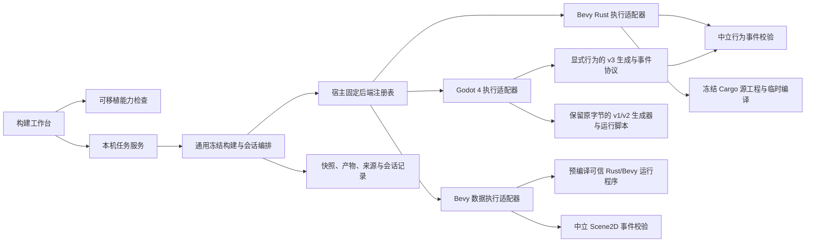

# 执行后端中间层

本页描述 **纯能力与计划契约 → 可信宿主编排 → 具体执行适配器** 的职责。当前源码版本为 **0.2.6**，Linux 宿主提供 Godot 4、Bevy 数据与 Bevy Rust 三个受限适配器。应用版本、安装与平台范围见[状态页](STATUS.md)，历次接入前言见[历史归档](history/backend-middleware-2026-10-25.md)。

| 阅读目的 | 入口 |
| --- | --- |
| 了解模块归属和信任边界 | [三层职责](#三层职责) · [架构](ARCHITECTURE.md) |
| 确认某后端能接收哪些计划 | [描述符与能力检查](#描述符与能力检查) · [二维后端映射](FUNCTION_MAPPING_2D.md#当前后端映射) |
| 核对冻结构建和重复运行 | [宿主适配与冻结回放](#宿主适配与冻结回放) · [工具身份检查](#工具身份检查) · [工程管理](BACKEND_PROJECTS.md) |
| 核对执行次数、队列和记录的不同限制 | [有限执行预算](#有限执行预算) · [执行调度观察](#执行调度观察) · [运行留存](PROJECT_BUILD.md#运行记录与留存) |
| 观察与验收 | [运行对象](#运行对象观察) · [运行验收用例](#运行验收用例) · [验证边界](#验证与下一步) |
| 接入具体领域 | [声音](#声音领域的具体适配) · [逐实例动画](#逐实例动画的后端准入) · [物理](SCENE_PHYSICS2D.md#构建交付与边界) |
| 使用现有构建入口 | [工作台](PROJECT_BUILD.md#编辑器工作台) · [Bevy 工具配置](BEVY_BACKEND.md) · [当前项目协议选择](PROJECT_BUILD.md#当前项目协议选择) |

0.2.6 源码的 Godot 执行适配器为 **0.36.0**；0.2.5 的历史交付为 **0.32.0**；含音轨项目生成0.36.0，无音轨但含动画项目生成0.35.0，两者均无时保持0.34.0；内部保留0.34业务位置层和0.33调度观察层，本机Studio安装仍为0.2.0。Bevy 数据为 **0.3.0**，Bevy Rust 为 **0.2.0**。这些是适配器身份，不能与应用版本、作者格式或按内容选择的生成器版本混用。空间图偏移／尺寸编辑沿用原后端契约；角色停止／滑动响应另以 `physics.character-slide2d` 显式声明，只有实际滑动才要求该能力。原生 Nuislang／ns-nova／yalivia、离屏渲染、内嵌运行视口、GPU 计算与通用插件 ABI 尚未接入或冻结。

新运动构建另声明 `physics.character-events2d`：行为局部版本1端口只报告真实起跳／落地，作者脚本选择普通项目事件名。它是后端可选脚本能力，不通过文本扫描推断计划需求，也不改变项目运行协议；旧运动生成层0.24.0及作者schema 3保持。

静态单向平台以作者 schema 4 的 `oneWay: { margin: 1 }` 显式声明，只限静态矩形，margin 为 1–64。计划仅在字段实际存在时要求 `physics.one-way-platform2d`；Godot 0.26.0 包装设置原生形状的单向碰撞与容差，方向固定朝上。关闭后保留 schema 4，缺省继续普通碰撞；旧响应、运动和事件生成层保持，项目与观察协议不变。两个 Bevy 通道不支持该执行能力。

0.28.0生成层提供可选 `physics.character-contacts2d`：自由平面停止／滑动和重力角色的行为独立观察本步实际移动碰撞集合的开始／结束，对方身份来自原生节点匹配。唯一收集器复用原求解结果，原文／wire／trace保持；普通作者脚本决定是否发布项目事件以及如何筛选载荷。没有角色时继续旧生成分支；0.2.4所用0.27.0仍保留历史生成与检查，语义见[移动碰撞事件](SCENE_PHYSICS2D.md#用角色移动碰撞驱动项目事件)。

0.30.0新增声明驱动的水平往返平台 `physics.platform-motion2d`：Rust校验schema 5，前端只编辑并审阅原文；后端轨迹控制器以既有项目时钟前进，将实际支撑平台的位移合入重力角色原运动请求。输入、轨迹、原生求解与观察分离；垂直和旋转运动尚未声明，见[水平往返平台](SCENE_PHYSICS2D.md#配置水平往返平台)。

0.29.0仅在同场景同时声明重力角色与静态单向平台时添加可选 `physics.character-drop-through2d`。下穿端口只接收自身实例请求，独立控制器管理队列、支撑与例外；共享移动钩子不增加求解。作者输入动作由普通TXT处理，原生例外与几何恢复由后端负责，具体生命周期见[主动下穿](SCENE_PHYSICS2D.md#从单向平台主动下穿)。

0.31.0另提供可选 `physics.platform-events2d`，行为局部端口通知本步抵达过的轨迹端点。每端每步最多一次，作者TXT决定是否发布原有项目事件；端口、轨迹与事件预算独立，见[平台端点事件](SCENE_PHYSICS2D.md#用平台端点事件驱动动画与声音)。

## 三层职责

| 层次 | 实现 | 负责内容 |
| --- | --- | --- |
| 可移植有限控制 | `engine/scene-control-program.mjs` | 检查全局／按实例方向布尔程序、冻结实例目标、时长及输入行／联合对象预算；按行准入有限步骤样本与生命周期，不模拟移动、不携引擎句柄 |
| 可移植执行预算 | `engine/project-execution-budget.mjs` | 提供七维有限策略和原子成本预留；不持有业务序号、队列、原始记录或重置时钟 |
| 可移植请求观察 | `engine/project-queued-requests.mjs` | 共用分流、时钟、FIFO结果、留存及异常收尾；不拥有领域准入规则 |
| 动画请求领域 | `engine/project-animation-requests.mjs` | 冻结动画来源、目标及命令校验；复用共用请求观察 |
| 音频请求领域 | `engine/project-audio-requests.mjs` | 冻结音轨与绑定校验；调用回执不代表设备已经出声 |
| 可移植事件位置 | `engine/project-event-positions.mjs` | 保存已准入发布与逐接收者回执的精确位置，保留已结清尾部及全部未决发布 |
| 可移植业务位置 | `engine/project-execution-frames.mjs` | 校验独立封套、委托原业务准入并保留128条位置；不从预算日志推测时钟 |
| 可移植调度观察 | `engine/project-execution-clock.mjs` | 组合既有运行reader，校验真实帧对与成本向量，合并并保留有界窗口；不执行调度或补充额度 |
| 可移植运行观察 | `engine/scene-runtime-query.mjs` | 从已验证 plan 1／2／3 建立独立身份／来源视图，消费准入事件并按实例／定义筛选；不启动进程、不查询引擎反射 |
| 可移植能力契约 | `engine/backend-capabilities.mjs` | 校验纯数据描述符，分别检查执行操作、平台、计划版本和功能需求；不接触文件、进程、DOM 或具体引擎 |
| 可移植工具状态 | `engine/execution-tool-status.mjs` | 严格校验身份检查状态及版本／摘要；不携工具路径、进程输出或执行权限 |
| 宿主中间层 | `scripts/adapters/node-execution-backends.mjs`、`node-project-build.mjs`、`scripts/lib/project-build-service.mjs` | 捕获已保存输入，固定后端身份与可信实现，校验输出与冻结回放，管理任务、取消、进程结果及记录 |
| 具体执行适配器 | `scripts/backends/godot4-adapter.mjs`、`bevy-adapter.mjs`、`bevy-rust-adapter.mjs` | 各引擎的工具识别、生成入口、阶段、命令行参数、环境、协议事件、诊断和缓存回收 |

注册表由本机程序以可信实现创建；它复制并冻结描述符、阶段列表和调用入口。HTTP 和工程文件不能注册代码、加载模块或传入可执行文件与输出路径。服务由宿主选择一个后端，网页没有引擎选择下拉框；源码 CLI 可以明确选择已登记的后端与本机工具。Bevy Rust 也沿用相同输入、输出和冻结运行检查，Cargo 编译只存在于其固定适配器内部，不增加通用动态编译或可执行文件交付钩子。这不是已冻结的通用插件 ABI。

[工程持久管理](BACKEND_PROJECTS.md)是 Node 宿主与 GUI 的独立对接层：来源与库存检查、持久运行选择和创建者清理记录分开，不加入引擎能力描述符。[有序验收组](RUNTIME_CASE_SUITES.md)由宿主顺序运行已准入用例，断言失败可继续，执行失败或取消停止余项；[成员报告](RUNTIME_CASE_REPORTS.md)只读取已接收采样与终态。后端不实现额外的报告队列或文件下载接口。

## 描述符与能力检查

描述符使用 `format: "viento-execution-backend"`、`schemaVersion: 1`，精确包含以下字段。作者格式版本、描述符版本和运行协议分别管理。

| 字段 | 约定 |
| --- | --- |
| `id`、`label`、`version` | 点分命名空间身份、展示名称、无前导零的 `x.y.z` 适配器版本；当前 Godot 为 `org.viento.godot4`、`Godot 4`、`0.36.0` |
| `platforms` | 无重复的平台标识数组；当前 Godot 适配器仅声明 `linux` |
| `plans` | `{ kind, schemaVersion, runtimeProtocolVersion }` 数组，按 kind／schema 唯一；Scene2D plan 1／2／3 分别绑定 runtime 1／2／3，3 用于显式行为。当前 Godot 另声明 project plan 1／项目运行协议 11，实际生成分支按[项目内容选择](PROJECT_BUILD.md#当前项目协议选择)；每次访问嵌套对应子场景原协议。通用描述符接受 project runtime 1–11，由具体适配器显式声明 |
| `capabilities` | 无重复的功能标识数组；Godot 包括二维场景、输入、图片、GDScript 行为、有限控制回放、声音、项目事件／状态／切换、动画与二维物理。完整标识以[Godot 描述符](../scripts/backends/godot4-adapter.mjs)为准，各声明仍须与冻结计划同时核验 |
| `execution` | 下表七个键都必须存在并为布尔值 |
| `extensions` | `{ id, version }` 数组，ID 必须处于后端自身命名空间；仅描述能力扩展身份，不含代码或路径 |

| 执行操作 | Godot 4 | Bevy 数据 | Bevy Rust | 含义 |
| --- | --- | --- | --- | --- |
| `build` | `true` | `true` | `true` | Godot 导入／检查脚本；Bevy 数据检查场景；Bevy Rust 检查 Cargo 源工程 |
| `headlessLogic` | `true` | `true` | `true` | 独立进程执行无头逻辑测试 |
| `windowPreview` | `true` | `false` | `false` | 独立正常窗口运行 |
| `windowCapture` | `true` | `false` | `false` | 窗口 smoke 运行生成截图；也必须声明窗口预览能力 |
| `offscreenRender` | `false` | `false` | `false` | 当前没有离屏渲染实现 |
| `embeddedViewport` | `false` | `false` | `false` | 当前没有嵌入编辑器的运行视口 |
| `gpuCompute` | `false` | `false` | `false` | 当前没有 GPU 计算接口 |

上方字段表列出 Godot 声明。Bevy 的 ID 为 `org.viento.bevy`、适配器／可信运行程序版本为 `0.3.0`，仅声明 Linux、scene2d plan／runtime 1／2，以及 `scene2d`、`input.arrows`、`state.movement`、`runtime.control-replay`、`runtime.control-replay.instances`；`extensions` 为空。带图片或行为的计划不能因同为 Scene2D 而绕过能力检查。

Bevy Rust 的适配器版本为 `0.2.0`，仅支持无图 plan／runtime 3，声明 `scene2d`、`input.arrows`、`state.movement`、`behavior.bindings`、`behavior.rust`。固定步接口是 Rust 运行模板内的实例能力：`ready` 显式登记更新函数，固定时间步与自身位置命令由运行时管理；通用宿主仍只接收已有协议事件，不识别作者 Rust 函数。编译缓存属于可回收宿主临时目录；工程清单只含冻结源码。

无头逻辑能力不推导出渲染能力；命名空间中的原生扩展信息也不表示已经能执行原生代码。当前 Godot 的 `extensions` 为空。生成器保留其历史后端元数据与摘要，描述符 `version` 不替换历史生成器版本。

`validateExecutionBackendDescriptor(input)` 返回与输入分离且递归冻结的描述符，未知字段、非数据成员、自定义原型、访问器、循环、稀疏数组和预算超限会被拒绝；访问器不会在校验过程中运行。错误为 `TypeError`，`errorCode` 为 `build_backend_invalid`。

`checkExecutionBackendSupport(descriptor, { operation, platform?, plan? })` 返回诊断数组，空数组表示这组声明支持该请求。缺操作或操作为 `false` 返回 `build_execution_unsupported`；平台不符为 `build_platform_unsupported`；计划格式、种类或版本不符为 `build_backend_plan_unsupported`；缺功能仍使用 `build_capability_missing`，保留场景 UUID、逻辑路径与原有空 JSON Pointer。无效 DTO 或未知操作拒绝为 `build_backend_invalid`。`canExecuteBackend(descriptor, operation, platform?)` 为 UI 提供失败时返回 `false` 的便利检查，不查找工具，也不启动运行。

## 宿主适配与冻结回放

适配器 contract version 1 提供描述符、构建／运行准备阶段，以及 `availability`、`identify`、`generate`、`fingerprint`、`executePhase`、`diagnostics`、`createEventReader`、`cleanupProject` 入口。可执行函数仅存在于可信宿主实现中。通用执行器消费这些入口，不包含 Godot 命令行参数、环境变量、缓存名或生成文件名。

工程管理增量给构建后的 `cleanupProject(directory, context)` 另传可信的 `generatedFiles` 与 `resourceFiles` 相对路径列表；适配器可忽略此可选上下文。Godot 只清除这些已知输入对应的 UID／导入辅助文件，未知内容留给统一库存检查和保留规则。宿主不按后端名称猜测缓存文件。

生成结果通过 `files`、中立的 `resourceFiles`（资源 UUID → 相对文件路径）、`sourceMap`、历史 `backend` 元数据和 `artifact` 描述交付。宿主先校验并复制结果，再创建输出目录：拒绝绝对路径、路径逃逸、文件与资源冲突、同一路径同时作文件和目录、缺少入口及预算超限。构建输出始终位于作者工程和实际素材目录之外。具体引擎如何组织自己的生成项目，属于适配器职责。

`build.json` 和 `session.json` 记录独立的 `executionAdapter: { id, contractVersion, sha256 }`。指纹覆盖具体适配器声明的契约、生成器与运行实现，完整列表以各适配器的 `fingerprint()` 为准；它与 `backend.sha256` 的生成器／运行脚本摘要分别核对。运行从冻结原文重建计划，核对后端、协议、工具版本与二进制摘要、生成文件清单和每份字节，才创建独立运行副本。源工程离线后可运行，工具或适配器变化要求重建；首次接入的十二文件列表保存在[历史归档](history/backend-middleware-2026-10-25.md#中间层首次接入的指纹说明)。

显式兼容旧记录的已知 Godot 适配器允许没有 `executionAdapter` 字段的历史构建，仍执行旧生成器、工具和产物检查。新字段存在时必须精确匹配；其他后端不能因为字段缺失而自动获得兼容。原作者正文、UUID、登记、图片、Scene2D 格式和历史生成脚本不因此迁移。原无行为 plan／runtime 1／2 保持，行为清单明确选择新增 plan／runtime 3。

本机状态返回平台、完整描述符，以及 `job.backendId`／`latestBuild.backendId`。构建工作台分别判断构建、无头测试和窗口预览，并把描述符变化视为旧计划和产物批准失效；后端身份不符的任务不能授权新操作。界面保留中英日翻译、草稿保护、诊断导航及关闭后任务观察。工具路径仍来自宿主配置，HTTP 仅接受既有场景、任务和产物身份。

## 工具身份检查

工作台使用 **检查工具身份**，源码 CLI 使用 `--command tool-check`。两者共用 `node-execution-tool-probe.mjs`，先确认宿主配置的候选文件，再调用可信适配器的既有 `identify`，最后复查候选。版本兼容规则仍由 Godot／Bevy 各自维护；没有为检查新增执行操作、适配器版本或运行协议。

公共数据是 `viento-execution-tool-status` schema 1：精确字段为 `format`、`schemaVersion`、`backendId`、`status`、`reason`、`identity`。四种状态为 `unchecked`、`checking`、`ready`、`unavailable`；只有 `ready` 携带 `{version, sha256, platform, arch}`，摘要为二进制完整字节的 64 位小写 hex。失败原因限 `tool_missing`、`platform_unsupported`、`tool_version`、`tool_timeout`、`tool_output_limit`、`tool_failed`、`tool_cancelled`、`tool_changed`。DTO 严格分离并冻结，拒绝额外字段、访问器和原型污染；不返回路径、原始输出或异常文本。

`GET /api/project-build` 只观察文件权限、解析路径和文件状态，不启动工具。身份检查须显式 `POST {"action":"tool-check"}`，不能附场景、后端、路径或其他字段，沿用本机连接和编辑鉴权。服务同时只允许一个检查或构建任务；检查不创建任务、不替换最近产物、计划批准或运行观察。未保存草稿不阻止检查。关闭宿主会取消检查并等待进程回收；网页关面板不会结束宿主检查。

总检查预算默认 12 秒，包含文件身份与版本检查；既有适配器版本进程仍有 10 秒／合计 1 MiB 输出限制，取消清理可能稍后完成。CLI 可指定 1–12000 毫秒的更短预算。缓存只属于当前服务内存，以私有候选摘要失效；文件、权限或链接目标变化后显示未检查。检查失败禁用构建／运行，检查计划及静态预览仍可使用。`ready` 只描述检查当时的事实；实际构建／运行继续重新识别工具并校验冻结二进制摘要，检查不能授予执行权限或绕过旧记录验证。工具发现、图形配置和安装仍待开发。

工具身份检查首次接入时的验证见[工具检查记录](test-results/runtime-tool-probe/results.json)；该报告保留 0.0.8 开发时点，不代表当前安装或全量验收。

任务状态与作者目录读取分别维护：服务已成功读取目录且拥有成功冻结构建时，后续源工程不可读取不会中断工具／运行状态。保留上次目录并返回无路径的 `catalogDiagnostic: {code: "build_catalog_unavailable"}`，界面单独提示；重新读到源工程后清除提示。新计划／构建始终重新读取作者目录，不能借旧列表启动；已有冻结产物的运行、inspect、取消及工具检查继续可用。首次目录读取失败仍报错，不伪造有效工程。

## 运行验收用例

[有限用例](RUNTIME_CASES.md)在通用宿主组合控制回放与可移植评判，沿用已有执行操作和适配器接口。纯层检查有限方向程序、plan 2 实例目标、步骤与显式位置容差／状态预期；宿主从严格 trace 取得样本并给出真实运行完成事实。会话追加独立 `verification`，不把断言失败写成引擎进程失败，取消／协议错误不补造通过证据。HTTP 输入只含纯数据且在任务分配前准入；Godot／Bevy 仍各自执行控制程序，无新引擎接口、计划、trace 或设备句柄。

## 有限执行预算

`engine/project-execution-budget.mjs` 是项目执行准入的纯中间层。`PROJECT_EXECUTION_BUDGET_POLICY` 固定下列会话累计上限；Godot 0.32.0 新生成项目与可移植事件总线消费同一策略，作者格式和项目运行协议 4／7／10／11 保持。这里的版本标识属于新的生成包装；下文及历史文档中的原生成层仍保留。

| 成本维度 | 会话累计上限 |
| --- | --- |
| `eventRegistrations` | 1024 次事件订阅注册 |
| `eventPublishes` | 128 次事件发布 |
| `eventDeliveries` | 1024 个预留接收者 |
| `eventBytes` | 524288 字节事件名与载荷成本 |
| `stateMutations` | 1024 次共享状态变更 |
| `audioRequests` | 256 次声音控制请求 |
| `animationRequests` | 256 次动画控制请求 |

一次 `reserve(costs)` 先检查完整成本向量，再同时扣除各维额度。未知维度、负数、非安全整数或任何一维超额都会整体拒绝，不污染其他计数。端口先完成身份、输入与当前容量检查，再提交成本；重复订阅、同值写入和删除不存在的状态键不计费。`engine/project-event-bus.mjs` 使用这一机制预留发布次数、接收者数和字节，事件序号、令牌归属及投递队列仍由事件总线管理。

Godot 协调器持有一个共用预算实例，事件、共享状态、音频和动画分别使用自身维度。`sequence`／`state_revision` 记录业务事实，音频与动画各自的 `reserved_count` 保留单调的请求身份，不能拿它们当可重置额度。活动订阅数、待处理队列长度和待处理字节数属于当前占用，仍由各服务独立限制；原始日志留存、业务记录与运行生命周期也分别管理。

`godot4-execution-budget.mjs` 仅转换已知生成模板，将策略保存为可审阅的 `execution-budget.json`，连同 `project-execution-budget.gd` 和转换后的脚本纳入库存与摘要。检查按同一策略重建并核对这些字节；删除 sidecar 或 helper 后仍留有预算接线会被拒绝。无预算层痕迹的历史产物继续走原库存分支，历史生成器和运行模板源文件保持冻结；作者脚本、资源与登记不迁移。宿主仍须通过原有工具、适配器和冻结产物身份检查，库存兼容不授予绕过指纹的资格。

本轮仍采用**会话累计有限策略**。flush、deferred 调用和场景切换不会补充额度，没有逐帧重置或 continuous 执行开关；动画完成通知等其他限制保持各自原契约。验证范围与证据见[有限执行预算记录](test-results/runtime-execution-budget/README.md)。

## 执行调度观察

0.2.6 源码收录可选后端能力 `runtime.execution-clock`。该调度包装生成层为 **0.33.0**，当前外层适配器为0.36.0；独立 `VIENTO_EXECUTION_CLOCK:` 协议 **1** 与原项目协议 4／7／10／11、物理观察流组合，不向业务事件账本插入调度样本。本版为源码交付，尚未随新版安装程序验收，开发阶段验证范围见[执行调度观察专题](test-results/runtime-execution-clock/README.md)。

`godot4-execution-clock.mjs` 复用冻结的0.32预算生成层，将原 `project.godot` 保存为 `execution-clock-original.godot`，只在新入口登记autoload。`execution-clock.json`、两个新脚本及入口变化接受严格库存检查；已有预算、运行和物理脚本保持。普通单场景生成分支不因此增加项目观察。工具、执行适配器指纹与冻结产物身份继续分别核对。

`execution-clock-host.gd` 在项目协调器进入树时接入 `execution-clock-budget.gd` 观察包装。包装把准入委托给原有限预算，读取 Godot `Engine.get_process_frames()`／`get_physics_frames()` 组成 `{idleFrame, physicsFrame}`，记录七维累计总量 `total` 和当前窗口增量 `used`。同一帧对内的记录合并；monitor在idle／physics回调汇出有变化的快照，预算拒绝立即汇出 `rejected`，终止时汇出最后状态。重复订阅、同值状态等未改变预算的成功操作不会凭空增加成本。

纯读取器 `engine/project-execution-clock.mjs` 单独识别此前缀，其他内容交给原reader。默认保留最近 **32个观察窗口**，同时记录累计窗口数及保留／移出范围；同窗口更新不增加窗口数。每条观察行最多 **16 KiB UTF-8**，每会话最多处理 **8192条观察帧**；超限与非法帧产生独立诊断，不覆盖最后合法成本与窗口。七维向量必须完整、非负且在有限策略内，时钟只能向前或在当前同一帧对更新，累计量必须等于窗口基线加增量。

宿主经 `onExecutionClockSnapshot` 接收分离快照，保存为 `session.json.executionClock`，任务接口携带同名字段；目前没有专用界面控件。phase区分 `waiting`、`recording`、`finished`、`incomplete`：只有合法终止样本和正常运行结果才能确认完成，取消、失败、缺失终止样本或观察诊断保留最后合法数据并标记不完整，不能用日志尾部推算完成。

这里的窗口是**真实引擎调度帧对的观察分组**，不是因果事务或可重置执行周期。同一窗口可包含多个来源，递归／deferred调用也不能借窗口变化重新获得额度。没有重置预算、裁剪业务语义账本或解除事件128次等累计上限；输出、时长和原运行协议预算仍有效。该观察为后续定义调度与因果合同提供证据，不代表 continuous 运行已完成。

## 业务回执的精确引擎帧

业务位置生成层为 **0.34.0**，提供独立能力 `runtime.execution-frames`。生成层只转换已知项目协调器副本的最终输出点，调用 `execution-frame-emitter.gd`；在输出当时读取 `Engine.get_process_frames()`／`get_physics_frames()`，以 `VIENTO_EXECUTION_FRAME:` 协议1承载 `{protocol, index, clock, frame}`。`frame` 仍是原项目协议4／7／10／11的完整DTO，序号从1连续递增；新构建不再重复输出裸 `VIENTO_PROJECT:`。普通单场景和没有此能力的历史读取器保持原入口。

`engine/project-execution-frames.mjs` 在原clock／物理／项目读取器外组合：先校验封套和单调时钟，再交给原业务准入，只有成功准入才保存位置。默认保留最近 **128条** `{index, clock, reference}`；reference只含事件身份、访问、实例及原业务序号，不复制负载、演员数组或作者路径。`session.json.executionFrames` 和任务接口保存独立快照及累计／保留／移出数量。无换行尾帧、取消和通知异常都保留已接受的位置，失败过程标记 `incomplete`；已准入业务通知抛错后不重放原缓冲。

封套每会话最多处理4096次，去除LF／CRLF后的单行上限为原 `PROJECT_RUNTIME_MAX_LINE` 加512个UTF-16代码单元；还原业务行继续按原读取器限额计入换行。封套无权扩大业务预算、跳过来源校验或退回裸帧。`execution-frames.json`、helper和各份原脚本副本组成严格库存：原副本须匹配已知生成源码，转换后字节须重新推导一致；删除、链接、超限、同时修改原副本和hash均拒绝。宿主另逐项重生成冻结产物并核对完整backend描述，不能只删build记录中的能力来切换读取器。

业务位置与预算窗口分开。零成本 `finished` 可以有真实位置而没有同帧预算窗口；不得强行匹配相邻窗口或制造扣费。128条位置尾部本身不保留更早锚点时钟；下述事件位置视图独立保留其已结清尾部及全部未决发布的位置。这一业务位置层不承担排队请求身份；音频与动画接受／应用时刻由下述独立观察层处理，账本裁剪与持续运行仍需后续合同。

旧GDScript模板保持原字节。旧预算／clock库存读取器增加了受校验的原 `project-runtime.gd` 字节参数，JavaScript源码指纹随之变化；此前冻结构建需要显式重建，不能把“旧协议可读”理解为所有旧构建hash仍可直接运行。原生与回归证据见[精确执行帧专题](test-results/runtime-execution-frames/README.md)。

## 项目事件发布与投递位置

项目事件已有 `event-publish` 接受回执和逐接收者 `event-delivery`（handled／skipped）回执。`project-event-positions.mjs` 只从这些已准入业务事实及 `executionFrames` 的对应帧派生 `eventPositions`，不增加请求ID或进程输出前缀。发布沿用会话sequence；接收者沿用subscriptionId及冻结绑定来源，拒绝的业务帧不会新增位置记录。

快照格式为 `viento-project-event-positions`、schemaVersion=1，包含phase、counts、retention及items。每个item保留原事件账本的sequence、name、value、origin和deliveries，另加 `published:{clock,executionFrameIndex}`。handled／skipped接收者增加 `delivered:{clock,executionFrameIndex}`；pending接收者没有delivered。双方source只取原账本解析的冻结声明，进程不能提供作者路径；clock是原封套中的真实idle／physics帧对。

counts包含published、settled、pending、deliveries、handled、skipped和pendingDeliveries；deliveries是发布时捕获的接收者总数，不是已执行次数。retention包含limit、total、retained、dropped、pending、settled、firstSequence和lastSequence，默认按发布sequence保留最近32条已结清发布及全部未决发布。零接收者发布立即结清；部分完成的发布保留全部接收者及已有位置。这个视图的留存不裁剪完整事件账本、不退休订阅身份，也不返还预算。

发布位置证明接受回执已输出；投递位置证明对应handled／skipped回执已输出，不是回调开始时刻。pending表示尚未观察到完整回执，回调可能已经产生状态或媒体副作用；失败、取消、超时不补造discarded。宿主在准入后的业务或位置回调抛错时保存已接受事实并标incomplete；尾部无换行封套由下游完成解析后再保存，不能重放已接受帧。

Godot适配器只在项目协议≥3且生成能力包含 `runtime.execution-frames` 时选择此宿主reader。没有新backend capability、sideband、GDScript变换、helper或库存；原业务协议、描述符0.36.0及含音轨0.36／无音轨有动画0.35／两者均无0.34产物保持。执行适配器指纹包含新reader，因此旧冻结构建须显式重建，不能因backend版本相同跳过宿主身份检查；无能力、旧协议及其他后端保持原字段范围。

新事件核心23项、宿主12项与既有链共171项定向通过，另有核心跨通道收尾57项回归通过，覆盖落盘与深拷贝、准入后观察异常、空初始化失败、尾帧、取消、原始尾部淘汰、任务实时／最终交接和旧reader兼容。真实Godot六案也已通过且源码守卫一致；完整检查8667项、8105通过、562条件跳过，音频与动画14项真实Godot兼容回归通过，见[本轮专题](test-results/runtime-event-positions/README.md)；该轮未新增界面或更新安装。

0.2.6 源码提供独立事件位置只读面板。`engine/project-event-positions-query.mjs` 复用原事件合同并对快照格式、计数、来源、保留和时钟进行有界校验，返回独立副本；界面不发布事件、不执行回调、不修改作者数据。宿主只展示当前后端、项目、任务及冻结构建匹配且成员来源可核对的快照；缺能力、旧构建或无效数据时隐藏此面板，不替旧事件账本补造位置。中英日分别显示发布帧、逐接收者回执与保留范围；未确认仅表示没有回执，回调可能已执行。Bevy当前不支持项目事件，本面板不授予其新能力。[面板专题](test-results/runtime-event-positions-ui/README.md)的定向162／162、浏览器独立组件三语言／两尺寸合成快照6种组合以及真实Chrome构建对话框接线已验证；其app-only检查8684项、8122通过、562条件跳过、零失败／取消属于升版前0.2.5工作树，不计为0.2.6重跑、真实引擎或安装验收。

## 动画排队请求观察

含动画的新Godot项目增加 `runtime.animation-requests`，动画生成包装为 **0.35.0**；当前执行适配器描述符为0.36.0，含音轨时再套0.36音频层。无动画项目不选择动画reader；同时无音轨时保持0.34生成结果。独立 `VIENTO_ANIMATION_REQUEST:` 协议1与精确业务封套组合，原项目协议4／7／10／11、作者格式、256次动画请求和64条待处理容量保持。

三类记录使用会话内连续的 `requestId`，与执行后的 `commandSequence` 分开：

| 记录 | 准入与证据 |
| --- | --- |
| `accepted` | 成功预留并入队后输出；携带真实 `clock`、`origin`、`target`和`command`。来源只传访问／场景／绑定／实例／对象身份，作者路径从冻结计划补齐；seek先核对整段duration，选片后的范围继续由drain验证 |
| `applied` | 在原 `animation-command` 封套之后输出；FIFO队首必须匹配已准入回执的命令／来源／目标，并精确匹配 `commandSequence`、当前 `executionFrameIndex` 和同一 `clock` |
| `discarded` | `reason: "abort"`；仅在已有合法运行error后按FIFO核对abort清理循环于移除队首前同步输出的标记。没有完整applied的已执行回执不能被改写成discarded |

`engine/project-animation-requests.mjs` 通过共用 `engine/project-queued-requests.mjs` 在framed reader外组合，领域身份与命令校验仍由动画模块提供；其他流按原路径准入。`animationRequests`以最近128条终态加全部pending保留请求，终态尾部可设1–256。每条观察去除LF／CRLF后最多16 KiB UTF-8，每会话最多512次前缀尝试，诊断最多128条；旧业务帧、进程输出和运行时限不变。请求身份、时钟和结果检查失败不修改已接受队列。

`pending`表示结果证据未齐，不能读作“尚未执行”。进程取消、断流或业务通知在准入后抛错，可能留下真实业务回执而缺少随后applied；两边证据分别保留，不重放缓冲，不推定取消。正常业务终态、没有未决请求且没有诊断才确认finished；失败／取消／超时由宿主标为incomplete。快照保存到 `session.json.animationRequests` 和任务同名字段，当前没有新增界面控件。

`godot4-animation-requests.mjs`只转换已知生成队列的接受、应用和clear位置；`animation-requests.json`、helper和原脚本副本逐字重建核验。删除部分库存不能降级，原模板和作者文件不写回；宿主仍核对完整backend、执行指纹和产物字节，旧冻结构建按指纹要求显式重建。动画与音频请求分别接入，事件发布及逐接收者位置由独立视图保留；统一事件请求sideband、完整账本裁剪及continuous模式未开放。[本轮证据](test-results/runtime-animation-requests/README.md)独立记录源码、宿主和真实引擎验证范围；未发布或安装。

## 音频排队请求观察

含音轨的新Godot项目增加 `runtime.audio-requests`，独立生成外层为 **0.36.0**。它包装动画请求层；无音轨的生成结果完整保留既有0.35（有动画）或0.34（无动画）产物。适配器按音频与动画各自的能力组合reader，原项目协议4／7／10／11、作者数据和原始GDScript模板保持。旧冻结构建仍须匹配当前生成器与适配器指纹，必要时显式重建。

`VIENTO_AUDIO_REQUEST:` 使用独立协议1，字段精确匹配以下记录；每条均包含protocol、event、requestId、clock，clock为实际输出时的idleFrame／physicsFrame。

| 记录 | 额外字段与含义 |
| --- | --- |
| `accepted` | origin只含visitIndex／sceneId／bindingId／instanceId／objectId，另含trackId与action（play／stop）；成功预留后分配连续ID并入队，随后输出接受标记；绑定来源、音轨资源及声明来源由冻结计划补齐 |
| `applied` | commandSequence与executionFrameIndex必须匹配队首请求、已准入的原audio-command、当前精确业务帧和完全相同时钟；只证明后端播放／停止调用已有匹配回执，不证明设备已经出声 |
| `discarded` | reason固定为abort；须已观察合法业务错误，且按FIFO核对abort循环于移除队首前同步输出的清理标记；标记不推定播放发生或失败，没有完整应用证据的已执行回执不能改写为丢弃 |

`project-audio-requests.mjs` 提供音频领域规则，`project-queued-requests.mjs` 与动画共用分流、时钟、FIFO关联、留存及异常收尾。两个观察器各有独立的1–256请求ID、256次会话预算、64条pending容量、默认128条终态尾部、512次前缀尝试与128条诊断；每条去行尾观察最多16 KiB UTF-8。全部pending独立保留，原语义账本不裁剪，观察不会返还额度或改变混合队列的执行顺序。

`audioRequests` 保存到session.json及任务接口，与animationRequests分开；phase、counts、requests、retention沿用共用观察模型。pending只表示缺少完整终态证据，不能推定后端尚未调用，也不能因取消推定已丢弃。回调异常、取消和无换行尾部保留已准入事实，收尾不重放业务；失败／取消／超时由宿主标记incomplete。

`godot4-audio-requests.mjs` 只变换已知project-audio.gd副本的成功入队、原audio-command封套输出与clear位置。audio-requests.json、audio-request-emitter.gd、原副本与实际队列严格核对冻结源码和唯一变换；固定音频Buffer逐层复制，旧库存仍真实读取文件并拒绝缺失、链接、非文件、超限与缺层。宿主另重生成全部产物并核对完整backend，部分删除库存不能退回旧reader。Godot导入产生的固定audio-request-emitter.gd.uid按64字节上限、普通文件及UID文本格式验证，它仅是元数据，不加入执行库存；其他同前缀文件及无sidecar的孤立UID仍拒绝。

本轮仍是未发布工作树能力；核心136项与宿主定向已验证；UID修复后的库存16项含真实import／script-check通过。新音频真实Godot7项及既有动画／迁移8项、原音频5项均通过；完整检查最终范围以[独立报告](test-results/runtime-audio-requests/README.md)为准。没有新增声音设备验收、窗口控件、事件请求身份、账本裁剪或continuous模式。

## 运行对象观察

[运行对象](RUNTIME_OBJECTS.md)沿用 adapter contract version 1 与已有运行协议。通用执行器在工具与产物全部校验后建立观察，先发布分离的 runtime 视图，再通知原始事件；任务服务的完整视图独立于 128 条事件环，终态会话保留最后有效观察。来源仅取冻结声明，状态事件不更新坐标；取消或错误不补造 finished 样本。

HTTP inspect 只接受当前任务 UUID 及可选实例／定义 UUID，绕过新任务和工具可用性门禁，只读服务拥有的当前 run 任务。界面从 status.job.runtime 本地筛选，不向引擎发送查询或修改。该共同能力由 Godot／Bevy 的实际现有事件验证，无需加入 Entity、RPC、动态编译或渲染接口。

## 验证与下一步

当前另接入[有限控制回放](RUNTIME_CONTROL.md)：宿主冻结与记录纯方向程序；schema 2 提前按已验证 plan 2 核对实例 UUID，后端同时声明实例回放能力，未列实例由运行程序逐步释放。适配器在独立会话暂存驱动／程序，两引擎自行执行移动；可移植准入器按原顺序处理 runtime 与 trace 帧，样本进入同一对象观察。作者场景、旧计划、原构建库存及 adapter contract version 1 保持；`executePhase` 只增加可选 `controlProgram` 数据参数，不增加 stdin、RPC 或 Entity 接口。每次回放都继续核对工具、适配器、快照和产物摘要；没有程序的旧运行方式不增加控制字段。

此前中间层轮次的[验证记录](test-results/backend-middleware/results.json) 区分纯能力契约、Godot 包装适配器、通用宿主、真实 Godot、浏览器及打包资源。替代后端夹具仅用于测试通用执行器可注入另一种输出布局和阶段；它不是产品第二引擎，也不证明 Bevy、Nuis 或 GPU 已接入。已有冻结生成物与历史证据继续按原条件保留。

专项命令和平台要求见 [验证指南](TESTING.md#执行后端中间层)。GDScript 源码、参数、事件与来源的独立范围见[场景行为](SCENE_BEHAVIORS.md)；Bevy 实际工具链、同计划双引擎比较和受限能力见 [Bevy 指南](BEVY_BACKEND.md)。`engine/scene-runtime-events.mjs` 独立校验 Scene2D 运行身份、状态和生命周期；Bevy 不导入 Godot 生成器或事件读取器，旧 Godot 文件保持原字节。现有实例观察已由两个真实后端共同验证；有限控制只增加固定步骤采样，连续实时采样、BRP、反射和更多运行资源仍需独立契约；作者 Rust 行为已由独立 Bevy Rust 适配器接入，不从旧数据通道推导。作者数据仍由原文、登记和素材维护，设备句柄与执行实现不进入工程迁移包。

运行验收的工程保存层见[用例文档](RUNTIME_CASES.md#工程内保存与迁移未发布增量)：只保存场景稳定身份与纯用例，文档读写／包迁移由作者宿主处理；Godot 和 Bevy 继续收到原控制程序，不读取项目路径、包装或登记元数据。

## 因果锚点投影

当前开发增量以 `engine/project-causal-anchors.mjs` 消费已准入的完整运行观察，生成独立 `causalAnchors`。每类最近16项之外，未完成投递、当前访问的目标基线和最近控制器进入作为保留根，进一步保留其事件／完成／命令引用。全局命令截止与逐实例播放原因分开；场景切换只释放旧访问的基线，仍被其他根引用的旧记录继续保留。

宿主在发布观察前捕获分离投影，最终保存到 `session.json.causalAnchors`；任务接口复制实时与最终摘要。失败、取消或观察者异常不能抹除最后合法来源。调用方可用0–64的 `recentPerKind`查询不同尾部规模；完整账本仍负责旧协议校验、去重、订阅退休和累计准入，稀疏投影没有反向授权。

现有clock汇总可能晚于业务输出，投影不根据相邻行推断发生窗口。已执行命令回执不代表排队请求，最近进入不代表实时活跃控制器。该因果投影沿用原协议；业务位置层0.34另记录业务帧真实位置，但不替旧锚点补造时钟。动画与音频请求各有独立观察层；已有事件发布与逐接收者回执的位置由独立视图保留；其他跨尾部因果位置、完整账本裁剪仍需后续合同。字段见[纯引擎接口](../engine/README.md#项目因果锚点)，实测见[因果保留专题](test-results/runtime-causal-anchors/README.md)。

## 声音领域的具体适配

共享 Rust 定义音轨、播放／停止提示及显式时刻的声明状态；schema 1 允许 0–64 个提示，空提示不新增 ABI，也不替代项目声音命令账本。可移植计划层核对关联与来源，宿主冻结层读取真实资源并校验哈希及 PCM16 WAV 容器。音频文件限制单／双声道、8–96 kHz、每份不超过 32 MiB；文档播放器支持的其他音频格式不自动成为执行后端能力。

Godot 生成工程把音频映射至独立资源路径，普通图像及行为生成保持各自模块。运行器使用独立 `AudioStreamPlayer` 与每轨流副本处理音量、循环和 play／stop；有限 smoke 观察 0、0.25、0.5 秒，窗口运行由实际场景时间推进。`music`／`effect` 不映射为混音总线或空间节点。声音帧使用独立 `VIENTO_AUDIO` 协议 1，由 `scene-audio-events.mjs` 与已有演员／行为读取器组合；受冻结身份、顺序、预算与来源限制，不给 GUI 发引擎对象句柄。有限运行结束时刻另与演员固定步数交叉核对；提示保留 IEEE-754 精度，包括 0.5 秒两侧相邻 double 的触发差异。

工程库存和 ZIP 交付包含冻结的 WAV 原字节、声音清单及运行脚本。真实测试已核对异地工程文件／资源，并在 Godot 的隔离混音缓冲验证非零 PCM、零增益、停止与独立循环；这不验证实际扬声器。当前音频与有限控制回放组合明确拒绝；项目内行为触发已通过[独立声音控制](PROJECT_AUDIO_CONTROLS.md)接入；空间声音、总线、Bevy 音频及独立游戏发行仍需单独对接。见[声音指南](SCENE_AUDIO.md)和[专项验收](test-results/scene-audio/README.md)。

项目声音控制使用协议 4 的 `audio-command` 及起止命令计数，行为和音轨来源从当前冻结计划分别解析。原 `VIENTO_AUDIO` 协议 1 继续负责时间提示与声音生命周期；动态回执还需满足到期提示前缀、局部时钟及访问结束校验。Godot 独立声音队列在事件队列后排空，调用播放器后才发回执；核心没有播放器对象或磁盘读写。无动画项目生成 `assembly.json` schema 5，与动画或物理组合时按[项目内容选择](PROJECT_BUILD.md#当前项目协议选择)；作者组装与项目计划保持 1，旧单场景生成分支保持。

Godot音频退出的[独立调查](test-results/godot-audio-shutdown/README.md)确认：播放器停止及场景free完成，不保证AudioServer已回收播放引用；本机4.7.2立即退出仍可报告WAV／PlaybackWAV残留。固定等两帧也不能证明回收完成。此为上游关停清理缺口；后续已将五行清理补丁回移到本机独立工具链，见[修订验收](test-results/godot-audio-shutdown-patch/README.md)。适配层未加等待或隐藏警告，成功音频命令回执与引擎退出清理仍分开验证。工具链版本和SHA变化继续要求旧冻结构建显式重建，不放宽来源检查。

## 逐实例动画的后端准入

作者动画schema4显式保存 `playbackScope`，对应animation-plan 3。只有instance范围要求 `animation.instances2d`；能力检查同时复核冻结声明，移除标记不能绕过准入。场景plan及project:1父格式保持，旧动画计划1／2继续读取。单独scene2d生成遇到instance会报告 `build_animation_instances_require_project`，必须从项目组装构建；只读保存态预览不受这个生成限制。Bevy两个通道均未声明此运行能力。

当前协议、`assembly.json` 和生成器版本统一见[项目协议选择表](PROJECT_BUILD.md#当前项目协议选择)。当前 Godot 执行适配器为0.36.0；含音轨项目的外层生成包装为0.36.0，无音轨但含动画为0.35.0，两者均无时保持0.34.0；项目内的基础运行层仍按内容使用冻结的0.11.0／0.16.0／0.19.0／0.20.0，并经0.32预算层、0.33调度观察层及0.34业务位置层组合。新物理构建在原schema 1包装0.21.0或schema 2响应包装0.22.0之上使用观察包装0.23.0，保留所选项目协议，独立声明 `physics.observe2d`。显式 schema 3 角色运动由独立0.24.0层增加运动参数与脚本，再套0.25.0作者事件包装；无运动字段的schema 3不授予角色重力／跳跃及其运动事件能力；若仍声明character，当前0.28.0会提供独立的 `physics.character-contacts2d` 移动碰撞端口。只有实际滑动角色要求 `physics.character-slide2d`，实际运动角色另要求 `physics.character-motion2d`；schema 4 的实际单向平台要求 `physics.one-way-platform2d` 并增加0.26.0包装。旧GDScript模板与业务协议保持；新增库存组合参数改变了预算／clock JavaScript指纹，旧冻结构建需重建。新适配器生成的物理工程增加独立观察脚本和库存。

适配器描述符声明可接收协议11，实际生成分支仍按计划选择；文档4的scene范围本身不会启用协议11。清单12精确列出每个场景的范围、合法动画实例及所需运行文件，实例列表与冻结轨道相符。状态表作者v1–v5源文件不迁移，包装和target层仅进入生成工程；源与运行资源纳入生成器／适配器指纹、库存复核和ZIP交付。

协议11命令保留发起行为身份并追加独立target；完成记录以 `targetCommandSequence` 锚定目标最后命令，以 `commandSequence` 保存完成时全局截止。中立账本、完整运行读取与查询校验访问、目标归属、Rust传输和投递关系。其他实例的命令不撤销该目标完成通知；原全局队列和总量预算保持，旧协议仍按原精确字段读取。

Godot公开动画端口按原端口对象、登记访问、绑定与实际行为身份取回控制来源；修改字段或整体替换绑定声明不能重定向目标。该身份检查不限制任意GDScript的引擎／本机副作用，不是代码沙箱。GUI仍只显示冻结来源、目标和回执，不能持有引擎对象或注入任意目标命令。正式stop与预览静态恢复的区别见[动画范围](SCENE_ANIMATION.md#为正式运行选择播放范围)，实际验证见[本轮记录](test-results/animation-instance-runtime/README.md)。
