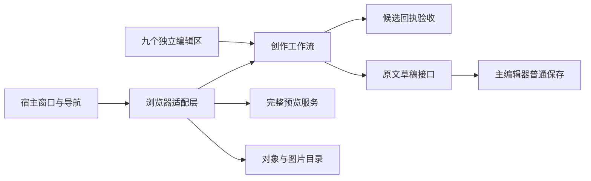

# 场景创作的工作流边界

片段定义管理现增加[重命名](SCENE_COMPOSITION.md#重命名片段定义)：沿用 `definitions` 会话和完整候选审批，以独立可选 Rust 能力同步所有放置引用。九域保持；原共享演员、组织组、放置、主编辑器和执行后端接口不变。

当前 0.0.10 源码把配方的九个编辑入口接到独立创作层：实例属性、单实例位置、批次位置、共享片段字段、整组放置偏移、片段演员结构、整份放置管理、组织分组和片段定义。现有按钮、审阅步骤和普通保存方式保持兼容。各编辑器继续维护自己的输入、选择、审批状态及局部历史，未来可以分别调整面板、快捷操作和导航。

## 职责与连接

| 层 | 模块 | 负责的内容 |
| --- | --- | --- |
| 配方语义与补丁 | 既有 Rust 核心及 `scene-composition-*.mjs` | 严格展开、稳定身份、原字节补丁与提案复核 |
| 候选验收 | `engine/scene-authoring-candidate.mjs` | 核对候选正文摘要、来源及不同编辑操作的目标；不读取文件或调用服务 |
| 创作流程 | `engine/scene-authoring-workflow.mjs` | 能力、来源获取、异步会话归属、审阅及应用回执；通过注入接口工作 |
| 浏览器连接 | `web/modules/app-scene-authoring.js` | 绑定九个独立编辑器，提供 HTTP 预览、临时预览释放、对象／图片目录及摘要计算 |
| 窗口宿主 | `web/modules/app-project-build.js` | 提供当前文档与窗口状态，处理成功应用后的导航 |
| 原文编辑器 | `web/modules/app-runtime.js` | 最后核对当前正文与保存基线，只应用内存草稿；持久化仍走普通保存 |

候选层和工作流层不导入 DOM、Node 文件接口、HTTP 服务、Godot／Bevy 或具体表单。浏览器适配层消费服务，窗口宿主提供来源和导航接口；编辑器不互相导入。这个范围是配方原文创作，尚未把普通场景事务编辑、执行任务或整个主编辑器归并成统一工作流。

## 接口与状态

`createSceneAuthoringWorkflow(options)` 为一个编辑入口创建独立工作流。`kind` 是固定语义 `instance`、`positions`、`fragment`、`placement`、`structure`、`placements`、`groups` 或 `definitions`；实例属性与单实例位置使用相同补丁语义，但仍有各自的工作流与回执。`placement` 只处理现有放置的偏移，`placements` 处理整份放置的新增、复制与移除，各自使用独立核心能力和提案。`groups` 处理组名／父级、演员归组及空组增删，候选另核对完整组织语义。`definitions` 新增、复制或重命名片段定义，以及移除未引用定义，候选检查全部有序实例、组织关系及重新生成的贡献来源；不生成新实例目标。未知语义拒绝初始化和验收，不回退到单实例操作。

宿主提供当前窗口／来源状态、该入口的核心能力、读取原文、可选目录加载、候选预览、释放临时预览、摘要、应用草稿和成功通知。工作流不保存构建结果、运行进程或后端工程句柄。每个编辑区只取得 `editable`、`creating`、`busy`、`compositionSourceWritable`、`sceneDraftPath`、`sceneDraftToken` 以及自己的能力标志，不能读取兄弟编辑区的能力或执行后端状态。

`open`、`validateDraft` 和 `applySourceDraft` 每次跨越异步接口都复核窗口会话、所选文档、逻辑路径及当前调用者归属。候选请求使用分离的提案；正在检查的提案被修改时拒绝接纳。临时预览即使过期也会尝试释放，释放失败不把候选变成可应用内容。

`sourceApplied` 只接纳同一入口记录的成功回执、原提案和窗口会话。应用会合法推进原文草稿令牌，成功导航不能继续要求旧令牌；新窗口、切换文档、关闭或回执重放仍不能触发导航。宿主收到成功通知后自行决定关闭窗口和聚焦原文，纯工作流不操作页面。

## 保留的作者边界

修改先生成完整候选，经实际预览服务检查定义、投影、有效图片及来源，再经对应纯补丁接口复核，最后仅应用当前原文草稿。主编辑器继续保留磁盘缓存、保存基线、外部冲突检查和作者未保存输入。结构编辑允许移除原来选中的演员和编辑未放置片段；未放置片段仍只检查声明与登记依赖，没有有效实例的渲染验收。

各编辑区的撤销与审阅仍属于各自会话，没有跨区统一撤销、多文件事务或自动保存。后续交互优化应从明确的来源、审阅、应用和导航接口接入，并单独验证键盘、焦点、面板及设备行为；更换呈现方式不应取得额外保存或运行权限。

配方操作见[片段组合](SCENE_COMPOSITION.md)，验证记录见[验证指南](TESTING.md)。

## 工作流拆分的历史验证范围

[本轮证据](test-results/scene-authoring-workflow/results.json)分别保存新接口专项、完整应用、六入口真实浏览器回归、桌面／移动准备副本和独立审查。已有 UI 与原文宿主保持原字节，专项验证解耦后的会话、回执和服务连接；尚未制作新安装包或实测 Android 编辑设备。旧失败与历史指纹保留原条件。

整份放置管理的新增、复制和移除另保留[独立记录](test-results/scene-composition-placement-structure/results.json)，不改写六入口拆分时的验证条件。移除可让原来选中的演员消失，完整候选验收仍检查全部剩余实例和组的身份／贡献来源；普通保存权威保持在主编辑器。

组织分组创作另有[独立记录](test-results/scene-composition-group-authoring/results.json)。新的 `groups` 候选在完整身份与贡献检查之外，核对实际组名、父级和有序演员归组，防止身份正确但组织关系错误的回执获得批准；原来各操作语义不变。

片段定义管理另保留[独立记录](test-results/scene-composition-definition-authoring/results.json)。删除前置未使用定义时重新核对来源路径；新增和复制的未放置声明只检查基础登记依赖，首次放置才检查有效投影及实际图片。各区仍单独持有能力和来源回执。
