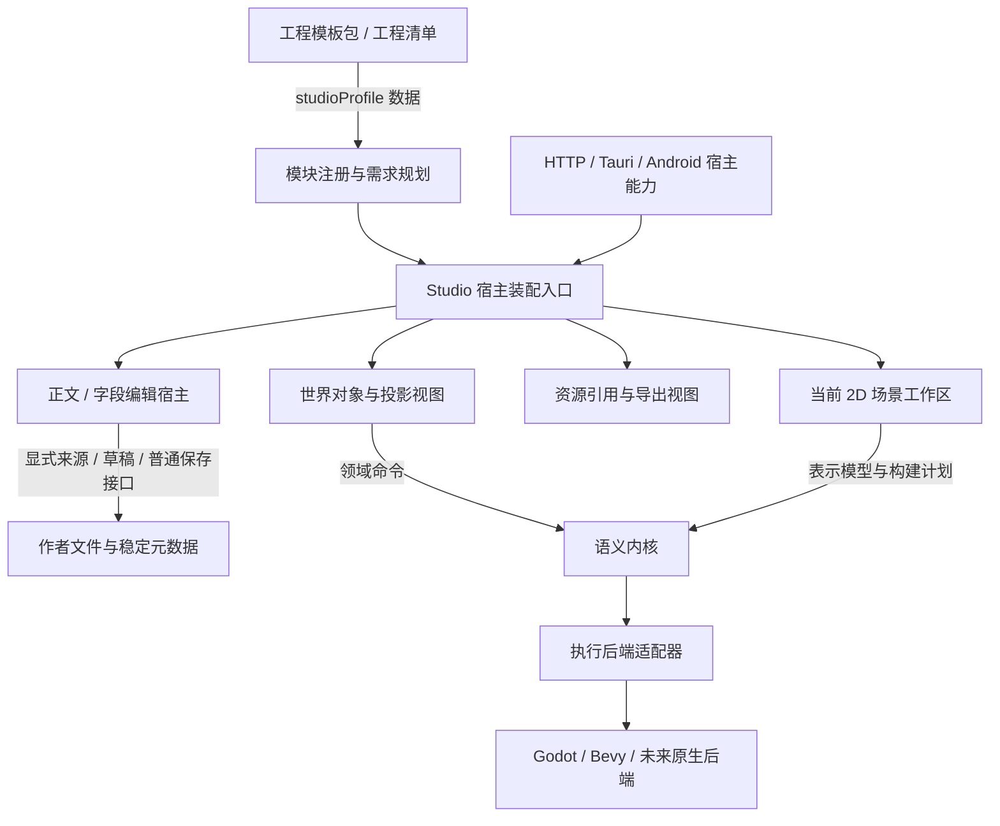

# Studio 系统模块与工程需求

0.1.0 源码保留 0.0.10 接入的独立装配入口，并交付九个独立 3D 作者域：变换、对象管理、环境、属性、整体移动、位置对齐、等距分布、批量复制和批量移除。加上原有功能区与[独立只读预览](SCENE3D.md)，0.1.0 发布时共 17 个固定模块、33 项声明能力。之后的[独立行为编辑](SCENE_BEHAVIORS.md#内置行为编辑010-之后的工作树)增至 18／34，[首次创建行为](SCENE_BEHAVIORS.md#从场景首次添加行为)增至 18／35；当前再加入[内置脚本创建](SCENE_BEHAVIORS.md#内置脚本创建)，该阶段为 **19** 个固定模块、**36** 项声明能力。0.1.2 另接独立[配方创建助手](SCENE_COMPOSITION.md#新建场景配方)，增至 **20** 个固定模块、**37** 项声明能力。工程类型、模块实现、宿主权限、场景表示和执行后端分别描述自己的边界；预览导航与选择不增加作者权限。动态插件运行器仍未实现。

0.1.0 之后的标准方向、临时镜头平移、正交观察、坐标方向提示与双指导航只扩展现有 `scene3d` 只读预览内部接口。可选 `setViewDirection`、`setDragMode`、`setProjectionMode` 分别接受固定方向、`orbit/pan` 拖动模式与 `perspective/orthographic` 投影模式，界面按各自接口可用性启用控件；缺少其中一项不会禁用已有检索与声明。数学函数不取得 DOM 或宿主，渲染器不取得作者草稿、World 或保存接口。该导航阶段仍为 17 模块、33 项声明能力，没有新增作者权限或宿主端口。投影状态不进入工程需求、作者相机或导出，见[正交边界](SCENE3D.md#正交观察010-之后的工作树)与[平移边界](SCENE3D.md#临时镜头平移010-之后的工作树)。

方向提示使用可选 `onViewChange` 绘图观察接口，不注册新的系统模块或声明能力。渲染器只发布当前有效视图的冻结快照或失效 `null`；独立组件取得相机和固定词翻译，预览入口守护所属画布、渲染实例和当前会话。没有回执时隐藏提示，不影响已有声明、来源定位或作者编辑。组件没有作者文本、World、宿主或执行后端接口，见[方向提示](SCENE3D.md#坐标方向提示010-之后的工作树)。

双指导航的 `supportsTouchNavigation === true` 仅是当前渲染器给界面的操作提示，不是注册表中的声明能力或宿主权限。触点状态、阈值、捕获和取消属于渲染适配器，纯数学只组合临时相机；预览入口按本地提示显示中英日说明，不增加按钮。缺少提示时旧渲染器继续原有导航，作者、来源定位及普通保存接口保持，见[双指导航](SCENE3D.md#双指导航010-之后的工作树)。

## 系统的五层边界



| 边界 | 所有者与当前入口 | 不向其他层传递的内容 |
| --- | --- | --- |
| 工程与模板 | `workspace.json`、原生模板实例化、`engine/project.mjs` | 可执行模块路径、脚本载入权限、控制器 |
| 模块实现与需求 | `engine/studio-modules.mjs` | 文件 IO、DOM、具体引擎对象、源文写入权限 |
| GUI 装配 | `web/modules/app-studio-system.js` | 兄弟控制器、共享可变命令数组、正文内容快照 |
| 正文编辑 | `web/modules/app-runtime.js` | 普通保存权威；其他区只调用明确的来源和草稿接口 |
| 场景与执行 | 独立表示／计划与原后端能力协议 | 不以模板类型名、Godot 自身的 3D 支持推断 Studio 已实现 3D |

资源引用区可选地取得单个资源导出函数。关闭导出模块时，资源引用和插入仍可用。宿主权限另外检测；模块已装配不等于正文可写、语义命令可用或引擎工具已安装。

## 已装配的模块

| 固定模块 ID | 当前职责 |
| --- | --- |
| `org.viento.document` | 普通文档读取、编辑与 Markdown / 文本 / JSON / YAML 解析；原文保存留在现有宿主 |
| `org.viento.scripts` | 两份 GDScript 起始内容的完整预览与普通 TXT 草稿创建；仅依赖文档模块，提供 `authoring.script`，保存、登记、场景关联与执行各走原接口 |
| `org.viento.scene-composition-create` | 对象／二维投影目录、初始配方审阅与普通 JSON 草稿交接；只依赖文档模块，提供 `scene.authoring.composition-create`。宿主须有查询能力，不取得构建或保存接口 |
| `org.viento.settings` | 工作台设置和语言初始化 |
| `org.viento.project` | 工程类型与模板配置 |
| `org.viento.world` | 世界查询、命令、对象和投影创作 |
| `org.viento.export` | 工程导出与资源包 |
| `org.viento.media` | 图片、视频、音频的资源引用 |
| `org.viento.build` | 当前聚合的 2D 场景、配方、后端工程和执行工作区；独立控制器提供首次创建行为入口及 `scene.authoring.behavior-creation` |
| `org.viento.scene3d` | 独立 3D 方块表示与只读 WebGL2 预览；只依赖文档模块 |
| `org.viento.scene3d-transforms` | 独立单对象位置／旋转／尺寸原文审阅与草稿应用；只依赖文档模块，提供 `scene.authoring.transforms3d` |
| `org.viento.scene3d-objects` | 独立方块新增／复制／移除的完整原文审阅与草稿应用；只依赖文档模块，提供 `scene.authoring.objects3d` |
| `org.viento.scene3d-environment` | 独立作者相机、方向光、背景、可选距离雾及粒子场的完整候选审阅与草稿应用；只依赖文档模块，提供 `scene.authoring.environment3d` |
| `org.viento.scene3d-properties` | 独立现有对象名称／颜色原文审阅与草稿应用；只依赖文档模块，提供 `scene.authoring.properties3d` |
| `org.viento.scene3d-translation` | 独立 1–128 个现有对象的共同偏移、完整原文审阅与草稿应用；只依赖文档模块，提供 `scene.authoring.translation3d` |
| `org.viento.scene3d-alignment` | 独立 2–128 个所选对象沿作者单轴对齐到明确所选参照，完整审阅与草稿应用；只依赖文档模块，提供 `scene.authoring.alignment3d` |
| `org.viento.scene3d-distribution` | 独立 3–128 个所选对象按原坐标／声明序排序、保留两端的单轴等距分布；完整审阅与草稿应用；只依赖文档模块，提供 `scene.authoring.distribution3d` |
| `org.viento.scene3d-copy` | 独立现有对象的一对一新身份及共同偏移、保真批量复制；总数最多128，完整审阅与草稿应用；仅依赖文档模块，提供 `scene.authoring.copy3d` |
| `org.viento.scene3d-removal` | 独立多选保真移除，至少保留一个对象；明确删除与幸存声明、完整审阅及草稿应用；仅依赖文档模块，提供 `scene.authoring.removal3d` |
| `org.viento.scene-behaviors` | 已有绑定文档的稳定绑定／实例／关联 TXT 选择、带类型参数和信号编辑；完整审阅后只应用原文草稿，仅依赖文档模块，提供 `scene.authoring.behaviors` |

描述符是固定的 `viento-studio-module` schema 1 数据，包含 ID、API 版本、依赖和贡献能力。注册时拒绝重复提供者、未知依赖、版本冲突和依赖循环。工程声明不能注册模块，也不能加载代码；本轮没有第三方模块安装入口。

## 工程和模板的增量需求

工程清单、`viento-project-definition` 的配置输入和原生 `viento-project-template` 包可选地携带同一字段：

```json
{
  "studioProfile": {
    "format": "viento-studio-profile",
    "schemaVersion": 1,
    "required": [
      { "capability": "document.edit", "apiVersion": 1 },
      { "capability": "scene.representation.scene3d", "apiVersion": 1 }
    ],
    "optional": [
      { "capability": "behavior.rust", "apiVersion": 1 }
    ]
  }
}
```

当前源码已注册 3D 方块表示；作者 Rust 行为仍未注册，会得到局部能力缺失诊断。实际核心与渲染可用性另外检测，普通文本模块继续保持装配。项目类型为 `scene`、`character` 或 `level` 不会自动生成执行场景。戏剧模板的 `scene` 仍是 prose 文档。

`required` 与 `optional` 每组最多 128 条，同一能力不能跨组重复；API 版本为 1 至 65535 的整数。新增需求配置严格校验，配置接口在任何异步锁和文件读取之前分离已验证快照。读取已有工程时保留未来 schema 或无效声明，规划器报告 `studio_profile_invalid`，不删除作者内容或拒绝普通文档打开。需求不构成模块白名单，也不会授予写入或运行权限。

没有该字段的旧工程维持原来行为。采用项目定义时省略它保留现有声明，显式写入空的 `required` / `optional` 可清空需求。原生模板实例化复制它到工程清单；无字段的内置模板序列化和来源摘要保持原值。有字段的模板将声明纳入整个模板包的来源摘要。摘要按 JSON 整数语义归一化，`1`、`1.0` 和 `1e0` 在 Node／原生实现中得到同一摘要；归一化只用于摘要副本，作者声明与工程复制不被改写。备份、迁移与恢复保留工程自己的声明，不重新查询模板目录。

## 视图接入与诊断接口

`setupStudioSystem({ settings, features, ports })` 只在启动时装配。`ports` 按 `scripts`、`sceneBehaviors`、`world`、`build`、`project`、`export`、`media`、`scene3d`、`scene3dTransforms`、`scene3dObjects`、`scene3dEnvironment`、`scene3dProperties`、`scene3dTranslation`、`scene3dAlignment`、`scene3dDistribution`、`scene3dCopy`、`scene3dRemoval` 分开注入，设置在其他视图之前完成。返回控制接口只有 `refreshMedia()`、`updateCapabilities(payload)`、`updateProject(workspace)` 和 `snapshot()`；不返回控制器。

实际正文宿主调用该入口，并在能力检测和工程加载时更新它。`getStudioSystemSnapshot()` 只读导出当前实例的分离快照，包含装配计划、需求诊断和宿主能力，不包含正文、端口或控制器。它为后续诊断面板提供数据；本轮没有新增可视化模块配置或缺失能力提示面板。

`scene3d` 没有注入读取端口或被 `features.scene3d: false` 禁用时不装配，旧七模块继续工作。`scene3dTransforms` 独立注入 `getContext`、`getSource` 与 `applyDraft`；缺失或 `features.scene3dTransforms: false` 只关闭该区。关闭只读预览、World 或构建能力不关闭变换编辑。实际核心需另具解析和补丁 ABI，缺失时普通原文与旧预览保持各自能力。`scene3dObjects` 另有同形的独立来源／草稿端口及开关，只依赖文档模块；预览、变换、World 或构建关闭时仍可独立使用。`scene3dEnvironment` 再独立注入同形端口及开关，修改作者环境；预览的临时视角不进入该来源。`scene3dProperties` 独立注入 `getContext`／`getSource`／`applyDraft` 与同名开关，仅修改指定 UUID 的名称和颜色；八种创作提案各有私有品牌，审批不能跨入口流转；任何领域改变草稿会使其他旧审批失效。共享来源五字段与宿主草稿守护不共享控制器或审批权，旧只读来源快照仍为 `sourcePath`／`token`／`content` 三字段。九个 3D 视图都有自己的关闭与释放接口；旧功能区仍只支持启动装配。

`scene3dTranslation` 独立取得 `getContext`／`getSource`／`applyDraft`，同名 feature 为 false 或缺少端口时只关闭此区。来源仍为五字段快照，整体移动提案有自己的私有品牌；宿主共享来源与最后草稿守护，不共享审批或兄弟控制器。Rust 一次校验全部目标的共同偏移和最终原文，UI 不循环调用单对象变换。预览的选择与临时视角不会成为编辑输入；此模块不取得 World、后端或 Save 接口。旧核心缺少新 translation ABI 时仍保留其已支持的四份作者操作。详见[整体移动](SCENE3D.md#整体移动多个对象未发布增量)。

`scene3dAlignment` 独立取得 `getContext`／`getSource`／`applyDraft`，同名 feature 或缺端口仅关闭对齐。它有自己的参照、轴和选择，既不借预览选择，也不借整体移动的偏移或审批；九份作者品牌互不替代。Rust 一次根据原文参照值生成完整候选，宿主仍共享五字段来源和最后内存守护。取消勾选参照须重选，筛选隐藏对象保持全局选择，普通保存保持磁盘权威。缺新 alignment ABI 只禁用此入口，原五域仍各自可用。见[参照位置对齐](SCENE3D.md#对齐多个对象的位置未发布增量)。

`scene3d` 现在可选注入 `locateSource(snapshot, { instanceId, isCurrent })`，只拥有当前原文的选择与滚动权限。宿主通过共享 Rust 解析重新定位稳定 UUID，不接受界面提供的数组下标或范围；原文、文档、加载会话与审批守护保持有效后返回 `false` 或冻结的 `{ located: true, focus }`。视图关闭后调用一次性 `focus()`，再次核对作者会话，不抢新文档的焦点。检索索引仅从已校验模型派生显示行，临时聚焦及渲染不取得该端口或任何草稿应用接口；没有定位端口时，预览与检索仍可用。此扩展不新增固定模块或能力编号，完整边界见[3D 导航](SCENE3D.md#只读浏览导航未发布增量)。

画布选择是同一只读视图内部的输入适配：`renderer.hitTest(clientX, clientY)` 只返回 UUID 或空命中，`onPick(instanceId, { focus })` 不传原文范围、解析器或作者提案。预览核对当前画布、渲染适配器、文档与已校验模型后更新选择，明确请求聚焦时复用临时视角。列表和画布共用选择路径，筛选及旧有效画面保留；过期画面的原文定位仍由上述宿主守护。此能力不新增模块、能力或原文写接口，见[画布选择](SCENE3D.md#画布选择未发布增量)。

视觉反馈通过可选 `renderer.setSelectedObject(instanceId | null)` 同步同一稳定选择。它只控制实体表面的临时边缘颜色，渲染器不查询列表、正文或兄弟编辑区；没有该方法的旧渲染适配器仍可使用列表与原有预览。筛选、翻译和重复选择不会触发重复反馈重绘，模型刷新后重新同步；重置相机保留选择。提示按原实体深度和顺序显示，没有透视隐藏对象的权限，详见[视觉反馈](SCENE3D.md#选中对象的视觉反馈未发布增量)。

`snapshot.plan.modules[].active` 表示已实现模块的装配状态，`hostCapabilities` 表示宿主服务检测结果。执行后端的表示／schema／功能支持还由原来的后端能力协议单独检查。三个结果不能互相替代。

`scripts` 独立注入 `getContext`／`createDraft`，缺端口或 `features.scripts: false` 只关闭脚本创建。`app-script-create.js` 在正文操作栏装配 **新建脚本**，取得当前会话、正文目录与类型目录；纯 `script-authoring.mjs` 提供固定起始内容和深冻结私有提案，正文宿主核对上下文后建立普通 TXT 草稿。界面不取得保存、登记、World、行为关系或执行接口，构建与行为编辑模块关闭时仍可独立创建。工程无需 `script` 类型，模板选择不修改项目模板；语言／后端标识只描述当前起始内容，不代表已提供 LSP、其他语言执行或作者 Rust 编译。

`sceneBehaviors` 单独注入 `getContext`／`getSource`／`inspect`／`applyDraft`，缺端口或 `features.sceneBehaviors: false` 只关闭行为编辑。独立可移植提案保存当前原文及修订，来源宿主另做依赖摘要重验；界面没有普通保存、元数据关系写入、World 命令或执行后端接口。关闭 World、构建或 3D 区不会把行为控制器的权限交给其他模块。当前本机只读检查接口为 `/api/scene-behavior-authoring`，不接收工具路径、不执行脚本；宿主缺少服务能力时保留普通源码编辑。当前证据见[行为编辑专题](test-results/scene-behavior-authoring/summary.json)。

首次创建位于构建模块，由 `app-scene-behavior-create.js` 独立管理目录、稳定创建身份、预览、保存和关闭。它提供 `scene.authoring.behavior-creation`，仍需宿主实际支持 `behavior.create`，声明能力本身不授予文件写入权。创建通过窄命令一次提交新正文、新登记和既有场景关联；不借用已有行为草稿控制器，也不获得脚本执行接口。缺少创建能力不妨碍已有文档的参数／信号编辑，关闭独立行为编辑模块也不把草稿接口转交给构建区。首次 UI 限 Godot／GDScript 单绑定，创建核心接受中立声明；运行是否支持继续由执行适配器判断。见[首次创建专题](test-results/scene-behavior-creation/)。

## 后续扩展的顺序

3D 首个表示、Rust 解析、独立视图及静态 Godot 导出已接入；单对象原文变换编辑、对象新增／复制／移除、作者环境字段与现有对象名称／颜色已在当前工作树分别接入；后续素材、空间层级和跨对象事务分别验收。工程模板只声明需要的能力；同一 OC 的多个投影由各表示模块解析。不能把 3D 数据交给现有 2D 计划或借类型名隐式转换。

新增文学、戏剧、游戏或其他模板时，先定义自己的文档类型、字段和模板快照；只有确实需要专属工具时才声明对应能力。修改 GUI 面板、布局、键盘或焦点行为应留在视图层，避免改变作者格式和构建后端。

本轮尚未拆完的部分：正文生命周期仍集中在 `app-runtime.js`；世界区内部仍聚合查询与多个命令；构建区内部仍聚合 2D 预览和执行，当前 2D 预览仍受该区执行可用性约束；各视图仍使用现有 DOM 和 HTTP 适配。现有控制器没有完整释放协议，所以只声明启动装配，不支持热卸载、全局插件总线或模块级权限沙箱。这些是后续独立拆分任务。

## 验证与证据

本轮新增纯注册／规划、GUI 装配和项目声明／迁移专项。实际浏览器、原生宿主与准备副本分别验收，结果见[本轮记录](test-results/studio-system-modules/results.json)。该次系统装配验证保持共享 Rust 语义核心和 WASM、已有 2D 补丁与执行后端协议的原字节；当时变更的是系统装配与原生模板的可选声明复制。当前 3D 核心与只读视图的首切片验证见[3D 记录](test-results/scene3d-primitives/results.json)；其后独立变换创作及九模块接线见[新专题](test-results/scene3d-transform-authoring/results.json)。对象专题当时的十模块及独立对象管理验证另见[对象专题](test-results/scene3d-object-authoring/results.json)。上一环境专题十一模块及独立环境编辑验证另见[环境专题](test-results/scene3d-environment-authoring/results.json)。上一属性专题的十二模块与28项声明能力、独立属性编辑验证另见[属性专题](test-results/scene3d-property-authoring/results.json)。当前检索、临时聚焦、来源导航及原文换行映射另见[导航专题](test-results/scene3d-navigation/results.json)。历史次数与安装边界保持各自时点。

全量应用 2680 项在最后的原生摘要归一化修复之前通过；修复之后另行通过原生宿主 53 项（1 项旧全尺寸迁移测试忽略）和 83 项相关跨语言回归。两次验证的范围和日志分别保存，未将应用测试等同于桌面安装或 Android 实机验收。

[当前架构](ARCHITECTURE.md) · [工程模板](PROJECT_TEMPLATES.md) · [验证指南](TESTING.md) · [功能图谱](FUNCTION_ATLAS.md)

`scene3dDistribution` 独立取得 `getContext`／`getSource`／`applyDraft`，缺端口或同名 feature 为 false 只关闭该区。排序、数值规则和保真补丁在 Rust，界面仅持有选择、轴及自己的审阅；第七私有作者品牌不能跨入口应用。无新 distribution ABI 时旧六作者域保持，普通保存仍负责磁盘与外部冲突。见[位置等距分布](SCENE3D.md#等距分布多个对象的位置未发布增量)。

`scene3dCopy`独立取得`getContext`／`getSource`／`applyDraft`，缺端口或同名feature为false仅关闭本区。第八私有作者品牌与旧七域互拒；来源五字段和最后内存守护属于共享文档宿主，不共享控制器或审批。UUID按本次会话每来源一次分配，检查不会再生；Rust一次追加完整副本，普通保存负责磁盘及外部冲突。见[批量复制](SCENE3D.md#批量复制对象未发布增量)。

`scene3dRemoval`独立取得`getContext`／`getSource`／`applyDraft`。缺端口或同名feature为false只关闭本区，第九私有作者品牌与旧八域互拒。来源五字段与最后内存守护属于文档宿主，不共享选择或审批。Rust一次计算完整删除区间及最终候选，UI不循环单对象remove，也不删除资源。普通保存仍是持久化入口；见[批量移除](SCENE3D.md#批量移除对象未发布增量)。

粒子预览沿用 `org.viento.scene3d`，作者编辑沿用 `org.viento.scene3d-environment`。`scene3d-playback.js` 只管理临时时刻，`scene3d-particle-preview.js` 管理本地控件，`scene3d-particles-renderer.js` 只消费已验证的分布与偏移；均不取得作者写入、普通保存或执行后端端口。可选核心粒子 ABI 和实际渲染支持分别检查，不新增模块或全局权限。
