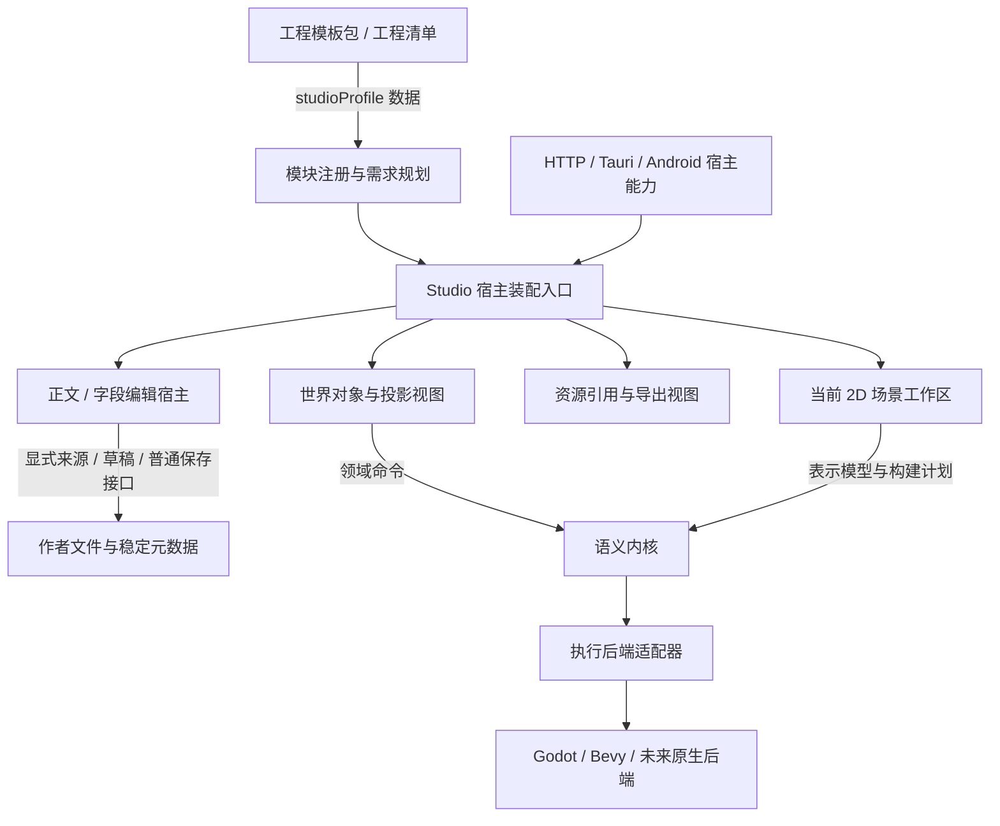

# Studio 系统模块与工程需求

当前 0.0.10 源码把整个工作台的装配入口独立出来。工程类型、模块实现、宿主权限、场景表示和执行后端各自描述自己的边界，供后续 3D、多种工程模板和工作流布局扩展使用。当前另接[独立 3D 只读预览](SCENE3D.md)，动态插件运行器仍未实现。

## 系统的五层边界



| 边界 | 所有者与当前入口 | 不向其他层传递的内容 |
| --- | --- | --- |
| 工程与模板 | `workspace.json`、原生模板实例化、`engine/project.mjs` | 可执行模块路径、脚本载入权限、控制器 |
| 模块实现与需求 | `engine/studio-modules.mjs` | 文件 IO、DOM、具体引擎对象、源文写入权限 |
| GUI 装配 | `web/modules/app-studio-system.js` | 兄弟控制器、共享可变命令数组、正文内容快照 |
| 正文编辑 | `web/modules/app-runtime.js` | 普通保存权威；其他区只调用明确的来源和草稿接口 |
| 场景与执行 | 独立表示／计划与原后端能力协议 | 不以模板类型名、Godot 自身的 3D 支持推断 Studio 已实现 3D |

资源引用区可选地取得单个资源导出函数。关闭导出模块时，资源引用和插入仍可用。宿主权限另外检测；模块已装配不等于正文可写、语义命令可用或引擎工具已安装。

## 已装配的模块

| 固定模块 ID | 当前职责 |
| --- | --- |
| `org.viento.document` | 普通文档读取、编辑与 Markdown / 文本 / JSON / YAML 解析；原文保存留在现有宿主 |
| `org.viento.settings` | 工作台设置和语言初始化 |
| `org.viento.project` | 工程类型与模板配置 |
| `org.viento.world` | 世界查询、命令、对象和投影创作 |
| `org.viento.export` | 工程导出与资源包 |
| `org.viento.media` | 图片、视频、音频的资源引用 |
| `org.viento.build` | 当前聚合的 2D 场景、配方、后端工程和执行工作区 |
| `org.viento.scene3d` | 独立 3D 方块表示与只读 WebGL2 预览；只依赖文档模块 |

描述符是固定的 `viento-studio-module` schema 1 数据，包含 ID、API 版本、依赖和贡献能力。注册时拒绝重复提供者、未知依赖、版本冲突和依赖循环。工程声明不能注册模块，也不能加载代码；本轮没有第三方模块安装入口。

## 工程和模板的增量需求

工程清单、`viento-project-definition` 的配置输入和原生 `viento-project-template` 包可选地携带同一字段：

```json
{
  "studioProfile": {
    "format": "viento-studio-profile",
    "schemaVersion": 1,
    "required": [
      { "capability": "document.edit", "apiVersion": 1 },
      { "capability": "scene.representation.scene3d", "apiVersion": 1 }
    ],
    "optional": [
      { "capability": "behavior.rust", "apiVersion": 1 }
    ]
  }
}
```

当前源码已注册 3D 方块表示；作者 Rust 行为仍未注册，会得到局部能力缺失诊断。实际核心与渲染可用性另外检测，普通文本模块继续保持装配。项目类型为 `scene`、`character` 或 `level` 不会自动生成执行场景。戏剧模板的 `scene` 仍是 prose 文档。

`required` 与 `optional` 每组最多 128 条，同一能力不能跨组重复；API 版本为 1 至 65535 的整数。新增需求配置严格校验，配置接口在任何异步锁和文件读取之前分离已验证快照。读取已有工程时保留未来 schema 或无效声明，规划器报告 `studio_profile_invalid`，不删除作者内容或拒绝普通文档打开。需求不构成模块白名单，也不会授予写入或运行权限。

没有该字段的旧工程维持原来行为。采用项目定义时省略它保留现有声明，显式写入空的 `required` / `optional` 可清空需求。原生模板实例化复制它到工程清单；无字段的内置模板序列化和来源摘要保持原值。有字段的模板将声明纳入整个模板包的来源摘要。摘要按 JSON 整数语义归一化，`1`、`1.0` 和 `1e0` 在 Node／原生实现中得到同一摘要；归一化只用于摘要副本，作者声明与工程复制不被改写。备份、迁移与恢复保留工程自己的声明，不重新查询模板目录。

## 视图接入与诊断接口

`setupStudioSystem({ settings, features, ports })` 只在启动时装配。`ports` 按 `world`、`build`、`project`、`export`、`media`、`scene3d` 分开注入，设置在其他视图之前完成。返回控制接口只有 `refreshMedia()`、`updateCapabilities(payload)`、`updateProject(workspace)` 和 `snapshot()`；不返回控制器。

实际正文宿主调用该入口，并在能力检测和工程加载时更新它。`getStudioSystemSnapshot()` 只读导出当前实例的分离快照，包含装配计划、需求诊断和宿主能力，不包含正文、端口或控制器。它为后续诊断面板提供数据；本轮没有新增可视化模块配置或缺失能力提示面板。

`scene3d` 没有注入读取端口或被 `features.scene3d: false` 禁用时不装配，旧七模块继续工作。独立预览拥有关闭与释放接口；旧功能区仍只支持启动装配。

`snapshot.plan.modules[].active` 表示已实现模块的装配状态，`hostCapabilities` 表示宿主服务检测结果。执行后端的表示／schema／功能支持还由原来的后端能力协议单独检查。三个结果不能互相替代。

## 后续扩展的顺序

3D 首个表示、Rust 解析、独立视图及静态 Godot 导出已接入；后续素材、空间层级和作者修改接口分别验收。工程模板只声明需要的能力；同一 OC 的多个投影由各表示模块解析。不能把 3D 数据交给现有 2D 计划或借类型名隐式转换。

新增文学、戏剧、游戏或其他模板时，先定义自己的文档类型、字段和模板快照；只有确实需要专属工具时才声明对应能力。修改 GUI 面板、布局、键盘或焦点行为应留在视图层，避免改变作者格式和构建后端。

本轮尚未拆完的部分：正文生命周期仍集中在 `app-runtime.js`；世界区内部仍聚合查询与多个命令；构建区内部仍聚合 2D 预览和执行，当前 2D 预览仍受该区执行可用性约束；各视图仍使用现有 DOM 和 HTTP 适配。现有控制器没有完整释放协议，所以只声明启动装配，不支持热卸载、全局插件总线或模块级权限沙箱。这些是后续独立拆分任务。

## 验证与证据

本轮新增纯注册／规划、GUI 装配和项目声明／迁移专项。实际浏览器、原生宿主与准备副本分别验收，结果见[本轮记录](test-results/studio-system-modules/results.json)。该次系统装配验证保持共享 Rust 语义核心和 WASM、已有 2D 补丁与执行后端协议的原字节；当时变更的是系统装配与原生模板的可选声明复制。当前 3D 核心与视图的增量验证见[3D 记录](test-results/scene3d-primitives/results.json)。

全量应用 2680 项在最后的原生摘要归一化修复之前通过；修复之后另行通过原生宿主 53 项（1 项旧全尺寸迁移测试忽略）和 83 项相关跨语言回归。两次验证的范围和日志分别保存，未将应用测试等同于桌面安装或 Android 实机验收。

[当前架构](ARCHITECTURE.md) · [工程模板](PROJECT_TEMPLATES.md) · [验证指南](TESTING.md) · [功能图谱](FUNCTION_ATLAS.md)
