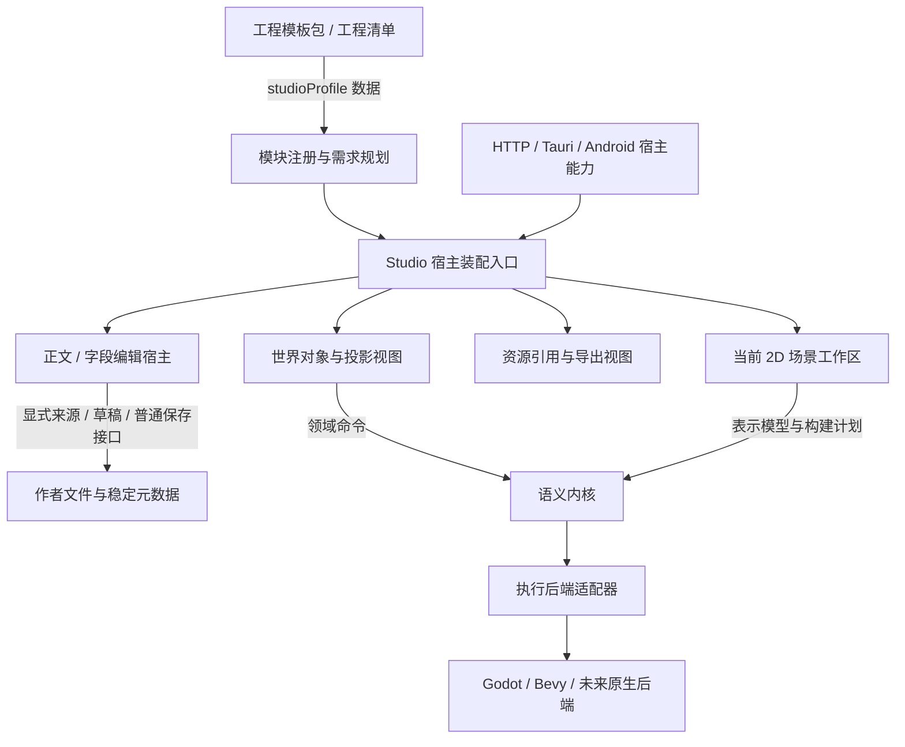

# Studio 系统模块与工程需求

Studio 将工程需求、模块实现、GUI 装配、宿主权限和执行后端分开。本文说明当前注册表和接入规则；架构全貌见[系统架构](ARCHITECTURE.md)，模板数据见[工程模板](PROJECT_TEMPLATES.md)。

当前源码 **0.2.3** 固定注册 **23 个模块、45 项声明能力**；碰撞偏移／尺寸编辑与角色响应选择复用已有物理模块。模块数只表示实现装配，不代表本机安装、工具可用或平台验收。此前各阶段数字、接线记录与测试次数见[整理前快照](history/studio-modules-2026-10-25.md)，当前验证范围见 [STATUS](STATUS.md)。

## 系统的五层边界



| 边界 | 所有者与当前入口 | 不向其他层传递的内容 |
| --- | --- | --- |
| 工程与模板 | `workspace.json`、原生模板实例化、`engine/project.mjs` | 可执行模块路径、脚本载入权限、控制器 |
| 模块实现与需求 | `engine/studio-modules.mjs` | 文件 IO、DOM、具体引擎对象、源文写入权限 |
| GUI 装配 | `web/modules/app-studio-system.js` | 兄弟控制器、共享可变命令数组、正文内容快照 |
| 正文编辑 | `web/modules/app-runtime.js` | 普通保存权威；其他区只调用明确的来源和草稿接口 |
| 场景与执行 | 独立表示／计划与原后端能力协议 | 不以模板类型名、Godot 自身的 3D 支持推断 Studio 已实现 3D |

资源引用区可选地取得单个资源导出函数。关闭导出模块时，资源引用和插入仍可用。宿主权限另外检测；模块已装配不等于正文可写、语义命令可用或引擎工具已安装。

## 已装配的模块

| 固定模块 ID | 当前职责 |
| --- | --- |
| `org.viento.document` | 普通文档读取、编辑与 Markdown / 文本 / JSON / YAML 解析；原文保存留在现有宿主 |
| `org.viento.scripts` | Godot GDScript／Bevy Rust 起始内容的完整预览与普通 TXT 草稿创建；仅依赖文档模块，提供 `authoring.script`，保存、登记、场景关联与执行各走原接口 |
| `org.viento.scene-composition-create` | 对象／二维投影目录、初始配方审阅与普通 JSON 草稿交接；只依赖文档模块，提供 `scene.authoring.composition-create`。宿主须有查询能力，不取得构建或保存接口 |
| `org.viento.settings` | 工作台设置和语言初始化 |
| `org.viento.project` | 工程类型与模板配置 |
| `org.viento.world` | 世界查询、命令、对象和投影创作 |
| `org.viento.export` | 工程导出与资源包 |
| `org.viento.media` | 图片、视频、音频的资源引用 |
| `org.viento.build` | 当前聚合的 2D 场景、配方、后端工程和执行工作区；独立控制器分别提供首次行为／声音／动画／物理入口及 `scene.authoring.behavior-creation`、`scene.authoring.audio-creation`、`scene.authoring.animation-creation`、`scene.authoring.physics2d-creation` |
| `org.viento.scene3d` | 独立 3D 方块表示与只读 WebGL2 预览；只依赖文档模块 |
| `org.viento.scene3d-transforms` | 独立单对象位置／旋转／尺寸原文审阅与草稿应用；只依赖文档模块，提供 `scene.authoring.transforms3d` |
| `org.viento.scene3d-objects` | 独立方块新增／复制／移除的完整原文审阅与草稿应用；只依赖文档模块，提供 `scene.authoring.objects3d` |
| `org.viento.scene3d-environment` | 独立作者相机、方向光、背景、可选距离雾及粒子场的完整候选审阅与草稿应用；只依赖文档模块，提供 `scene.authoring.environment3d` |
| `org.viento.scene3d-properties` | 独立现有对象名称／颜色原文审阅与草稿应用；只依赖文档模块，提供 `scene.authoring.properties3d` |
| `org.viento.scene3d-translation` | 独立 1–128 个现有对象的共同偏移、完整原文审阅与草稿应用；只依赖文档模块，提供 `scene.authoring.translation3d` |
| `org.viento.scene3d-alignment` | 独立 2–128 个所选对象沿作者单轴对齐到明确所选参照，完整审阅与草稿应用；只依赖文档模块，提供 `scene.authoring.alignment3d` |
| `org.viento.scene3d-distribution` | 独立 3–128 个所选对象按原坐标／声明序排序、保留两端的单轴等距分布；完整审阅与草稿应用；只依赖文档模块，提供 `scene.authoring.distribution3d` |
| `org.viento.scene3d-copy` | 独立现有对象的一对一新身份及共同偏移、保真批量复制；总数最多128，完整审阅与草稿应用；仅依赖文档模块，提供 `scene.authoring.copy3d` |
| `org.viento.scene3d-removal` | 独立多选保真移除，至少保留一个对象；明确删除与幸存声明、完整审阅及草稿应用；仅依赖文档模块，提供 `scene.authoring.removal3d` |
| `org.viento.scene-behaviors` | 已有绑定文档的稳定绑定／实例／关联 TXT 选择、带类型参数和信号编辑；完整审阅后只应用原文草稿，仅依赖文档模块，提供 `scene.authoring.behaviors` |
| `org.viento.scene-audio` | 已有声音轨道／提示的保真字段修改、完整审阅和原文草稿应用；只依赖文档模块，提供 `scene.authoring.audio`；保存与播放由原接口负责 |
| `org.viento.scene-animation` | 已有动画关键帧表、普通草稿应用与Rust采样示意；构建页可选控件独立消费相同采样和保存快照，需两模块与宿主能力均启用；只依赖文档模块，提供 `scene.authoring.animation`、`scene.preview.animation`。首次创建另属构建入口，保存与后端执行独立 |
| `org.viento.scene-physics2d` | 已有物理声明的碰撞体列表、实例 UUID、种类／形状／偏移／掩码、局部示意与原文草稿；只依赖文档模块，提供 `scene.authoring.physics2d`。可选保存态实例目录核对目标、场景空间图及偏移／尺寸提案回填，保留手填降级；运动条件与完整工程由构建检查 |

描述符是固定的 `viento-studio-module` schema 1 数据，包含 ID、API 版本、依赖和贡献能力。注册时拒绝重复提供者、未知依赖、版本冲突和依赖循环。工程声明不能注册模块，也不能加载代码；本轮没有第三方模块安装入口。

## 工程和模板的增量需求

工程清单、`viento-project-definition` 的配置输入和原生 `viento-project-template` 包可选地携带同一字段：

```json
{
  "studioProfile": {
    "format": "viento-studio-profile",
    "schemaVersion": 1,
    "required": [
      { "capability": "document.edit", "apiVersion": 1 },
      { "capability": "scene.representation.scene3d", "apiVersion": 1 }
    ],
    "optional": [
      { "capability": "behavior.rust", "apiVersion": 1 }
    ]
  }
}
```

当前注册了 3D 方块表示，但示例中的 `behavior.rust` 不是注册表能力，因此会得到局部能力缺失诊断。这与独立 Bevy Rust 后端已支持的受限作者脚本执行属于不同能力层。实际核心与渲染可用性另外检测，普通文本模块继续保持装配。项目类型为 `scene`、`character` 或 `level` 不会自动生成执行场景。戏剧模板的 `scene` 仍是 prose 文档。

`required` 与 `optional` 每组最多 128 条，同一能力不能跨组重复；API 版本为 1 至 65535 的整数。新增需求配置严格校验，配置接口在任何异步锁和文件读取之前分离已验证快照。读取已有工程时保留未来 schema 或无效声明，规划器报告 `studio_profile_invalid`，不删除作者内容或拒绝普通文档打开。需求不构成模块白名单，也不会授予写入或运行权限。

没有该字段的旧工程维持原来行为。采用项目定义时省略它保留现有声明，显式写入空的 `required` / `optional` 可清空需求。原生模板实例化复制它到工程清单；无字段的内置模板序列化和来源摘要保持原值。有字段的模板将声明纳入整个模板包的来源摘要。摘要按 JSON 整数语义归一化，`1`、`1.0` 和 `1e0` 在 Node／原生实现中得到同一摘要；归一化只用于摘要副本，作者声明与工程复制不被改写。备份、迁移与恢复保留工程自己的声明，不重新查询模板目录。

## 视图接入与诊断接口

`setupStudioSystem({ settings, features, ports })` 在启动时装配，先完成设置，再按模块注入独立端口。返回值仅为 `refreshMedia()`、`updateCapabilities(payload)`、`updateProject(workspace)`、`snapshot()`，不泄露控制器。`getStudioSystemSnapshot()` 只读导出装配计划、需求诊断和宿主能力，不包含正文、端口或控制器。

| 接入点 | 契约与边界 |
| --- | --- |
| `scripts` | `getContext`／`createDraft`；纯品牌提案经宿主重新核对会话、正文目录与类型目录后建立普通 TXT 草稿，不取得保存或执行端口 |
| `compositionCreate` | 保存态对象／投影目录与普通 JSON 草稿交接；缺查询能力只关闭创建，不取得构建权限 |
| `sceneBehaviors` | `getContext`／`getSource`／`inspect`／`applyDraft`；依赖摘要复验与字段审阅独立，不调用普通 Save、World 或后端 |
| `sceneAudio`／`sceneAnimation` | 自己的来源、检查与草稿接口；音轨／片段目录、用量、素材试听和采样按可选能力分别准入，保存与运行独立 |
| `scenePhysics2D` | `getContext`／`getSource`／`applyDraft`，可选 `getTargets`／`getSpace`；实例目录在应用前重读，空间视图只回报选择或品牌字段提案 |
| `scene3d` | 只读来源、预览和可选 `locateSource`；导航、命中和选择不授予作者写权 |
| 九个 3D 作者端口 | `scene3dTransforms`／`Objects`／`Environment`／`Properties`／`Translation`／`Alignment`／`Distribution`／`Copy`／`Removal` 分别注入 `getContext`／`getSource`／`applyDraft`；独立 feature、Rust 探针、私有提案及释放边界 |
| 首次行为／声音／动画／物理 | 构建模块中的独立创建控制器读取目录、审阅、提交窄 World 命令并回源；缺对应命令只关闭首次创建，不接管已有编辑器 |
| 其他功能区 | `world`、`build`、`project`、`export`、`media` 保持独立端口；资源区可选借用单资源导出函数，关闭导出不影响资源插入 |

装配、宿主、核心和后端是四项独立判断：`snapshot.plan.modules[].active` 表示模块已装配，`hostCapabilities` 表示服务可用，可选 Rust marker 表示该操作规则可用，执行描述符表示目标后端能运行对应计划。工程 profile 不替代任何一项检查。关闭某个 3D 或行为编辑区不把它的审批权转交给兄弟模块。

作者操作共用 source5 来源捕获和宿主最终内存守护，提案品牌、选择及审阅由各领域独立持有。任一实际草稿变化撤销旧审批，不能跨领域应用提案。只读 3D 来源仍为 `sourcePath`／`token`／`content` 三字段；`locateSource(snapshot,{instanceId,isCurrent})` 由宿主重新按 UUID 定位，返回 `false` 或冻结的 `{located:true,focus}`。延迟 `focus()` 只能使用一次，并再次核对当前文档归属。

3D 相机的 `setViewDirection`、`setDragMode`、`setProjectionMode`、`onViewChange` 与 `supportsTouchNavigation` 都是渲染器操作接口，不是全局声明能力。粒子临时时钟、方向提示、命中选择各自消费已验证模型，不进入作者相机、工程 profile 或保存结果。

物理空间 renderer 使用 `mode: view|offset|resize` 与可选 `onOffsetProposal`／`onResizeProposal`。查看、偏移、尺寸互斥；手势只产生临时轮廓，结束后由控制器核对精确视图、选中体、已检查模型、来源／能力代际与原始表单，仅回填变化字段。零变化保持原拼写和审阅，实际变化撤销审阅并走 Check → Review → Apply → Save；没有场景根变换或文件写入端口。

[完整接口细节与阶段记录](history/studio-modules-2026-10-25.md#section-04)。

## 项目运行中的声音观察

[行为驱动场景声音](PROJECT_AUDIO_CONTROLS.md) 沿用脚本、构建与声音作者模块；`project.audio-control` 属于执行后端能力，不新增 Studio 模块。脚本起始内容只产生可审阅普通草稿，音轨编辑器只管理声明，不取得运行端口。

独立声音观察组件仅消费严格准入的 `project.audioCommands`，显示实际播放／停止命令，并通过受守护来源端口分别打开行为绑定和音轨声明。它不解析日志、不发送命令，也不持有播放器、事件或状态面板控制器；各类观察共享任务身份守护，各自维护选择和来源范围。

## 后续扩展的顺序

新增文学、戏剧、游戏等模板，先定义文档类型、字段和模板快照，再按实际专属工具需要声明能力。表示模块解析同一 OC 的不同投影；3D 数据不借 2D 计划运行，模板类型名不触发隐式转换。

功能扩展先明确作者声明、纯领域规则、宿主端口和后端需求，再接视图。布局、键盘、触控与焦点属于交互层；媒体、空间层级、跨对象事务和新引擎能力分别验证。固定注册表尚无外部插件安装、动态代码加载、热卸载或模块权限沙箱。

尚存聚合边界：正文生命周期集中于 `app-runtime.js`，World 区聚合查询与命令，构建区聚合 2D 预览和执行；当前预览入口仍受该区可用性控制。九个 3D 作者视图有独立释放接口，但旧功能区不具备统一释放协议，当前只承诺启动装配。

## 验证与证据

模块注册与规划测试检查重复提供者、依赖／版本冲突、循环及工程需求；装配测试检查端口隔离、能力开关与来源守护。浏览器、原生宿主、安装和设备验收分别记录，不用一次应用测试代替全部平台证明。

原始装配证据见[系统模块专题](test-results/studio-system-modules/results.json)，最新空间编辑见[偏移](test-results/scene-physics2d-space-edit/README.md)和[尺寸](test-results/scene-physics2d-space-resize/README.md)。其余证据由[功能图谱](FUNCTION_ATLAS.md)索引；各专题保留执行时版本和计数，当前范围以 [TESTING](TESTING.md) 和 [STATUS](STATUS.md) 为准。
