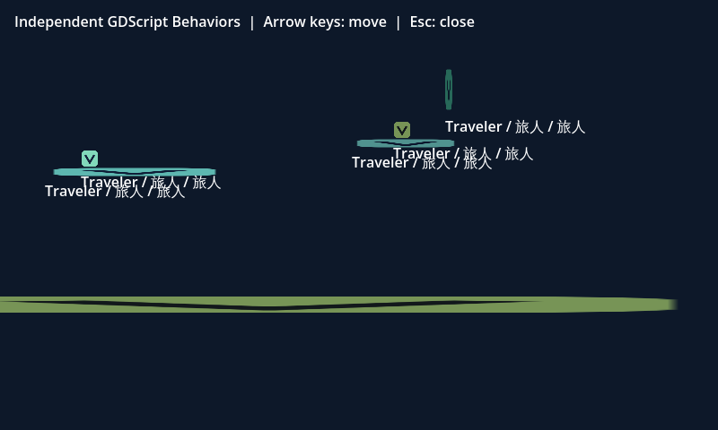

# 平台启停：事件驱动机关与工程交付

2026-11-04，0.2.7 之后的未发布工作树。Godot 执行适配器与实际移动平台外层为 **0.40.0**，增加可选 `physics.platform-control2d`；作者格式、项目协议、物理观察协议与 Rust/WASM 均保持。本机安装仍为 0.2.0。

## 工作流与边界

静态矩形声明水平或垂直往返 → 创建并普通保存“Godot / 事件控制平台”TXT → 显式绑定到该平台 → 配置初始状态与事件名 → 触发区发布进入／离开事件 → 平台下一物理步暂停或继续 → 核对支撑与端点 → 迁移作者资源包或交付独立 Godot 工程。操作见[物理指南](../../SCENE_PHYSICS2D.md#用事件控制平台启停)。

四个参数为 `initial_running`、`resume_event`、`pause_event` 和可选 `instance_id`。两事件名都非空时不能同名；空事件名禁用该方向。实例过滤器核对接收事件的载荷，不改变脚本控制目标，控制始终只作用于绑定的平台。压力板可把传感器模板的 `entered_event` 设为 `platform.resume`，`exited_event` 设为 `platform.pause`，平台初始设为暂停。模板按单次事件更新启停目标，不自动聚合多个对象的占用状态。

访问局部端口 `viento_platform_control` 协议 1 只接受严格布尔启停请求。每平台每接收步首个有效请求进入队列，下一项目物理步生效。`read_running()` 是已应用的作者开关，受阻或宿主暂停时它不证明平台位移；失效端口返回 null。离场撤销端口、清除请求，重入默认运行，再由当次作者脚本请求初始状态。没有反向、任意速度或位置跳转接口。

暂停保留轨迹相位，不补赶时间、不产生虚假端点；支撑、角色碰撞、下穿等仍由原独立物理层处理。控制器以准确端口对象、行为父节点、平台身份和访问号验证所有权，不能靠篡改元数据转移端口。普通模板保留最新期望并逐物理回调重试竞争拒绝；只有受理才清除。原生端口仍首请求优先，不承诺多个绑定竞争的公平性。

生成层仅在项目实际含移动平台时选择，不扫描任意作者 TXT 推断需求；无平台项目保持原生成输出。水平、垂直历史文件及摘要仍保留；先严格认证新入口、控制器、端口和库存，再归一化入口继续旧层完整检查。新文件进入工程 ZIP；旧托管构建需显式重建，作者文件不自动迁移。Bevy 物理、其他系统及新版安装程序未在本专题验收。

## 验证记录

| 验证 | 结果与证据 |
| --- | --- |
| 作者与旧脚本入口 | 100/100 通过、零跳过；[定向日志](author-targeted.log) |
| 普通控制模板原生检查 | Godot 37 个独立检查场景通过，其中 25 个明确预期拒绝；覆盖非法参数／端口、订阅清理、请求竞争和最新意图重试；[作者记录](author-evidence.json)、[原生模板记录](starter-native/starter-native.json) |
| 实际浏览器 | Chrome 156.0.8078.73 创建／取消、普通 TXT 保存、显式引用及绑定、四项参数、取消／应用／保存重开；中英日 390px 无横向溢出；[浏览器记录](browser-authoring/browser.json) |
| Godot 主专项 | 13/13 真实运行通过、零跳过；[原生日志](native.log)、[完整观察](native.json)、[工具与来源](native-evidence.json) |
| 暂停中的角色交互 | 实际 Godot 2/2 通过；升降单向平台保持相位，角色起跳并重新落回；主动下穿后例外清理、继续下落。30 步内未到下方地板，不据此宣称下穿落地；[日志](paused-character.log)、[观察](paused-character.json) |
| 物理输入回放兼容 | 既有垂直平台实际 Godot 1/1 通过，核对释放输入、方向＋跳跃、包装脚本篡改拒绝和临时驱动回收；[日志](replay-compat.log)、[观察](replay-compat.json) |
| 严格库存 | 8/8 通过；两轴／混合、缺失／篡改／软链接／孤儿、入口与历史备份、场景清单、取消、异步计划捕获；[日志](inventory.log) |
| 作者资源迁移 | 1/1 通过；平台 TXT、四参数、物理 BOM/CRLF、UUID／关系／引用及重建计划在不同正文目录恢复后保持；[日志](packages.log) |
| 适配与历史层集成 | 27 项：25 通过、2 条件跳过、零失败；[日志](integration.log)。跳过不计为实际引擎通过 |
| 预算与调度历史兼容 | 25/25 通过、零跳过，其中 6 项实际启动 Godot；其余核对严格库存与冻结旧源、协议；[实际工具日志](budget-clock-native.log)、[无工具定向日志](budget-clock-targeted.log) |
| 完整应用检查 | 8995 项：8344 通过、651 条件跳过、0 失败／取消；版本、1516 份 JS 语法与 API 契约预检通过；[最终日志](full-check.log)。后加入的独立暂停互动脚本另经语法检查与真实运行；条件跳过不计为实际引擎通过 |

实际工具为 Linux Godot `4.7.2.stable.viento_audiofix1_ed1daf0bf`。主专项包括两轴暂停／恢复与初始暂停、相位和乘客支撑、另一平台独立运动、严格布尔／伪造端口、行为移除、首个有效竞争请求、真实传感器压力板、受阻开关区分、端点回调中排队、场景往返、离线 ZIP 和隔离窗口。

每个普通原生样例的 51 个作者文件保持不变，竞争与压力板样例各 53 个文件保持不变。实际浏览器从 47 份隔离作者文件开始，45 份原文件完全保持；另两份仅在显式保存脚本引用和行为绑定时改变，新增 TXT 和其登记，不改写真实作品。原生测试、作者定向及完整检查有交集，不相加作覆盖率。

## 交付及来源

[离线工程 ZIP](platform-control.viento-build.zip) 258455 字节，SHA-256：`544ebf426637bee5e432e44a5095c25c0b889de7233f9dd975d82221946426b9`。测试在移走原作者和原构建目录后，于新目录解包、严格检查并真实运行；这证明生成工程可迁移，接收者仍需匹配 Godot 工具。

[来源摘要](source-hashes.json)记录最终生产、模板和测试代码；主原生专项还在开始／结束核对 21 个相关文件未变；暂停角色互动专项另外核对 22 份源码未变。浏览器保存与模板原生检查的 GDScript 源 SHA-256 同为 `0070591c4fd9cf0c51b250243b485563739f09f5ef37a05cff654f63795b252e`。

## 调查中发现的问题

初始暂停请求与启动时重叠传感器的恢复事件可能进入同一接收步。旧模板遇到拒绝即丢弃恢复意图，造成压力板已压下而平台始终暂停。修复在普通作者模板中保留最新意图并重试；不能用 `read_running()` 恰好等于目标值清除意图，因为旧请求可能已受理但尚未应用。模板原生验证同时覆盖这个反例。该策略不改变核心首请求约定。

完整应用首轮为 8995 项，8342 通过、651 条件跳过、2 失败；[首轮日志](full-first.log)保留原结果。两处失败是历史测试仍要求当前适配器返回旧平台入口及 0.37 生成版本；修正为精确认证新入口及其旧入口备份，历史生成器、预算和调度协议核对继续保留，随后重新运行完整检查。

最终完整回归在生产源与兼容断言固定后重新执行，8995 项零失败／取消；不把首轮失败计为通过，也不把条件跳过计为真实引擎验收。新增独立暂停互动脚本不进入应用 `.test.mjs` 列表，以实际运行和单独语法检查验收。
