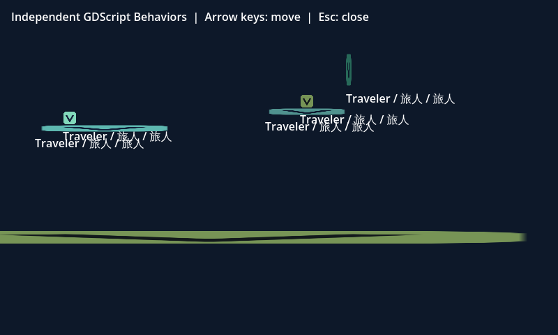

# 垂直往返平台：作者到工程交付验收

2026-11-04，0.2.7 之后的未发布工作树。新增物理作者 schema 6、独立 Rust/WASM 检查域与 `physics.platform-vertical2d`；Godot 执行适配器及实际垂直生成层为 0.39.0。应用版本保持 0.2.7，本机安装仍为 0.2.0。

## 形成的工作流

已有静态矩形 → 平台移动方式选择垂直往返 → 有符号 Y 偏移及速度 → 检查／完整原文审阅 → 应用普通草稿 → 普通保存并重开 → 组装检查与构建 → 升降承载、跳离／下穿及受阻恢复 → 端点与媒体接线 → 作者资源迁移和生成工程交付。

正 Y 向下，负 Y 向上；偏移绝对值 1–8192，速度 1–2000。水平继续使用 schema 5 的 `horizontal/offsetX`，垂直使用 `vertical/offsetY`；schema 6 也可保留水平或静止声明，关闭运动不降格式。规则和新 WASM 标记独立于渲染，前端只交接可审阅的原文提案；Bevy 两个通道仍拒绝物理能力。

平台及已确认乘客的原生扫过范围被阻挡时，该平台整步暂停相位；移除障碍后继续，不追补距离、不虚报端点。垂直支撑探测维护着地与行为接触端口，但物理观察 `contacts` 仍只记录角色那次实际移动扫掠。接触端口有支撑而该步扫掠列表为空是有意区分，物理验收的碰撞预期没有扩成着地检查。

升降单向平台下穿时，仅本层拥有的例外延续至角色完全位于平台下方或横向离开；其他静态／水平平台沿原规则，作者已有例外不会被接管。没有新增旋转、斜线、叠堆传力、挤压伤害或刚体惯性。

## 最终验证

| 验证 | 结果与证据 |
| --- | --- |
| Rust 核心 | 全部 420 项通过，0 失败；[原生日志](rust-core.log)。WASM 以同源代码重新生成，摘要见[来源记录](source-hashes.json) |
| 完整应用检查 | 8969 项：8333 通过、636 条件跳过、0 失败；[最终日志](full-check.log)。条件跳过不计入真实引擎通过 |
| 最终作者与契约专项 | 75/75 通过，0 跳过：独立检查域、能力拒绝、原文保真、方向切换、严格库存、输入映射组合、异步捕获与资源迁移；[日志](targeted.log) |
| 编辑与空间操作广泛回归 | 283/283 通过；后续增加的核心能力变化失效测试也进入最终专项及应用回归；[日志](editor-regression.log) |
| 实际浏览器 | Chrome 156.0.8078.73，隔离作者工程；方向切换、非法输入、取消、应用草稿、普通保存重开、几何偏移／尺寸，以及中英日 390px 无横向溢出；[浏览器记录](browser-1793779918334/browser.json) |
| Godot 主专项 | 17/17 通过：其中 1 项为纯生成字节兼容，16 项实际启动 Godot；[结果](native-final.log)、[完整结构化观察](native-proof.json) |
| Godot 媒体组合 | 独立实际引擎测试 1/1 通过，落地继续驱动原声音与动画；[结果](native-media.log)、[观察](native-media-proof.json) |
| Godot 物理输入回放 | 独立真实集成 1/1 通过；无行为／声音／动画的单场景项目，释放输入与方向＋跳跃两轮完整采样，篡改包装脚本被拒绝且临时驱动回收；[结果](native-replay.log)、[观察](native-replay-proof.json) |
| 既有水平平台 | 真实 Godot 5/5 通过：实体／单向平台、双乘客、跳离及下穿；[兼容日志](horizontal-compat.log) |
| 构建服务 | 最终代码独立复测 14/14 通过；[日志](build-service.log) |

实际工具为 Linux Godot `4.7.2.stable.viento_audiofix1_ed1daf0bf`，运行工具 SHA-256 随结构化记录保存。主专项实际覆盖下行／上行起步、实体与单向平台、圆形角色及碰撞偏移、双乘客、单人跳离与下穿、顶棚阻停后恢复、载人与空台下降撞地、水平／垂直混合、掩码、作者碰撞例外、最短路径最高速度跨多个端点、离线 ZIP，以及隔离 Xvfb 窗口截图。

主专项、媒体和物理回放共 19 个唯一测试，其中 18 个实际启动 Godot，另 1 个检查纯生成兼容。

每个主专项作者样例 51 个文件保持不变，媒体样例 55 个文件保持不变。浏览器测试只有显式普通保存的隔离物理正文变化；作者资源包测试在不同正文目录导入后逐份核对原始字节、UUID、关系、BOM/CRLF 和重建的物理语义。没有改写真实作品或安装程序。

## 交付及来源

[离线生成工程包](vertical-platform.viento-build.zip) SHA-256：`540c1e972085a2d2b70e79e1e33510f016bf252f177bfca3aff49e1ead2efc9e`。测试在原作者目录与原构建目录移走后，从另一目录解包，重新检查脚本并真实运行；垂直 helper、可选下穿层、原文库存、声明和入口均在包内。接收方仍需匹配的 Godot 工具，这不是无需引擎的游戏发行程序。

生成器在私有副本中把垂直轨迹投影为旧水平数据以复用历史层，真实 `offsetY` 单独保存在新声明中；原文、冻结计划与来源范围保持。新库存先精确认证真实声明、内部投影、所有 helper 及新入口，再归一化旧入口继续原校验。无垂直声明时，schema 6 的副本降为 5 后生成的文件及后端摘要与原分支逐字一致；水平旧源码与旧 0.31 生成摘要保持。

[来源摘要](source-hashes.json)记录本轮最终代码、WASM 和测试。旧托管构建因适配器指纹变化需要显式重建，作者文档不自动迁移。当前未更新桌面安装，也不以这些证据代表 Android、其他操作系统、Bevy 物理、实体键盘或扬声器输出验收。

## 调查中保留的失败

[首轮失败](native-first.log)保留原结果，后续修复没有覆盖它：

- 直接改 Y 轴时，运动体的场景位置已变化，原生物理位置仍落后一帧，导致角色位置看似平稳而着地／接触中断，跳跃和下穿不可用。最小真实 Godot 探针确认后，只在垂直层将原生 RID 设为静态模式并由显式项目时钟同步变换；水平层不改。
- 下降平台使角色从平台上方暂时分离，旧静态下穿清理提前恢复例外；新垂直清理等到完全位于下方或横向离开，原生查询同时尊重角色侧的例外。
- 混合方向原型暴露 GDScript 类型化数组空分支错误，现显式创建 `Array[Vector2]`；圆形偏移测试原先把独立站台高度写死，已按实际夹具几何校正。

首次全量应用检查在生成源仍变化期间启动；冻结指纹更新使服务测试替身未进入其等待中的运行回调，检查被明确终止，未计作通过。另修正了一个仍断言旧适配器 0.38 的测试。最终应用检查在运行代码固定后重新执行，结果见上表及完整日志，8969 项零失败；新增物理回放也有独立真实引擎结果。原型缓存只保留必要证据，临时工程已回收。
