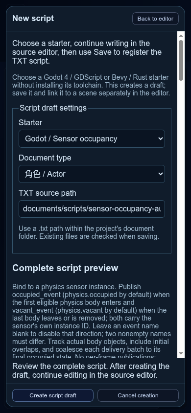

# 触发区占用：多对象压力板到平台启停

2026-11-04，基于 `00c06ffe9bad9389f3d4aeb344064b07ec522bb6`、应用 **0.2.8** 之后的未发布工作树。新增普通作者起始模板 **Godot / 触发区占用**；Godot 执行层仍为 **0.40.0**，作者格式、Rust/WASM、项目及物理观察协议均保持。本轮没有重建、安装或发布新版程序。

## 作者链路与合同

新建脚本选择占用模板 → 审阅普通 TXT 草稿 → 显式普通保存登记 → 关联到既有行为或首次创建行为 → 绑定到 sensor 实例 → 配置两个文本参数并审阅／普通保存 → 真实 Area2D 首入／末离 → 项目事件携带板自身 UUID → 已有平台控制按载荷筛选 → 核对来源／实际运动 → 作者资源包恢复与生成工程 ZIP 交付。逐步操作见[多对象压力板](../../SCENE_PHYSICS2D.md#多对象压力板与触发区占用)。

`occupied_event`、`vacant_event` 默认 `physics.occupied`、`physics.vacant`；空名分别禁用，双非空不能同名。初始空不发 vacant，平台初态用原 `initial_running`。实际物理体对象去重；同一派发批取最终空／非空状态，A 退出而 B 留在板上不会暂停。初始重叠延迟至普通 ready 后纳入；暂停中跟踪对象集合，恢复仅补最终边；销毁清理，关闭不补假 vacant。拒绝发布明确报错并停发，不无限重试或绕过事件预算。

载荷是传感器自身 UUID；原逐个进出模板继续使用对方 UUID，二者在本轮真实工程中共存。只纳入 Area2D 交给脚本、带规范实例 UUID 的 PhysicsBody2D；不是对作者可编辑 metadata 的登记认证，不读取生产生成器私有目录，不支持 TileMap／区域间占用或多板 AND/OR 聚合。该功能也不是角色运动扫掠的持续接触生命周期。

## 实际验证

| 范围 | 结果与证据 |
| --- | --- |
| 起始草稿／旧脚本入口 | Node 定向 **29/29**，零失败／跳过；[日志](starter-native/starter-and-authoring-tests.log)。包含下面的单个真实 Godot 测试回调，不与其内部计数相加 |
| 真实 Godot 模板边界 | 内部 **28 项核验、18 项预期拒绝**；同 UUID 的两个实际节点、重复进出／移除、初始与迟绑定重叠、同批交换／短脉冲、暂停销毁恢复、关闭／重入、端口签名及拒绝停发；[摘要](starter-native/starter-native.json)、[stdout](starter-native/starter-native-stdout.log)、[预期错误](starter-native/starter-native-stderr.log)、[实际脚本](starter-native/starter-generated.gd)、[原生检查场景](starter-native/starter-native-harness.gd) |
| Chrome 作者工作流 | 中英日 **390px** 的模板名称／说明、完整源码、焦点及创建／取消控件；TXT 草稿不写盘，普通保存只加源码及登记；关联、sensor 绑定及两个 String 参数均显式审阅／保存重开；[记录](browser-authoring/browser.json)、[日志](browser-authoring/browser.log) |
| Godot 项目集成 | **3/3**，零失败／跳过；[最终完整观察](native-final/native.json)、[原始日志](native-final/stdout.log)。19 个相关源文件在执行前后摘要保持，无引擎 warning／error／leak |
| 双角色／双板与旧模板 | A 离开而 B 留下时平台持续跑，末人离开才暂停，再进入恢复；相同事件名以板 UUID 独立筛选两个平台；旧 sensor 与新 occupancy 同 Area2D 并行，逐对象载荷保持角色 UUID。核对每条占用发布及两个接收者的绑定来源与执行位置 |
| 场景往返 | 场景 1 → 2 → 1，每次访问正常 occupied，退出不补 vacant，旧访问连接不延续 |
| 作者迁移及公开宿主 | 选择式资源包 **20 个登记对象**恢复到不同正文目录，TXT、类型化参数、关系及 BOM/CRLF 保持；正式 capture/build/run 成功；真正 ready 后取消，运行副本清理且冻结工程不变 |
| 离线生成工程交付 | **233522 字节**，SHA-256 `b865285ea48d868a323d54d28ebea7185026fb4745ee3b492e80a297954ace71`。原作者、恢复工程和原构建目录全部移走后，解压 ZIP 并严格核对、真实运行相同断言通过；接收者仍需 Godot 工具 |
| 目录兼容定向 | 111 项：**106 通过、5 条件跳过、零失败**；[日志](catalog-regression-final.log)。四处目录断言精确加入新 ID／数量，[旧目录保护](catalog-legacy-preservation.json)证明全部历史 legacy 块及源码 hash 字节保持 |
| 旧完整作者链复验 | 当前有序目录全部选项 → 旧 signal TXT 普通保存 → 首次行为 → Godot 检查／构建／无头运行 → 浏览器真实下载工程 ZIP → 独立验证／异地解包／Godot 导入成功；[最终记录](legacy-browser/browser.json)、[日志](legacy-browser/browser.log)。不是用旧报告冒充本轮执行 |
| 本地化专项 | **11/11**，零失败／跳过，包含英日覆盖、参数完整性、诊断和语言切换；完整应用回归另计 |
| 首轮完整应用 | 8997 项：8341 通过／4 失败／652 条件跳过；四处旧目录断言漏列新 starter；[失败及总计摘录](app-check-initial-failure.log)。历史源码哈希保持，修正精确新增名单与数量后重跑 |
| 最终完整应用回归 | **8997 项：8345 通过／0 失败／652 条件跳过，零取消**；版本、1522 份 JS 语法和 API 契约预检通过；[完整日志](app-check-final.log)。未提供工具环境的跳过不算实际设备／引擎通过 |

真实工具为 Linux x86_64 Godot `4.7.2.stable.viento_audiofix1_ed1daf0bf`（SHA-256 `d0214fafa4af018589761b772f38be02b421cd021ed69c45c1d7a4bcd2acbb04`），Chrome 版本与 Node／工具摘要见各自 JSON。新模板源码 SHA-256 在原生与浏览器证据中同为 `fc10a78b5b81e643bdfd6c43f3d8eae2e687e9a60ba7c4cb30f5b93528b8d59b`。

原生项目测试的普通 probe 通过实际物理体位置制造 Area2D 变化，独立读取平台状态／相位以证明行为；它不是产品输入回放，也不伪造协议事件。probe 为测试可读生成结构，正式占用模板不访问这些私有字段。原生业务验证保持全部 59 份作者文件与生成物不变；浏览器从 47 份原作者文件开始，45 份逐字保持，两份仅在显式保存引用与绑定时改变，另新增 TXT 和登记各一份。

选择式资源包保留选中对象及其已登记依赖，不据此宣称携带项目类型定义；目标类型／模板来自显式创建的目标工程。没有在本轮验收 Tauri 安装、Android／Windows／macOS、Bevy 物理、扬声器／图形像素或长期无限运行；条件跳过和替身接口检查不计为实际设备通过。

旧作者链[首跑记录](legacy-browser-initial/browser.json)未打开可选工程交付开关，交付只认启用开关后的 `legacy-browser` 最终记录。旧脚本原来硬编码“两种模板”，本轮改为精确核对完整有序目录，并同步其步骤文字；该文字单独通过语法检查，生产模板没有因此改动。

初稿 [native-initial](native-initial/native.json) 是模板仍在调整时的真实成功记录；最后冻结版本及旧模板共存以 `native-final` 为准，初稿原始字节保留，不拼接为最终通过。所有本轮 profile、临时作者工程、运行副本及引擎进程均已清理，日志内路径脱敏，旧发布与专题报告未改写。



## 复现

使用 Node 24 和明确的 `VIENTO_GODOT_BIN` 绝对路径：

```sh
node --test scripts/tests/physics-sensor-occupancy-starter.test.mjs scripts/tests/script-authoring.test.mjs
node scripts/tests/scene-physics2d-sensor-occupancy-smoke.mjs
node scripts/tests/sensor-occupancy-authoring-smoke.mjs
npm run check -- --app-only
```

前两个原生测试需要该工具环境变量；未设置时单体 native 回调明确跳过，项目专项则直接要求工具。浏览器专项另需 Chrome；默认生成本专题的新证据目录，不覆盖已有报告。作者、原生、迁移与完整应用验证存在交集，不求和作覆盖率。

本轮结果汇总见 [summary.json](summary.json)，对应生产、翻译及新旧验收脚本的 SHA-256 见 [source-hashes.json](source-hashes.json)。图谱只增加独立占用实现关系及其本轮证据，不提升历史安装或其他后端的成熟度。
